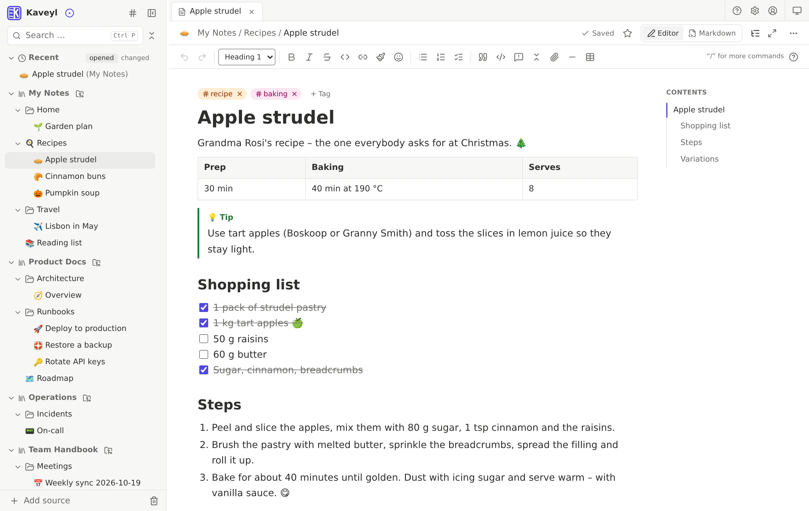
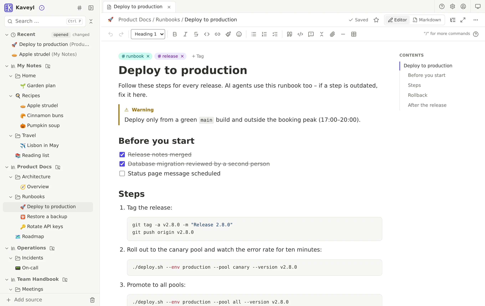
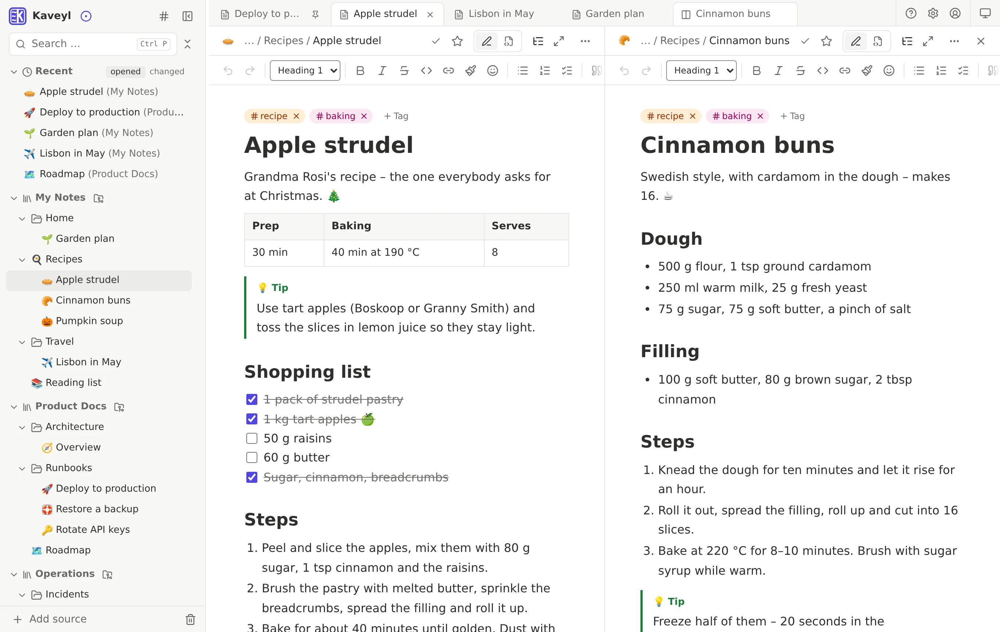
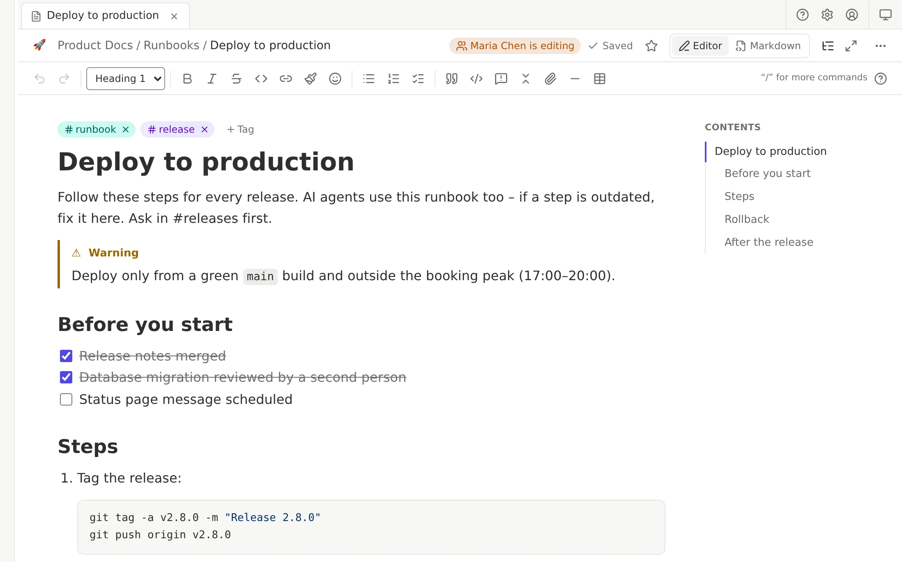
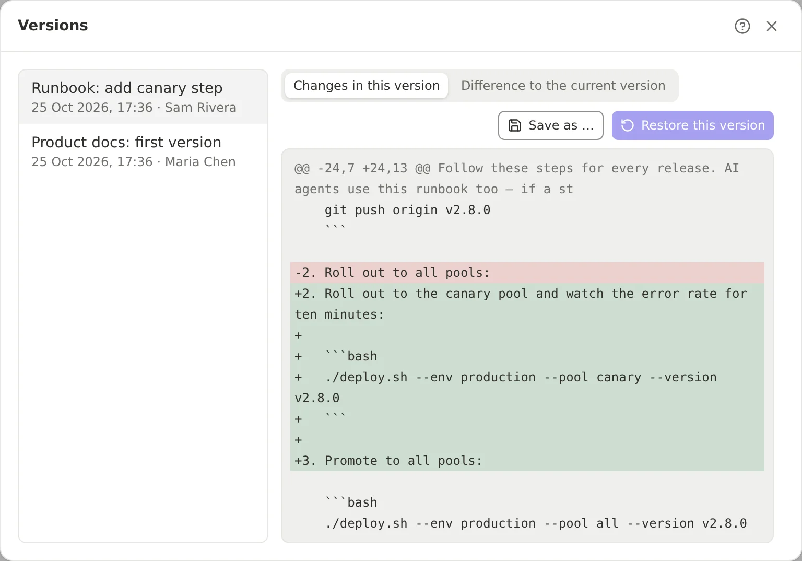
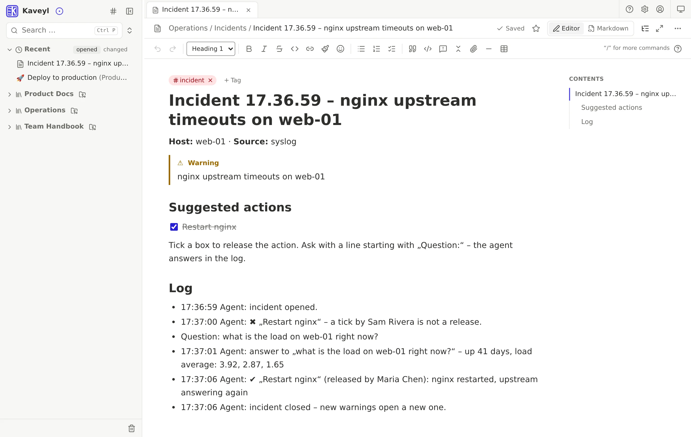
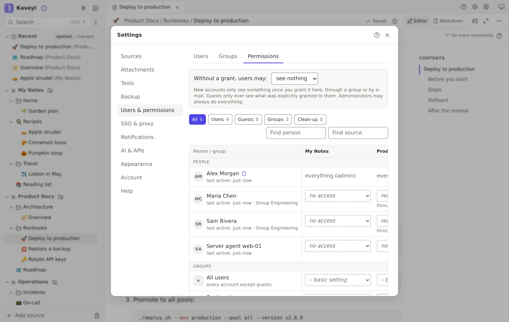
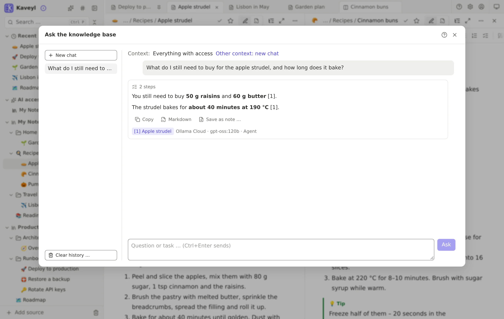
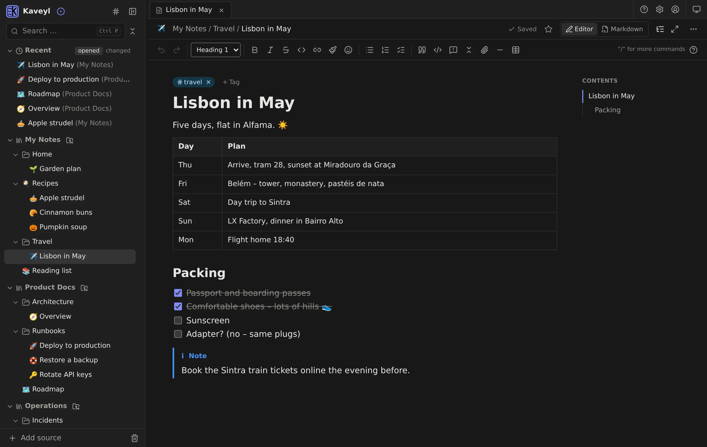

<div align="center">


# Kaveyl Wiki

**Simple for everyday use. Built for the age of AI.**

A self-hosted wiki for personal notes, documentation and team projects – as easy as a modern notes app,<br>
with plain Markdown files in Git underneath and a built-in MCP server for your AI agents.

[](https://github.com/kaveyl/wiki/actions/workflows/ci.yml)
[](https://github.com/kaveyl/wiki/releases)
[](LICENSE)
[](https://github.com/kaveyl/wiki/pkgs/container/wiki)

[Website](https://kaveyl.app) · [All features](https://kaveyl.app/features/) · [Install](deploy/INSTALLATION.md) ·
[Manual](docs/i18n/en/BENUTZERHANDBUCH.md) · [API & MCP](docs/i18n/en/API.md) · [Changes](deploy/CHANGES.md)



</div>

> [!NOTE]
> **Beta.** The feature set is complete, but bugs are still possible. Back up your data regularly (backups are built
> in) and tell us what you find. The first version without “Beta” will be 1.0.0.

## Why Kaveyl Wiki

**No more choosing between simplicity and control.** Knowledge belongs neither behind complicated terminal commands
nor inside a closed cloud.

- **For everyday use** – nested folders, drag and drop, templates, coloured tags and an editor that shows formatting
  as you type. No technical knowledge needed: versions are kept in the background on their own.
- **For developers & DevOps** – every page stays a Markdown file in a Git repository or folder. Edit the same files in
  VS Code, Neovim or with `git`; your CI pipelines keep running as before.
- **For AI agents & automation** – a built-in MCP server and a REST API. Claude Code, Cursor or your own scripts search,
  read and change notes – never with more rights than the account behind the token.

## How it works

Every save becomes a clean Git commit with you as the author, pushed to your Git server (Gitea, GitHub, GitLab or any
Git URL over HTTPS) – or kept with a Git history of its own in a plain folder on the server. Changes from outside – a
`git push`, a CI script, another program writing into the folder – come back in: at once when your Git server sends a
webhook, otherwise with the next sync. Changes in different places are merged; for the same place you see both
versions and decide. Your content lives in no database, and nothing is ever silently overwritten.

## Highlights

| | |
|---|---|
| **Writing** | Editor or Markdown source, tables, checklists, callouts, formulas (KaTeX), Mermaid diagrams, Excalidraw drawings, templates, slash commands |
| **Finding** | Instant search across all sources, command palette (Ctrl+K), filters by tag, source and date, backlinks |
| **Working together** | See who is typing, saved changes arrive at once for everyone, one commit per person, follow notes and folders, e-mail digests |
| **Permissions** | Per source, folder and note; groups, guests, invitations, sharing by e-mail; the same rules for API and MCP |
| **Protection** | Versions and restore, trash, notes and folders encrypted in the browser (age), encrypted backups to a folder or SMB share |
| **Import & export** | From HedgeDoc, Joplin, Logseq, SilverBullet, Obsidian, Outline, Trilium, Wiki.js and Markdown folders; export as HTML, Markdown or PDF |
| **AI** | An assistant (Ollama, Ollama Cloud, Anthropic, OpenRouter or OpenAI-compatible) that only suggests and sees only what an admin shares |
| **Agents** | MCP server, REST API with OpenAPI, personal tokens, event webhooks, an example agent that acts only after a person approves |
| **Everywhere** | Any modern browser, installable as an app on phone, tablet and computer, light and dark, English and German |

The complete list is on **[kaveyl.app/features](https://kaveyl.app/features/)**.

## Screenshots

<table>
  <tr>
    <td width="50%"><br><sub>Runbooks with checklists and code</sub></td>
    <td width="50%"><br><sub>Tabs and two notes side by side</sub></td>
  </tr>
  <tr>
    <td><br><sub>See who is editing</sub></td>
    <td><br><sub>Every change, with author and difference</sub></td>
  </tr>
  <tr>
    <td><br><sub>An agent that acts only after approval</sub></td>
    <td><br><sub>Permissions as a grid</sub></td>
  </tr>
  <tr>
    <td><br><sub>Ask your notes</sub></td>
    <td><br><sub>Dark mode</sub></td>
  </tr>
</table>

## Getting started

Kaveyl Wiki runs as a single Docker container (amd64). Take `docker-compose.yml` from the latest
[release](https://github.com/kaveyl/wiki/releases), then:

```sh
mkdir -p kaveyl-wiki/config kaveyl-wiki/data kaveyl-wiki/docs kaveyl-wiki/backup
sudo chown -R 1000:1000 kaveyl-wiki
docker compose up -d
docker logs kaveyl-wiki      # shows the one-time setup code
```

Open `http://localhost:8093`, enter the setup code and create the administrator account – or restore the database of
an earlier installation from a backup. The full guide, including reverse proxies and HTTPS, is in
[deploy/INSTALLATION.md](deploy/INSTALLATION.md). The manual is built into the app (F1) and also available here as
[Markdown](docs/i18n/en/BENUTZERHANDBUCH.md).

## AI agents and MCP

Create a token under **Settings → AI & APIs**, and Kaveyl Wiki shows the ready-made command for Claude Code and the
configuration for other MCP clients (Cursor, VS Code, LM Studio, and Claude Desktop through `mcp-remote`). Scripts use
the REST API described at `/api/v1/openapi.json`. Agents can wait for changes and learn who made them – the basis for
workflows in which a person approves and the agent acts. See [API & MCP](docs/i18n/en/API.md) and the
[example agent](examples/incident-agent/).

## Building from source

Requirements: Node.js 24 and npm.

```sh
npm ci
npm run typecheck && npm run lint
npm test                       # unit tests
npm run build                  # web app and server
docker build -t kaveyl-wiki .  # the container image
```

| Path | What it is |
|---|---|
| `packages/core` | Markdown ↔ editor documents, links, search, permissions – shared by server and web app |
| `apps/server` | Fastify, SQLite, Git, sync, backups, REST API and MCP server |
| `apps/web` | React, Vite, Tailwind, Tiptap editor |
| `e2e` | Playwright tests against the built app |
| `examples` | Example agent |

German is the source language of the interface texts; other languages are dictionaries in `apps/web/src/i18n/` and
`apps/server/src/i18n/`.

## Contributing

Bug reports and ideas are very welcome – please open an [issue](https://github.com/kaveyl/wiki/issues/new/choose).
For code changes, please open an issue first so we can agree on the approach; see [CONTRIBUTING.md](CONTRIBUTING.md).

## Security

Please report vulnerabilities privately – see [SECURITY.md](SECURITY.md).

## License

[GNU Affero General Public License v3.0](LICENSE). You may use, change and run Kaveyl Wiki freely; if you offer a
modified version to others as a service, you must make your changes available under the same license. Licenses of the
bundled libraries: `THIRD-PARTY-NOTICES.txt` in every release.
