# Kaveyl Wiki – Benutzerhandbuch

> Quellen und Verbindungen (Gitea, GitHub, GitLab, Git, Ordner), Editor, Rechte und Verschlüsselung, REST-API und
> MCP, KI-Assistent mit Agent, Zeichnungen und Export, Handy und Desktop, Löschregeln und Hilfe in der App.
> Dieses Handbuch ist zugleich die **Hilfe in Kaveyl Wiki** (Einstellungen → Hilfe, F1, „?“). Die Bilder zeigen
> Beispieldaten.

## Inhalt

1. [Was ist Kaveyl Wiki?](#was-ist-kaveyl-wiki)
2. [Hilfe in Kaveyl Wiki](#hilfe-in-kaveyl-wiki)
3. [Anmelden und Oberfläche](#anmelden-und-oberfläche)
4. [Menüs im Überblick](#menüs-im-überblick)
5. [Quellen einbinden](#quellen-einbinden)
6. [Notizen finden und lesen](#notizen-finden-und-lesen)
7. [Bearbeiten](#bearbeiten) (mit [Markdown-Spickzettel](#markdown-spickzettel))
8. [So funktioniert der Abgleich](#so-funktioniert-der-abgleich)
9. [Speichern, Übertragen und Synchronisieren](#speichern-übertragen-und-synchronisieren)
10. [Anlegen, Umbenennen, Verschieben, Löschen](#anlegen-umbenennen-verschieben-löschen)
11. [Links und „Verlinkt von“](#links-und-verlinkt-von)
12. [Versionen und Papierkorb](#versionen-und-papierkorb)
13. [Konflikte auflösen](#konflikte-auflösen)
14. [Repositories löschen](#repositories-löschen)
15. [Berechtigungen](#berechtigungen)
16. [Konten, Einladungen und Teilen per E-Mail](#konten-einladungen-und-teilen-per-e-mail)
17. [Im Team arbeiten](#im-team-arbeiten) (mit [Beobachten](#beobachten) und [Agenten im Team](#agenten-im-team))
18. [Verschlüsselte Notizen und Ordner](#verschlüsselte-notizen-und-ordner)
19. [Einstellungen im Überblick](#einstellungen-im-überblick) (mit [Backup](#backup))
20. [Zugriff über das Netz](#zugriff-über-das-netz) (Reverse-Proxy, Pangolin)
21. [Daten, Protokoll und Sicherungen](#daten-protokoll-und-sicherungen) (mit [Löschregeln](#löschregeln))
22. [KI-Assistent](#ki-assistent)
23. [API und MCP (Claude, Hermes, Skripte)](#api-und-mcp-claude-hermes-skripte)
24. [Tastenkürzel](#tastenkürzel)
25. [Fehlerbehebung](#fehlerbehebung)
26. [Exportieren und Drucken](#exportieren-und-drucken)
27. [Im Browser und als App: Handy, Tablet, Computer](#im-browser-und-als-app-handy-tablet-computer)
28. [Technik und Komponenten](#technik-und-komponenten)

---

## Was ist Kaveyl Wiki?

Kaveyl Wiki ist eine Wiki-Oberfläche für **ganz normale Markdown-Dateien** in Git-Repositories
und Ordnern. Es gibt keine eigene Datenbank für Inhalte: Was du in Kaveyl Wiki schreibst, landet
als `.md`-Datei im Repository – und was du in VS Code, Wiki.js oder per `git push` änderst,
erscheint in Kaveyl Wiki. Du kannst also jederzeit mit beiden Welten arbeiten.

Wichtige Grundsätze:

- **Dateien bleiben deine Dateien.** Kaveyl Wiki ändert beim Speichern nur die Abschnitte, die du
  bearbeitet hast; alles andere bleibt Byte für Byte, wie es war (auch fremde Formatierung).
- **Bloßes Öffnen ändert nie etwas.**
- **Nichts wird still überschrieben.** Bei gleichzeitigen Änderungen gibt es einen Konflikt-Dialog.

Wie Kaveyl Wiki mit dem Git-Server und mit anderen Editoren und Geräten zusammenspielt, erklärt
[So funktioniert der Abgleich](#so-funktioniert-der-abgleich).

### Auf einen Blick

**Dateien statt Datenbank.** Kaveyl Wiki ist ein Wiki für ganz normale Markdown-Dateien – eine eigene
Datenbank für Inhalte gibt es nicht. Die Notizen liegen in Git-Repositories (Gitea, GitHub, GitLab oder
jede Git-Adresse) oder in Ordnern, die in den Container eingehängt sind. Jede Quelle erscheint links als
eigener Baum; die Sofort-Suche und die Befehlspalette (Strg+K) finden alles.

**Schreiben und Abgleichen.** Geschrieben wird in einem Editor, der die Formatierung direkt zeigt, oder
im Markdown-Quelltext. Gespeichert wird sofort; in Repositories macht Kaveyl Wiki daraus Commits mit dir als
Autor und überträgt sie. Was du in VS Code, Wiki.js oder per git änderst, erscheint ebenso in Kaveyl Wiki –
nichts wird still überschrieben, Konflikte zeigt Kaveyl Wiki an. Unter jeder Quelle liegt Git: Repositories gleichen
mit deinem Git-Server ab, lokale Ordner führen ihre Versionen mit einem eigenen Git auf dem Server.

**Schutz und Rechte.** Versionen, Papierkorb, Backups auf ein NAS oder einen eigenen Ordner,
Link-Reparatur und eine nächtliche Prüfung schützen vor Verlust und gebrochenen Links. Rechte, Gruppen, Gäste und verschlüsselte Notizen regeln, wer was sehen
und ändern darf.

**KI und Schnittstellen.** Ein KI-Assistent hilft beim Schreiben und beantwortet Fragen aus
freigegebenen Notizen – er schlägt nur vor, du entscheidest. Über REST-API und MCP arbeiten Skripte und
KI-Werkzeuge wie Claude mit denselben Rechten mit.

Kaveyl Wiki läuft als **Docker-Container**. Was es selbst speichert (Benutzer, Einstellungen, Protokoll,
Sicherungen, lokale Kopien der Repositories), liegt in den eingehängten Ordnern `/config` und `/data`;
lokale Ordner (Notizen nur auf diesem Server) liegen unter `/docs` – siehe [Daten, Protokoll und Sicherungen](#daten-protokoll-und-sicherungen).

## Hilfe in Kaveyl Wiki

Dieses Handbuch steckt vollständig in Kaveyl Wiki – mit Bildern, Suche und der Referenz für API und MCP.
So kommst du hin:

| Wo | Was öffnet sich |
|---|---|
| **?** oben rechts (neben dem Zahnrad; auf dem Handy im Konto-Menü) | das Handbuch |
| **F1** – überall | in einem Einstellungsbereich oder Dialog die Hilfe genau dazu, sonst das Handbuch |
| **Einstellungen → Hilfe** | ganz oben die installierte Version (Admins: auch, ob eine neuere erschienen ist), dann was Kaveyl Wiki ist, wo es Hilfe gibt und Knöpfe zu guten Einstiegen |
| **?** oben rechts in der Titelleiste der Einstellungen (neben dem ×) | erklärt jeden Eintrag des gerade offenen Reiters |
| **?** in der Kopfzeile vieler Dialoge (Quelle einbinden, KI-Freigabe, Berechtigungen, Papierkorb, Versionen …) | die passende Stelle im Handbuch |
| **?** am Ende der Formatierungsleiste im Editor | [Bearbeiten](#bearbeiten) mit dem [Markdown-Spickzettel](#markdown-spickzettel) |
| **Befehlspalette** (Strg+K): „Hilfe“, „Hilfe: Markdown-Spickzettel“, „Hilfe: Tastenkürzel“ | das Handbuch an dieser Stelle |

Im Hilfe-Fenster stehen links die Kapitel (beim gewählten Kapitel auch seine Abschnitte), rechts der
Text. **Hilfe durchsuchen** findet Wörter in allen Kapiteln und Abschnitten. Die Treffer bleiben stehen, während du
einen nach dem anderen öffnest – der offene ist markiert, **×** leert die Suche. Oben rechts wechselst du
zwischen **Handbuch** und **API & MCP**. Ein Klick auf ein Bild zeigt es groß, Links im Text springen an
die genannte Stelle. Auf schmalen Bildschirmen wählst du das Kapitel oben aus einer Liste.

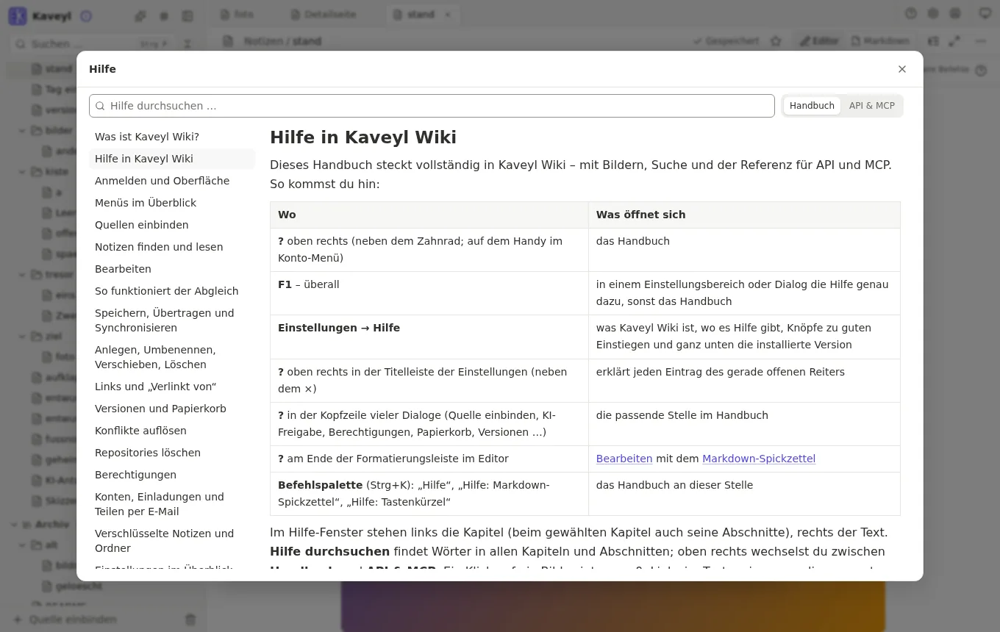

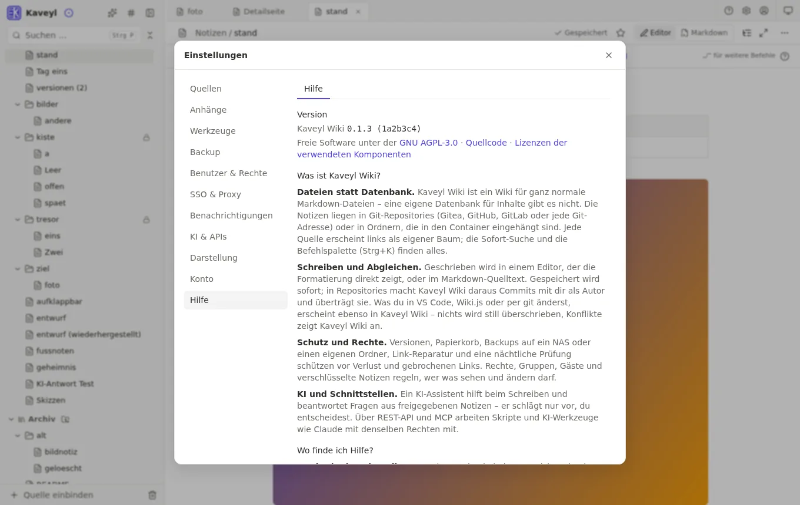

## Anmelden und Oberfläche

Adresse: die deines Kaveyl-Wiki-Servers – im eigenen Netz z. B. `http://server:8093`, von außen eine
`https://`-Adresse (z. B. hinter Cloudflare Access). Wie Kaveyl Wiki über eine eigene Domain und einen Reverse-Proxy
erreichbar wird: [Zugriff über das Netz](#zugriff-über-das-netz).

Beim allerersten Start gibt es noch kein Konto. Statt der Anmeldung erscheint dann **„Kaveyl Wiki einrichten“**: Dort
legst du das erste Administrator-Konto an. Dafür fragt die Seite nach einem **Einrichtungscode**. Kaveyl Wiki schreibt ihn
beim Start ins Log des Containers (`docker logs kaveyl-wiki`, eingerahmt von Gleichheitszeichen) und in die Datei
`setup-code` im Konfigurationsordner. So kann niemand, der die Adresse zufällig zuerst öffnet, die Instanz übernehmen.
Nach der Einrichtung verfällt der Code; startet Kaveyl Wiki ohne Konto neu, gibt es einen neuen.

Ist es ein **neuer Server** für eine Kaveyl-Wiki-Instanz, die es schon gab, legst du kein neues Konto an, sondern holst
unter dem Formular mit **Neuer Server? Aus einer Sicherung wiederherstellen** die Datenbank zurück – wie das geht, steht
unter [Auf einem neuen Server](#auf-einem-neuen-server).

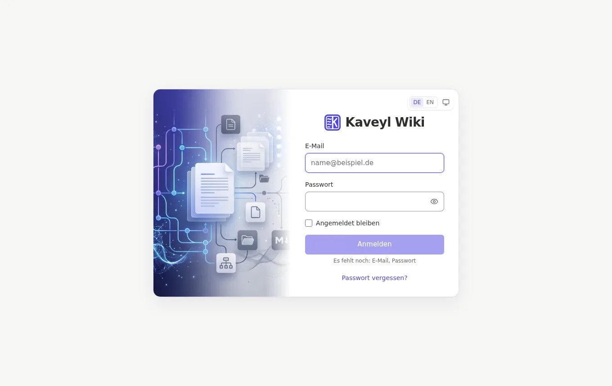

- Angemeldet wird mit **E-Mail-Adresse und Passwort**. Das Auge im Passwortfeld zeigt die Eingabe
  kurz im Klartext.
- **Angemeldet bleiben:** mit Häkchen bleibt die Anmeldung 30 Tage bestehen, ohne Häkchen endet sie,
  wenn der Browser geschlossen wird (spätestens nach einem Tag). Das Gerät merkt sich die Wahl.
- **Passwort vergessen?** unter dem Formular: E-Mail eingeben, du bekommst einen Link (30 Minuten
  gültig, nur einmal). Darüber legst du ein neues Passwort fest; alle anderen Anmeldungen enden, und
  eine Hinweis-Mail bestätigt die Änderung. Die Antwort ist immer gleich – auch für Adressen ohne
  Konto. Ist kein E-Mail-Versand eingerichtet, steht dort, dass ein Administrator das Passwort
  zurücksetzen muss.
- **Zu viele Fehlversuche:** Nach 10 falschen Passwörtern für dieselbe Adresse (oder 30 von einem Gerät)
  innerhalb von 15 Minuten nimmt Kaveyl Wiki eine Pause ein und meldet „Zu viele Fehlversuche“ – dann hilft
  auch das richtige Passwort erst nach einigen Minuten. Das bremst das Durchprobieren von Passwörtern;
  Administratoren sehen den Vorfall im Protokoll.
- **Passwortregeln** (für jedes neue Passwort, nach der Empfehlung NIST SP 800-63B-4): mindestens **15 Zeichen**
  (höchstens 256), alle Zeichen erlaubt (auch Leerzeichen, Umlaute, Emojis), keine Pflicht für Großbuchstaben, Ziffern oder
  Sonderzeichen. Ein langer Satz aus mehreren Wörtern ist ein gutes Passwort. Abgelehnt wird, was leicht zu
  erraten ist: bekannte Passwörter (eine eingebaute Liste, auch mit Ziffern oder Zeichen davor oder dahinter wie
  „Passwort2026!!!!“), Wiederholungen und Folgen wie „aaaa…“, „123456…“ oder „qwertz…“, die eigene E-Mail-Adresse
  und Passwörter nur aus dem eigenen Namen. Eine Liste unter dem Feld hakt ab, was schon erfüllt ist. Solange eine
  Angabe fehlt, ist der Knopf zum Absenden gesperrt; darunter steht, was noch fehlt (z. B. „Es fehlt noch: Passwort
  wiederholen“). Weicht die Wiederholung ab, steht „Stimmt nicht überein“ am Feld, sobald sie so lang ist wie das
  Passwort oder du das Feld verlässt – so auch bei Passwort ändern, Backup-Passwort und Passphrase. Bestehende Passwörter bleiben gültig – geprüft wird nur, wenn ein Passwort neu gesetzt wird. Wer
  sich mit einem Startpasswort vom Administrator anmeldet, muss zuerst ein eigenes festlegen; vorher geht nichts anderes.
- Die Anmeldeseite folgt **hell/dunkel** der Einstellung des Geräts (bzw. Einstellungen →
  Darstellung); auf dem Handy steht das Formular unter einem Bildstreifen.
- **Sprache und Farbschema** stehen oben rechts auf der Anmeldeseite und im Einrichtungsassistenten: **DE | EN**
  schaltet die Sprache um, das Symbol daneben das Farbschema. So lässt sich Kaveyl Wiki auch komplett auf Englisch
  einrichten. Ohne eigene Wahl richtet sich die Sprache nach dem Browser (deutscher Browser → Deutsch, sonst
  Englisch). Was du hier wählst, übernimmt dein Konto bei der Anmeldung.

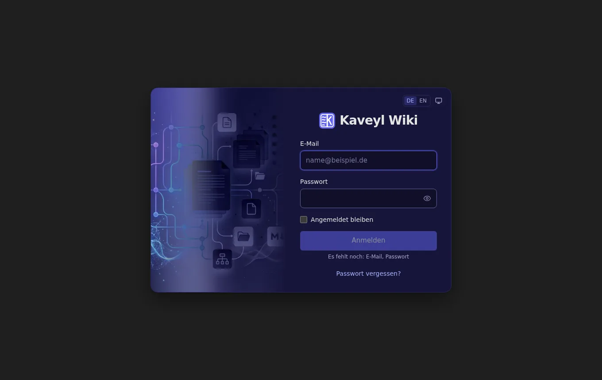

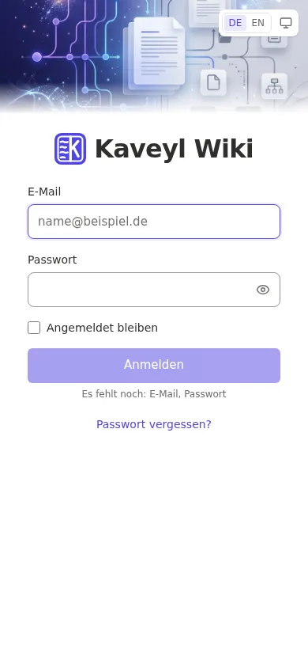

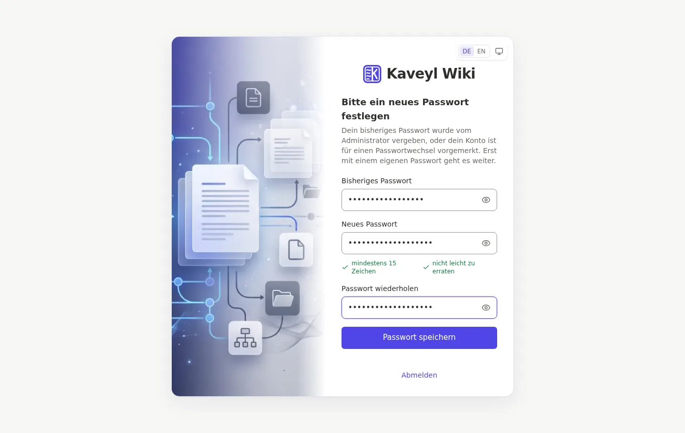

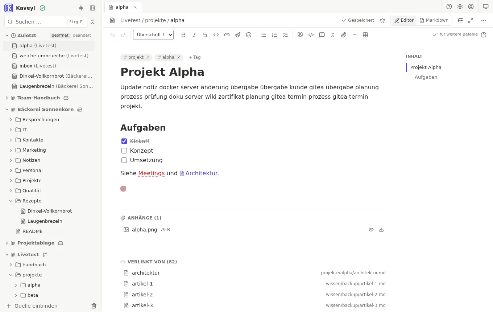

- **Links (Seitenleiste):** oben neben „Kaveyl“ das **Sync-Symbol**, dann ✦ **KI fragen** (wenn eingerichtet),
  **#** Tags und Seitenleiste ausblenden; darunter
  die Suche, Favoriten, „Zuletzt“ und jede eingebundene **Quelle** (Repository oder Ordner) als eigener Baum.
  Alle Menüs Eintrag für Eintrag: [Menüs im Überblick](#menüs-im-überblick).
- **Oben rechts** in der Tab-Leiste – immer sichtbar, auch bei eingeklappter Seitenleiste: **?** Hilfe, das
  **Zahnrad** (Einstellungen), das **Konto-Menü** (Personen-Symbol: dein Name und deine E-Mail-Adresse,
  **Mein Konto …**, **Abmelden**) und das **Farbschema-Symbol** (Sonne, Mond oder Bildschirm). Jeder Klick darauf
  schaltet weiter: Hell → Dunkel → System (folgt dem Gerät); die Wahl bleibt in diesem Browser gespeichert. Auf dem
  Handy stehen Hilfe und Einstellungen mit im Konto-Menü, damit die Tabs Platz haben.
- **Oben:** Tabs der geöffneten Notizen. Die mittlere Maustaste öffnet in einem neuen Tab (unter Favoriten und
  Zuletzt auch Strg+Klick; im Baum [markiert](#mehrere-markieren) Strg+Klick). Rechtsklick auf einen Tab → **„Tab anheften“**: angeheftete Tabs rücken nach links,
  zeigen eine Stecknadel statt ×, werden beim Öffnen einer anderen Notiz nie ersetzt und bleiben
  bei „Andere Tabs schließen“ und Mittelklick stehen. Klick auf die Stecknadel löst sie wieder.

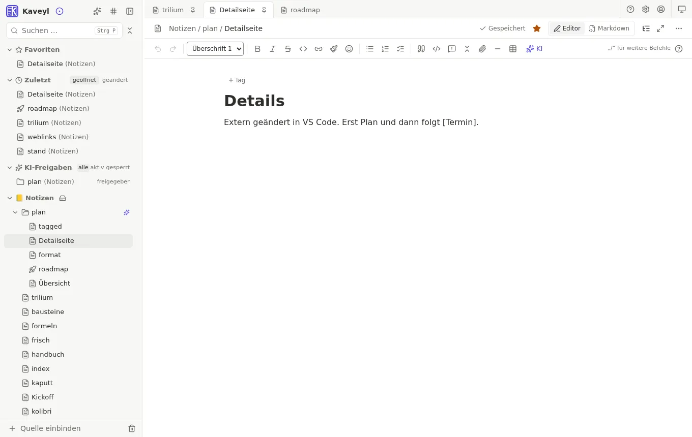
- **Mitte:** der Editor mit Formatierungsleiste. **Rechts** das Inhaltsverzeichnis (bei
  längeren Notizen), ein- und ausblendbar.
- Oben rechts in der Notiz: **Editor / Markdown** (Ansicht umschalten), Breite umschalten
  und das Menü **„…“** (Versionen, Umbenennen, Löschen …).

**Willkommensseite.** Solange keine Notiz offen ist, zeigt die Mitte die Willkommensseite. Oben stehen die ersten
Schritte, passend zur Rolle; was schon erledigt ist, ist abgehakt:

- **Administratoren:** Quelle einbinden, E-Mail-Versand einrichten, Reverse-Proxy mit https einrichten (erledigt,
  sobald Kaveyl Wiki deine Anfrage als https erkennt – siehe [Reverse-Proxy](#reverse-proxy)), Leute einladen (erledigt,
  sobald es ein zweites Konto gibt) und ein Backup festlegen (erledigt mit einem aktiven Zeitplan). Ohne https gehen
  Passwörter und Notizen unverschlüsselt durchs Netz, und ohne eingetragenen Proxy sieht Kaveyl Wiki nicht, wer wirklich
  anfragt – im Protokoll steht dann nur die Adresse des Proxys, und die Anmeldebremse trifft alle zugleich.
- **Benutzer:** Notizen finden (erledigt nach der ersten geöffneten Notiz), Favoriten merken (nach dem ersten Stern),
  Darstellung anpassen, Kaveyl Wiki wie eine App benutzen (mit dem Weg für dein Gerät, erledigt, wenn es schon als App
  läuft – siehe [Im Browser und als App](#im-browser-und-als-app-handy-tablet-computer)).
- **Gäste:** die geteilte Notiz öffnen, Darstellung anpassen, Kaveyl Wiki wie eine App benutzen.

Ist noch keine Quelle freigegeben, steht statt „Notizen finden“ **„Auf eine Freigabe warten“** – ein Administrator
gibt Quellen oder Ordner frei (siehe [Berechtigungen](#berechtigungen)); dasselbe steht dann auch in der Seitenleiste. Darunter steht, was Kaveyl Wiki kann: für alle
Versionen und Papierkorb; für Benutzer zusätzlich KI-Assistent, API und MCP, Verschlüsselung und die Arbeit mit
anderen Editoren; für Administratoren außerdem Backup, Benachrichtigungen und Kaveyl Wiki wie eine App.
**„Einrichten“** öffnet die passende Einstellung, **„Mehr dazu“** das Kapitel in diesem Handbuch. Sobald eine Quelle
eingebunden ist, blendet **„Nicht mehr anzeigen“** die Seite aus; eine kurze Meldung sagt, wo sie wieder zu finden ist.
Zurück holst du sie unter Einstellungen → [Hilfe](#hilfe) mit **„Willkommensseite wieder anzeigen“** oder in der leeren
Mitte mit **„Willkommensseite anzeigen“**. Die Wahl gilt für dein Konto auf allen Geräten.

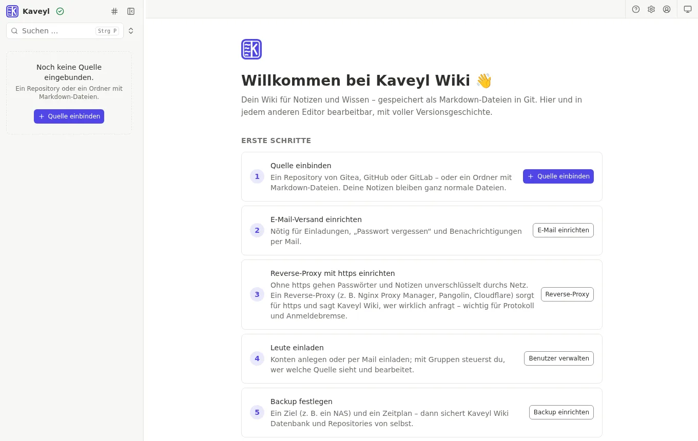

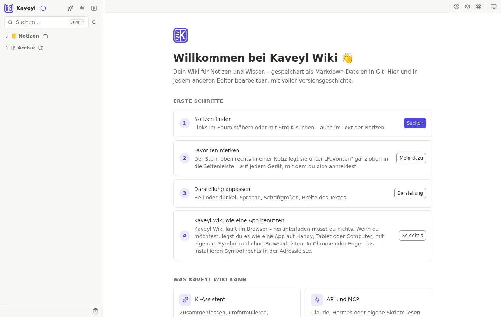

## Menüs im Überblick

Fast alles erreichst du per **Rechtsklick** (auf Touch-Geräten: **lange drücken**) oder über das
Notiz-Menü **„…“**. Was du nicht darfst (z. B. ohne Schreibrecht), erscheint gar nicht erst.

### Kopfzeile der Seitenleiste

| Symbol | Wirkung |
|---|---|
| Sync-Symbol | Zustand aller Quellen (grün = synchron, Punkt = wartet auf Übertragung, Warnung = bitte ansehen, durchgestrichene Wolke = keine Verbindung zum Server); ein Klick öffnet die [Sync-Übersicht](#speichern-übertragen-und-synchronisieren) |
| ✦ KI fragen | [Frag die Wissensbasis](#frag-die-wissensbasis) über alles Freigegebene |
| # Tags | alle Tags mit Anzahl und Farbe; ein Klick zeigt die Notizen, Rechtsklick färbt oder benennt um |
| Seitenleiste ausblenden | wie beschriftet |
| Neben der Suche: Neu …, Alles auf-/zuklappen | neue Notiz/neuer Ordner; alle Rubriken und Ordner auf- oder zuklappen |

### Oben rechts

| Symbol | Wirkung |
|---|---|
| ? Hilfe | dieses Handbuch (auch **F1**) |
| Zahnrad | [Einstellungen](#einstellungen-im-überblick) |
| Konto-Menü (Personen-Symbol) | dein Name und deine E-Mail-Adresse; **Mein Konto …** öffnet Einstellungen → Konto; **Abmelden** (fragt vorher, wenn noch etwas ungespeichert ist). Auf dem Handy zusätzlich **Hilfe / Handbuch** und **Einstellungen** |
| Farbschema | Hell → Dunkel → System |

### Rechtsklick auf eine Quelle

| Eintrag | Wirkung |
|---|---|
| Neue Notiz / Neuer Ordner | auf oberster Ebene der Quelle |
| Einfügen „…“ | was du vorher kopiert oder ausgeschnitten hast (Strg+V) |
| Importieren ▸ Markdown-Dateien … | `.md`-Dateien vom Computer als Notizen auf die oberste Ebene ([Markdown importieren](#markdown-importieren)) |
| Importieren ▸ Aus anderem Programm … | Export eines anderen Programms (ZIP) als neuer Ordner ([Aus anderen Programmen importieren](#aus-anderen-programmen-importieren)) |
| Berechtigungen … | [Rechte](#berechtigungen) für die ganze Quelle (Admins, „verwalten“) |
| Teilen ▸ Zugriff per E-Mail geben … | die ganze Quelle mit jemandem [teilen](#konten-einladungen-und-teilen-per-e-mail) (Admins, „verwalten“) |
| KI-Freigabe … | [KI-Freigabe](#ki-freigaben) und KI-Gedächtnis der Quelle (Admins) |
| Anordnen → Quelle nach oben / unten, Oberste Ebene alphabetisch sortieren | Reihenfolge in der Seitenleiste bzw. der obersten Ebene |
| Jetzt synchronisieren | holt und überträgt sofort (Repositories) |
| Exportieren ▸ HTML (ZIP) / Markdown (ZIP) | die ganze Quelle als Webseiten oder als Markdown-Dateien ([Export](#exportieren-und-drucken)) |
| Papierkorb | gelöschte Notizen dieser Quelle ([Papierkorb](#versionen-und-papierkorb)) |
| Backup ▸ Jetzt sichern / Sicherungen und Wiederherstellen … / Zeitpläne … | sofort sichern (alle aktiven Zeitpläne mit dieser Quelle), ihre [Sicherungen](#sicherungen) oder [Zeitpläne](#zeitpläne) öffnen (Admins) |
| Quelle bearbeiten … | [Quelle bearbeiten](#eine-quelle-bearbeiten): Name, Symbol, Optionen, Inhalt, aushängen (Admins) |
| Repository löschen … | nur Gitea/GitHub/GitLab, Admins ([Repositories löschen](#repositories-löschen)) |

### Rechtsklick auf einen Ordner oder eine Notiz

| Eintrag | Wirkung |
|---|---|
| In neuem Tab öffnen, Rechts / Links daneben öffnen | Notiz in neuem Tab (auch mittlere Maustaste) oder in der [geteilten Ansicht](#notizen-finden-und-lesen) |
| Nur diesen Ordner zeigen (Fokus) | Seitenleiste zeigt nur diesen Ordner |
| Neue Notiz / Neuer Ordner | darin (an einer Notiz: daneben) |
| Umbenennen / verschieben | Name und Ziel, auch in eine andere Quelle; Links werden repariert |
| Kopieren, Ausschneiden, Einfügen „…“ | Strg+C / Strg+X / Strg+V im Baum |
| Pfad kopieren | vollständiger Pfad mit der Quelle vorne (`Quelle/Ordner/Notiz.md`) in die Zwischenablage |
| Auswählen | [mehrere markieren](#mehrere-markieren) – Kästchen vor den Zeilen, ein Tippen markiert (für Tablet und Handy; mit der Maus: Strg+Klick) |
| Importieren ▸ Markdown-Dateien … | nur an Ordnern: `.md`-Dateien vom Computer als Notizen hinein ([Markdown importieren](#markdown-importieren)) |
| Importieren ▸ Aus anderem Programm … | nur an Ordnern: Export eines anderen Programms (ZIP) als neuer Unterordner ([Aus anderen Programmen importieren](#aus-anderen-programmen-importieren)) |
| Exportieren ▸ HTML-Datei bzw. HTML (ZIP) beim Ordner, Markdown bzw. Markdown (ZIP) beim Ordner | [Export](#exportieren-und-drucken) |
| Aus Backup wiederherstellen … | die [Sicherungen](#sicherungen) der Quelle, beim Öffnen ist diese Stelle ausgewählt (Admins) |
| Anordnen → Nach oben / Nach unten, Inhalt alphabetisch sortieren | Reihenfolge ohne Ziehen |
| Zu Favoriten / Aus Favoriten entfernen | Stern-Liste oben in der Seitenleiste |
| Icon ändern … | Symbol, Emoji oder eigenes Icon |
| Ordner verschlüsseln … / Ordner fertig verschlüsseln … / Verschlüsselung aufheben … | [Verschlüsselung](#verschlüsselte-notizen-und-ordner) |
| Berechtigungen … | [Rechte](#berechtigungen) für diesen Ordner bzw. diese Notiz |
| Teilen ▸ Per Mail versenden … | nur an Notizen: die Notiz als Datei an eine beliebige Adresse ([Per Mail versenden](#per-mail-versenden)); ausgegraut ohne E-Mail-Versand und bei verschlüsselten Notizen |
| Teilen ▸ Zugriff per E-Mail geben … | Ordner (mit allem darin) bzw. Notiz mit jemandem [teilen](#konten-einladungen-und-teilen-per-e-mail) („verwalten“) |
| KI-Freigabe … | [KI-Freigabe](#ki-freigaben) genau hier (Admins) |
| Löschen | in den [Papierkorb](#versionen-und-papierkorb), mit Rückfrage |

### Notiz-Menü „…“ und Kopfzeile der Notiz

In der Kopfzeile: **Icon** der Notiz (Klick ändert es), **Pfad** (Quelle / Ordner / Notiz – in schmalen Fenstern
vorne zu „…“ gekürzt; ein Klick oder Antippen zeigt ihn ganz), **Stern** (Favorit), **Editor / Markdown** (beschriftet
nur, wenn der Notizname daneben ganz Platz hat), **Herunterladen** (Pfeil nach unten: die Notiz als `.md`, mit Bildern
oder Dateien als ZIP – siehe [Export](#exportieren-und-drucken); nicht bei verschlüsselten Notizen), Breite,
Inhaltsverzeichnis ein/aus und **„…“** mit:

| Eintrag | Wirkung |
|---|---|
| Im Baum anzeigen | klappt den Baum bis zur Notiz auf |
| Versionen | [Versionen](#versionen-und-papierkorb) aus der Git-Historie – wiederherstellen oder als neue Notiz speichern |
| Drucken / als PDF …, Exportieren ▸ HTML-Datei / Markdown | [Export](#exportieren-und-drucken) |
| KI fragen …, KI: Zusammenfassen, KI: Weiterschreiben | nur wo es keine Werkzeugleiste gibt (Lesemodus, Markdown-Ansicht) – sonst im [KI-Knopf](#ki-im-editor) |
| Schreibschutz setzen / aufheben | `readonly: true` im Frontmatter |
| Als Vorlage speichern | macht die Notiz zur [Vorlage](#vorlagen) |
| Verschlüsseln … / Verschlüsselung entfernen … / Jetzt sperren | [Verschlüsselung](#verschlüsselte-notizen-und-ordner) |
| Berechtigungen …, Teilen ▸ Per Mail versenden … / Zugriff per E-Mail geben … | wie im Rechtsklick-Menü |
| Umbenennen / verschieben, Löschen | wie im Rechtsklick-Menü |

### Rechtsklick auf einen Tab

**Rechts daneben anzeigen**, **Links daneben anzeigen**, **Geteilte Ansicht schließen**, **Tab anheften /
lösen**, **Tab schließen**, **Andere Tabs schließen**. Die mittlere Maustaste schließt einen Tab.

### Befehlspalette

**Strg+K** öffnet ein Eingabefeld für Notizen und Befehle; mit `>` am Anfang nur Befehle: neue Notiz,
neuer Ordner, im Baum anzeigen, Favorit, Versionen, KI fragen, Tags, Suche mit Filtern,
synchronisieren, drucken, exportieren, Papierkorb, Einstellungen, **Hilfe**, Quelle einbinden,
hell/dunkel/System, Sprache, Seitenleiste, Inhaltsverzeichnis, Breite.

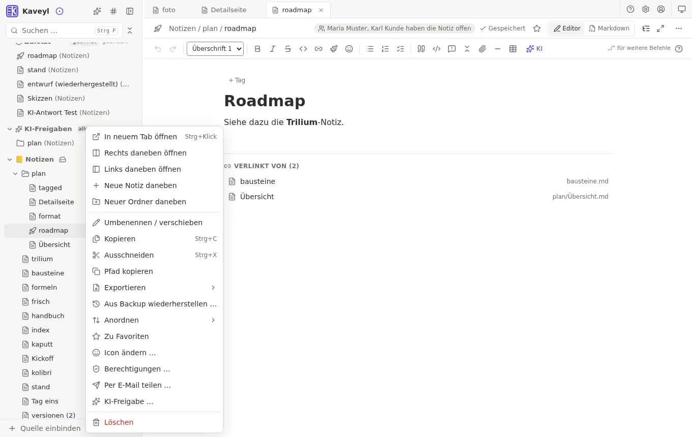

## Quellen einbinden

„Quelle einbinden“ öffnet einen Assistenten in vier Schritten.

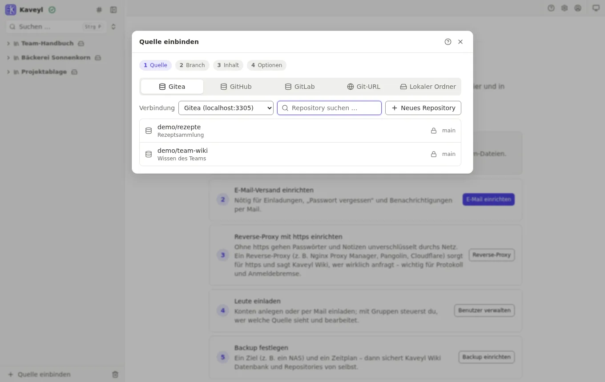

1. **Quelle:**
   - **Gitea**, **GitHub**, **GitLab** – Liste deiner Repositories über eine
     [Verbindung](#verbindungen). Gibt es noch keine, richtest du sie direkt hier ein (Adresse und
     Token); bei mehreren wählst du oben die Verbindung. Mit **„Neues Repository“** legst du ein
     Repository direkt beim Anbieter an (privat als Standard, mit README) und bindest es gleich ein.
   - **Git-URL** – beliebiges HTTPS-Repository. Unter **Anmeldung**: ohne (öffentlich), eine
     passende Verbindung (gleiche Adresse – wird vorgeschlagen) oder **Neuer Token …** (optional mit
     Benutzername); daraus wird beim Einbinden eine Verbindung.
   - **Lokaler Ordner** – für Notizen, die nur auf diesem Server liegen: ein Unterordner von `/docs`, den der Betreiber
     in der `docker-compose.yml` einhängt (auf dem Server z. B. `./kaveyl-wiki/docs` neben der `docker-compose.yml`).
     **Neuer Ordner …** legt im geöffneten Ordner einen Unterordner an und öffnet ihn – etwa einen je Person („Annas
     Wiki“), ohne Terminal. Mit **Versionen führen** (Standard, siehe Optionen) bekommt der Ordner ein eigenes Git:
     Versionen, Papierkorb und wer was geändert hat wie bei einem Repository, nur ohne Abgleich mit einem Git-Server.
     Ist kein Ordner eingehängt, sagt der Assistent, wie es geht. Für den Abgleich mit einem Git-Server (und andere
     Geräte, VS Code am PC): ein Repository (Gitea, GitHub, GitLab, Git-URL).
2. **Branch** (nur bei Repositories). Ist das Repository noch leer (kein Commit, also auch kein Branch – der Anbieter nennt trotzdem „main“), steht das dort: erst beim Anbieter eine Datei anlegen (z. B. README) oder das Repository über „Neues Repository“ anlegen, dann **Erneut prüfen**.
3. **Inhalt:** Häkchen-Baum – ganzes Repository, einzelne Ordner oder einzelne Dateien.
4. **Optionen:** Name und Symbol in der Seitenleiste (dieselbe Auswahl wie bei Notizen: Symbole,
   Emoji, eigene Icons; ohne Auswahl zeigt die Seitenleiste die Art: **Git-Zweig** für Repositories,
   **Ordner mit Git-Zeichen** für lokale Ordner mit eigenem Git, **Festplatte** für lokale Ordner ohne
   Git – mit der Maus auf dem Namen steht die Art immer, auch bei eigenem Symbol) sowie:

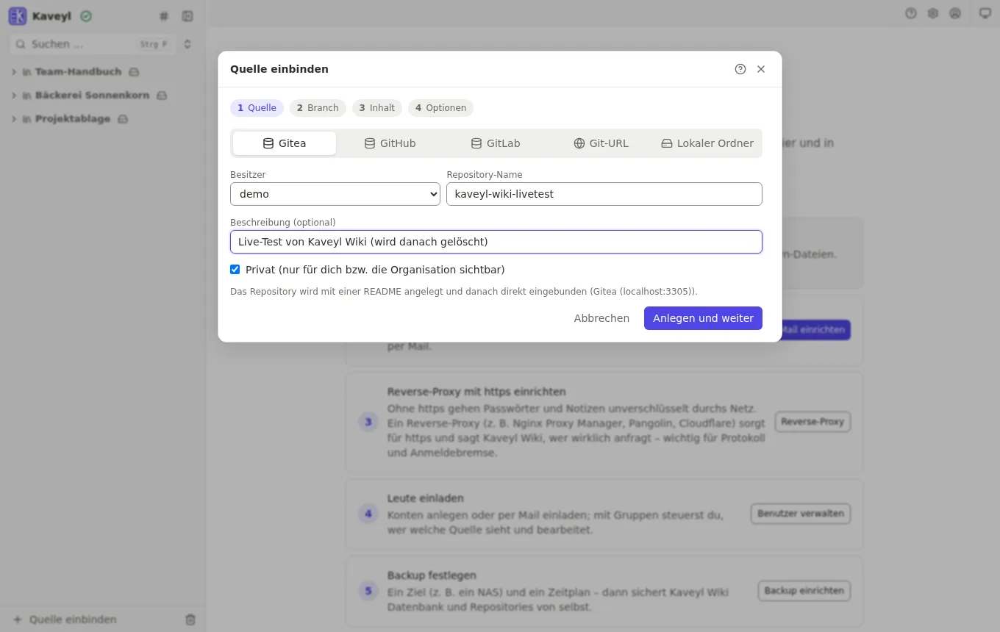

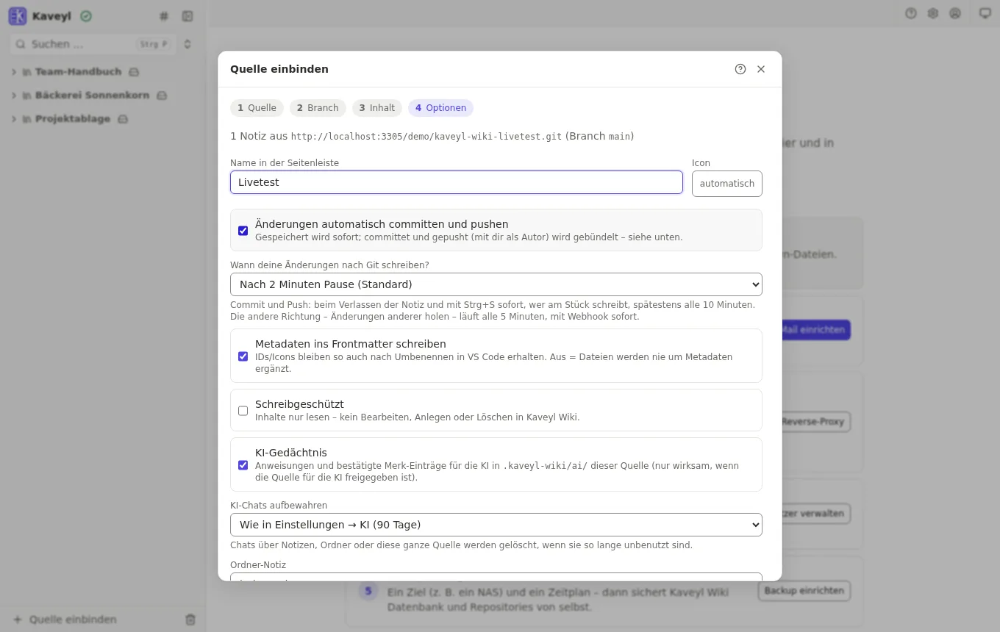

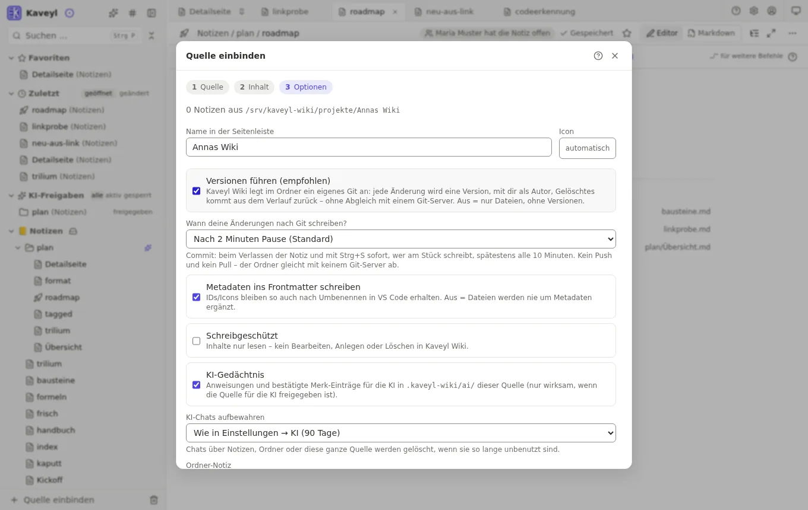

| Option | Bedeutung |
|---|---|
| Versionen führen | Nur bei lokalen Ordnern ohne Git, **Standard an**. Kaveyl Wiki legt im Ordner ein eigenes Git an (versteckter Ordner `.git`) und speichert jede Änderung als Version – mit der Person als Autor; was ein anderes Programm dort ändert (etwa über eine Freigabe des NAS), wird ebenfalls eine Version, mit „Kaveyl Wiki“ als Autor. Kein Push, kein Pull. Gelöschtes bleibt im Verlauf (wie bei Repositories). Kaveyl Wiki muss in den Ordner schreiben dürfen (Besitzer, siehe `user:` in der `docker-compose.yml`), sonst sagt es das beim Einbinden. Aus = nur Dateien, ohne Versionen; später per Rechtsklick auf die Quelle → „Quelle bearbeiten …“ → **Versionen einschalten …**. |
| Änderungen automatisch committen (und pushen) | Bei Repositories Standard, bei Ordnern mit **Versionen führen** immer an. In lokalen Ordnern mit eigenem Git (etwa einem Projekt, an dem du in VS Code arbeitest) aus: Kaveyl Wiki schreibt nur die Dateien, committen machst du selbst. **Lokale Ordner ohne Git** haben diese Option nicht – dort wird nur gespeichert. |
| Wann deine Änderungen nach Git schreiben? | Pause nach der letzten Änderung, bevor committet/gepusht wird: 10 s, **2 Min (Standard)**, 5 oder 15 Min. Beim Verlassen der Notiz und mit Strg+S immer sofort. |
| Metadaten ins Frontmatter schreiben | Neue Notizen bekommen eine `id:` – damit erkennt Kaveyl Wiki sie auch nach Umbenennen in VS Code wieder. Aus = Dateien bekommen nie Metadaten. |
| Schreibgeschützt | Nur lesen; kein Bearbeiten, Anlegen, Löschen in Kaveyl Wiki. |
| Ordner-Notiz | Datei, die als Inhalt ihres Ordners gezeigt wird (`index.md`, bei Wiki.js oft `home.md`). |
| KI-Gedächtnis | Anweisungen und Merk-Einträge der KI in `.kaveyl-wiki/ai/` dieser Quelle mitschicken (nur wirksam, wenn die Quelle für die KI freigegeben ist). |
| KI-Chats aufbewahren | Wie lange unbenutzte [KI-Chats](#chats-und-aufbewahrung) über diese Quelle (ihre Notizen, Ordner oder die ganze Quelle) bleiben: **wie in Einstellungen → KI** (Standard 90 Tage), 7 / 30 / 90 / 180 Tage, 1 Jahr oder nie löschen – z. B. kürzer für ein Tagebuch. |

### Eine Quelle bearbeiten

Eine Quelle bearbeitest oder **hängst du aus** (Admins) per Rechtsklick auf ihren Namen → „Mount
bearbeiten …“. Dort lässt sich bei Repositories auch die **Verbindung** wechseln (z. B. auf ein
anderes Konto mit derselben Adresse). Außerdem: **Pausiert** (ausgeblendet; bei Repositories auch kein Sync), die
Glob-Muster **Einbinden / Ausschließen** und „Im Baum neu auswählen …“ – die gelten für jede Quelle,
auch für lokale Ordner: sie bestimmen, welche Dateien und Ordner in Kaveyl Wiki erscheinen. **Aushängen** (rot, unten
links) entfernt sie nur aus Kaveyl Wiki; die **KI-Freigaben und Rechte dieser Quelle** werden dabei mit entfernt (sie
würden nirgends mehr gelten). Wo die Dateien bleiben:
- **Repository:** beim Anbieter unverändert. Die lokale Kopie auf dem Server wird zur „verwaisten Kopie“ und nach der
  Löschregel (Einstellungen → Werkzeuge → [Aufräumen](#aufräumen), Standard 30 Tage) als Git-Sicherung abgelegt und
  gelöscht. Soll das Repository **ganz weg**, nicht aushängen, sondern Rechtsklick auf die Quelle →
  [Repository löschen …](#repositories-löschen) (Gitea, GitHub, GitLab) – das hängt die Quelle mit aus. Ist sie schon
  ausgehängt, löschst du das Repository beim Anbieter selbst.
- **Lokaler Ordner:** Ordner und Dateien bleiben, wo sie sind – mit Versionen samt Verlauf (`.git` im Ordner).
  Kaveyl Wiki löscht einen lokalen Ordner nie von selbst, denn er ist das Original; weg ist er nur, wenn du ihn auf
  dem Server löschst.
Rückfragen wie „Ungespeicherte Eingaben verwerfen?“ oder „… löschen?“ erscheinen in einem Kaveyl-Wiki-Fenster: **Esc** oder
„Weiter bearbeiten“/„Abbrechen“ lässt alles, wie es war.

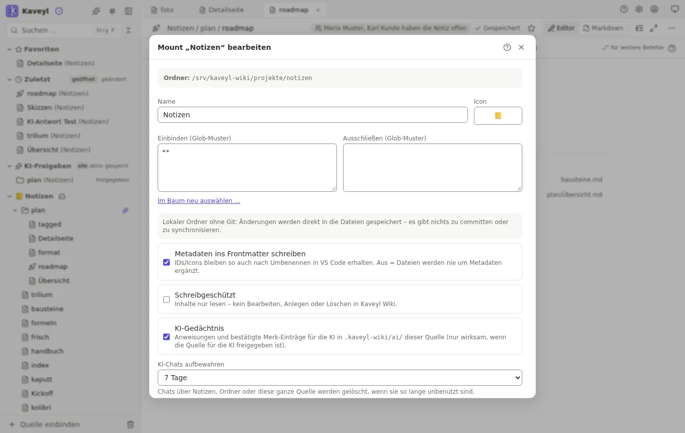

### Verbindungen

Zugangsdaten für Repositories verwaltest du an einer Stelle: **Einstellungen → Quellen →
Verbindungen** (erster Reiter; daneben **Eingebundene Quellen** mit Liste, „Quelle einbinden“ und
Repository-Papierkorb). Eine Verbindung ist ein Konto bei **Gitea**, **GitHub** (github.com oder
Enterprise), **GitLab** (gitlab.com oder eigene Instanz) oder **Git allgemein** (jeder HTTPS-Server,
optional mit Benutzername). Mehrere Verbindungen – auch mehrere Gitea-Instanzen – sind möglich.

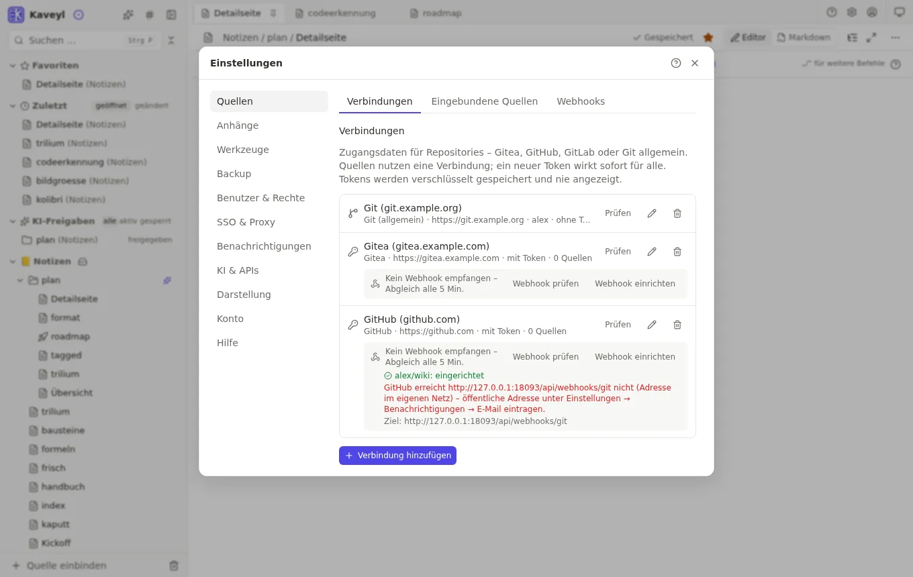

- **Verbindung hinzufügen** (unter der Liste): Art wählen, Adresse (bei GitHub/GitLab vorbelegt), optional Name,
  Token. Welche Rechte der Token braucht, steht direkt unter dem Feld.
- **Prüfen** meldet sich beim Anbieter an und zeigt „angemeldet als …“ oder den Fehler.
- **Bearbeiten:** Name und Token (bei „Git allgemein“ auch Benutzername) jederzeit – ein neuer
  Token gilt sofort für alle Quellen dieser Verbindung. Der gespeicherte Token wird nie angezeigt,
  nur ersetzt. Die **Adresse** ist fest, solange Quellen die Verbindung nutzen oder Repositories
  von ihr im Papierkorb liegen.
- Der Token einer Verbindung geht **nur an ihren eigenen Server**: Wählst du im Assistenten eine
  Verbindung und änderst danach die Adresse, fällt die Auswahl auf „Ohne Anmeldung“ zurück.
- **Löschen** geht erst, wenn keine Quelle sie mehr nutzt und kein Repository von ihr im
  Papierkorb liegt.
- **Webhook** (Gitea, GitHub, GitLab mit Token): Die Zeile darunter zeigt, ob zuletzt ein Webhook
  ankam („Sofort-Abgleich … zuletzt vor …“) oder ob die Quellen alle 5 Minuten abgeglichen werden.
  Darunter steht, was beim Anbieter **wirklich** an Webhooks von Kaveyl Wiki da ist – je Webhook eine Zeile:
  „Webhook am Konto … – meldet Pushes aus allen deinen Repositories“ und/oder „Webhook am Repository …“. Gibt es keinen,
  steht nur „Kein Webhook eingerichtet – Abgleich alle 5 Min.“. Markiert wird ein Webhook, der noch auf eine frühere
  Adresse zeigt, der beim Anbieter ausgeschaltet ist, oder ein Repository-Webhook neben dem Konto-Webhook („jeder Push
  kommt doppelt an“). Haben nur manche eingebundenen Repositories einen, nennt die Zeile „Ohne Webhook (Abgleich alle
  5 Min.)“ die übrigen. Kaveyl Wiki fragt beim Öffnen nach, bei **Webhook prüfen** und wenn du ins Fenster zurückkommst –
  was du beim Anbieter von Hand gelöscht hast, ist dann auch hier weg. Als eigener Webhook zählt nur einer, der auf die
  aktuelle Webhook-Adresse dieser Kaveyl-Wiki-Instanz zeigt oder auf eine, die sie früher selbst benutzt hat – auch einer,
  den du selbst angelegt hast; Pushes kommen nur an, wenn er das Secret von der Seite [Webhooks](#webhooks) trägt. Ein
  Webhook auf …`/api/webhooks/git` an einer anderen Adresse gehört zu einer anderen Kaveyl-Wiki-Instanz (etwa einer
  Testinstanz am selben Konto): Er steht grau als „… – gehört zu einer anderen Kaveyl-Wiki-Instanz (Adresse)“ da, ohne
  Knopf, und Kaveyl Wiki stellt ihn nie um und entfernt ihn nie – auch nicht mit „Alle entfernen“. **Webhook einrichten** legt die fehlenden an – nach Rückfrage, nie von selbst. Neue
  Webhooks heißen beim Anbieter „Kaveyl Wiki“ (GitHub kennt keinen Namen):
  - **Gitea:** Die Rückfrage lässt dich wählen. **Nur die eingebundenen Repositories** legt an jedem eingebundenen
    Repository einen eigenen Webhook an – gemeldet werden nur Pushes dort; bindest du später ein weiteres ein, richtest
    du es noch einmal ein. **Dein ganzes Konto** legt **einen** Webhook auf deinem Konto an (Benutzer-Einstellungen →
    Webhooks): Er gilt für alle Repositories, die dir gehören, auch künftige – jeder Push daraus geht an Kaveyl Wiki,
    abgeglichen werden aber nur eingebundene Quellen, der Rest steht unter „Zuletzt empfangen“ als „keine passende
    Quelle“. Repositories anderer Besitzer (Organisationen) bekommen in beiden Fällen je einen eigenen. Die Rückfrage
    nennt für jeden Weg, was passiert; beim Wechsel räumt Kaveyl Wiki den anderen Weg auf (ein Konto-Webhook fällt weg
    bzw. die Webhooks an deinen eigenen Repositories), damit kein Push doppelt ankommt. Gibt es beides trotzdem,
    meldet die Prüfung das.
  - **GitHub / GitLab:** je ein Webhook pro eingebundenem Repository (persönliche Konten haben keinen
    kontoweiten). Der Token braucht dafür das Recht auf Webhooks (siehe Hinweis unter dem Token-Feld).
  - Ziel ist die [Adresse für Webhooks](#webhooks) (Einstellungen → Quellen → Webhooks), ohne eigene Angabe die öffentliche
    Adresse aus Einstellungen → Benachrichtigungen → E-Mail. Liegt sie im eigenen Netz, sagt Kaveyl Wiki bei
    GitHub.com/GitLab.com gleich, dass sie die Adresse nicht erreichen.
  - **Rückfrage nur, wenn es etwas zu tun gibt:** Ist alles eingerichtet, heißt der Knopf **Webhook eingerichtet** (mit
    Haken), und ein Klick sagt nur „Nichts zu tun“. Sonst nennt die Rückfrage je Ort, was passiert (anlegen oder von
    welcher auf welche Adresse umstellen).
  - **Neue Adresse:** Zeigt ein Webhook von Kaveyl Wiki noch auf eine frühere Adresse, steht das bei der Prüfung
    („zeigt noch auf …“); **Webhook einrichten** stellt ihn dann um, statt einen zweiten anzulegen. Danach steht
    darunter, was passiert ist – „Angelegt“, „Auf die neue Adresse umgestellt“ oder „Nichts zu tun“.
  - **Entfernen:** Jede Webhook-Zeile hat ihren eigenen Papierkorb – er löscht nach Rückfrage genau diesen Webhook,
    die anderen bleiben. Bei mehreren gibt es oben zusätzlich **Alle entfernen** (die Rückfrage nennt jeden Ort).
    Andere Webhooks beim Anbieter (nicht von Kaveyl Wiki) bleiben immer. Ist keiner mehr da, steht oben „Kein Webhook
    eingerichtet – Abgleich alle 5 Min.“; mit **Webhook einrichten** kommt er zurück.

Öffentliche Repositories und lokale Ordner brauchen keine Verbindung.

## Notizen finden und lesen

- **Sofort-Suche** links oben (Strg+P): Ergebnisse erscheinen beim Tippen, gruppiert nach
  Ordnern, Notizen (Titel/Pfad) und Inhalt. Rechtsklick (auf Touch-Geräten: lange drücken) auf einen Treffer → „In neuem Tab
  öffnen“, „Rechts/Links daneben öffnen“, „Im Baum anzeigen“ oder „Pfad kopieren“ (der Pfad
  mit der Quelle vorne; eine Meldung bestätigt das Kopieren). „Alle Ergebnisse …“ öffnet die
  Such-Seite.

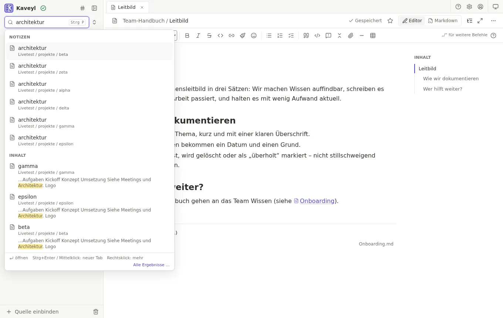

- **Befehlspalette** (Strg+K): ein Eingabefeld für alles – Notiz suchen und öffnen
  (Strg+Enter: neuer Tab) oder Befehle ausführen (neue Notiz/neuer Ordner, im Baum anzeigen,
  Versionen, synchronisieren, Einstellungen, hell/dunkel, Seitenleiste, Inhaltsverzeichnis,
  Breite). Mit `>` am Anfang erscheinen nur Befehle.

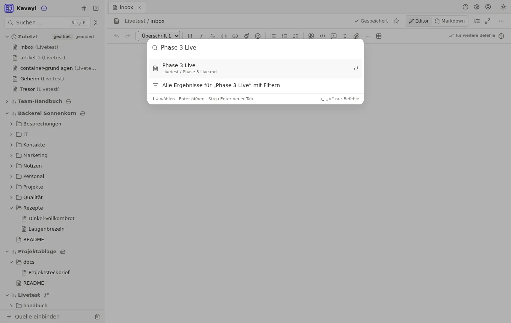

- **Such-Seite** (Befehlspalette → „Alle Ergebnisse …“ oder „Suche mit Filtern“): volle
  Trefferliste mit Tags, Änderungsdatum und Textausschnitt, Filter für Quelle, Tag, Ordner und
  „geändert seit“. Die Filter lassen sich auch direkt tippen:

  | Eingabe | Wirkung |
  |---|---|
  | `tag:projekt` | nur Notizen mit diesem Tag |
  | `in:Handbuch` | nur diese Quelle (Name) |
  | `path:docs/` | nur dieser Ordner |
  | `seit:7d` | geändert in den letzten 7 Tagen (`h`, `d`, `w`, `m`, `y` oder ein Datum) |
  | `"genaue Phrase"` | Wörter genau in dieser Reihenfolge |
  | `-wort` | Notizen mit diesem Wort ausschließen |

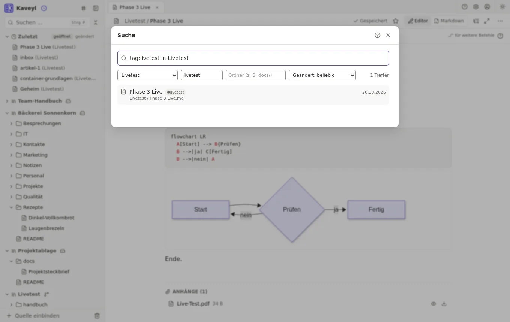

- **Favoriten:** Stern oben rechts in der Notiz (oder Rechtsklick im Baum → „Zu Favoriten“,
  das geht auch für Ordner ohne eigene Ordnernotiz – ein Klick darauf zeigt den Ordner aufgeklappt
  im Baum). Favoriten stehen ganz oben in der Seitenleiste. Rechtsklick auf einen Eintrag in
  „Favoriten“ oder „Zuletzt“: in neuem Tab, rechts oder links daneben öffnen, im Baum anzeigen,
  **Aus Favoriten entfernen** bzw. „Zu Favoriten“. **Zuletzt** zeigt darunter die zuletzt
  geöffneten Notizen – oder mit „geändert“ die zuletzt geänderten (auch von anderen, aus VS Code
  oder per Git). Hinter jedem Eintrag steht grau in Klammern die **Quelle** – praktisch, weil
  Git-Projekte oft dieselbe Ordnerstruktur haben (z. B. mehrere `README` oder `docs/`). Beide
  Abschnitte lassen sich einklappen; ein Klick auf „geöffnet“ oder „geändert“ klappt „Zuletzt“
  dabei automatisch auf. Die Listen gehören zu deinem Konto und liegen nicht im Repository.
  In „Zuletzt“ landet eine Notiz erst, wenn sie sich öffnen ließ. Einträge, deren Notiz es nicht
  mehr gibt (gelöscht, außerhalb umbenannt, Quelle ausgehängt), blendet die Seitenleiste aus.
  Lässt sich eine Notiz nicht öffnen, bietet der Tab „Suchen“ und „Papierkorb“ (Notiz nicht
  gefunden) bzw. „Erneut versuchen“ (anderer Fehler) und „Tab schließen“ an.


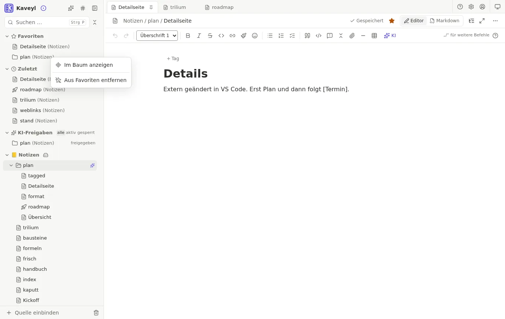

- **Icons:** Klick auf das Symbol links neben dem Pfad (oder Rechtsklick im Baum → „Icon ändern
  …“). Drei Reiter:
  - **Symbole** – „Häufig“ zeigt eine Auswahl; über die Liste daneben alle rund 1 900
    Lucide-Symbole nach **Kategorie** (Dateien, Entwicklung, Finanzen, Wetter …) oder „Alle“.
    Das Suchfeld durchsucht Namen, Schlagworte und Kategorien (Namen und Schlagworte englisch,
    z. B. `bird`, `cloud`).
  - **Emoji** – Auswahl oder ein beliebiges eigenes Emoji.
  - **Eigene** – **Hochladen …** (PNG, WebP, JPEG, GIF oder SVG, höchstens 256 KB, auch mehrere
    auf einmal). Eigene Icons gelten für **alle Quellen** und alle Benutzer; löschen darf sie der,
    der sie hochgeladen hat, oder ein Admin. Notizen mit einem gelöschten Icon zeigen ein leeres
    Kästchen.

  „Kein Icon“ entfernt es. Gespeichert im Frontmatter als `icon: lucide:rocket`,
  `icon: emoji:📘` bzw. `icon: custom:<id>`; ein Ordner zeigt das Icon seiner Ordnernotiz. Eigene
  Icons liegen in der Datenbank der App (nicht im Repository) und sind in deren Sicherung enthalten.

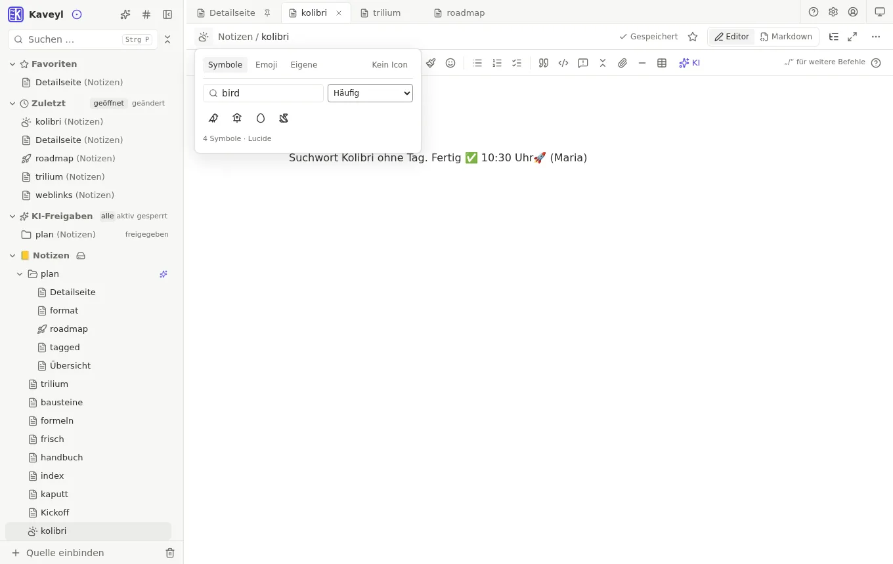

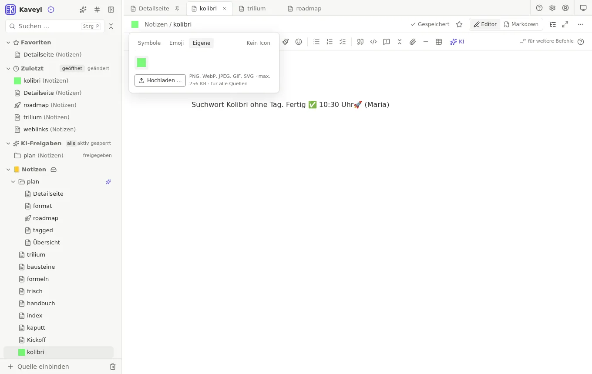
- **Schreibschutz:** „…“ → „Schreibschutz setzen“ schreibt `readonly: true` in die Notiz – sie
  öffnet dann für alle im Lesemodus („Nur lesen“ entsperrt sie vorübergehend). Aufheben über
  denselben Menüpunkt.
- **Geteilte Ansicht:** Rechtsklick auf eine Notiz im Baum oder einen Suchtreffer → „Rechts daneben
  öffnen“ oder „Links daneben öffnen“ (im Tab-Menü heißt es „Rechts/Links daneben anzeigen“). Die gewählte Notiz kommt neben die
  aktuelle. Ist sie selbst die aktuelle (gerade per Klick geöffnet), kommt die zuvor geöffnete
  Notiz auf die andere Seite. Beide Hälften sind vollwertige Editoren; ein Klick auf den Tab der
  rechten Notiz tauscht die Seiten, × in ihrer Kopfzeile schließt die Teilung.

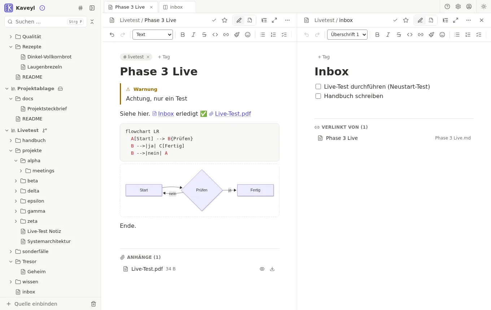

- **Auf- und Zuklappen:** Favoriten, „Zuletzt“, „KI-Freigaben“ und jede Quelle klappst du per Klick auf ihre
  Überschrift ein und aus. Neben der Suche ein Symbol, das je nach Zustand umschaltet: **Alles zuklappen**,
  solange irgendein Ordner offen ist, sonst **Alles aufklappen** (alle Rubriken, alle Ordner aller Quellen). Beim Überfahren einer Quelle erscheint **Alle Ordner
  aufklappen / zuklappen**, beim Überfahren jedes Ordners – in jeder Quelle, auf jeder Ebene – **Alles darunter
  aufklappen / zuklappen** (ein Symbol, das je nach Zustand umschaltet; hat der Ordner keine
  Unterordner, klappt es nur ihn selbst auf oder zu) und, wo du schreiben darfst, **+** für eine
  neue Notiz oder einen neuen Ordner. **Alt+Klick** auf den
  Pfeil eines Ordners klappt ihn ebenfalls mit allem darunter auf oder zu. Auf Touch-Geräten
  (ohne Maus) stehen die Symbole an der Quelle immer und am gerade gewählten Ordner.
- **Zeichen am rechten Rand** einer Zeile bleiben immer an derselben Stelle: ✦ (eigene
  [KI-Freigabe](#ki-freigaben), nur für Admins sichtbar), das Schloss (verschlüsselter Ordner) und
  an einer Quelle der Sync-Spinner bzw. das Warndreieck bei Sync-Fehler oder Konflikt (Tooltip mit
  der Meldung). Die Knöpfe beim Überfahren erscheinen links davon – nichts verrutscht.
- **Breite der Seitenleiste:** am rechten Rand der Seitenleiste ziehen – mit der Maus oder dem Finger. Mit der Tastatur: den Rand mit Tab anwählen, dann Pfeil links/rechts.

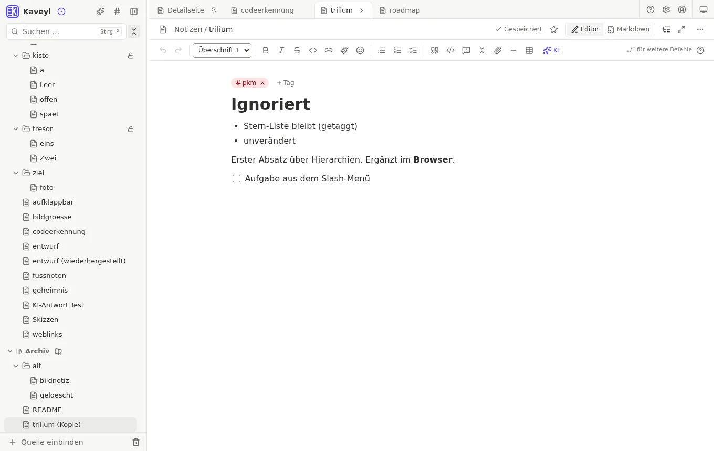

- **Fokus (Hoisting):** Rechtsklick auf einen Ordner → „Nur diesen Ordner zeigen (Fokus)“. Die
  Seitenleiste zeigt dann nur noch diesen Ordner; „Fokus: …“ oben mit × hebt ihn auf.
- **Namen:** Baum, Tabs, Kopfzeile, Suche, Favoriten und Listen zeigen überall den **Dateinamen**
  ohne `.md` (eine Ordnernotiz `index.md` unter dem Namen ihres Ordners). Ein `title:` im
  Frontmatter oder die erste Überschrift ändern die Anzeige nicht – die Suche findet Notizen
  aber weiterhin auch über ihren Titel.
- **Tags:** stehen über dem Text. „+ Tag“ fügt einen hinzu (Tippen schlägt passende vorhandene
  Tags vor, der Pfeil im Feld oder ↓ zeigt alle; antippen oder Enter übernimmt), × entfernt ihn, ein Klick zeigt alle Notizen mit diesem Tag. Gespeichert
  wird im Frontmatter `tags:` im Stil der Datei – Wiki.js-Schreibweise `tags: a, b` bleibt so,
  eine YAML-Liste bleibt eine Liste. Alle Tags mit Anzahl: **#** oben in der Seitenleiste.

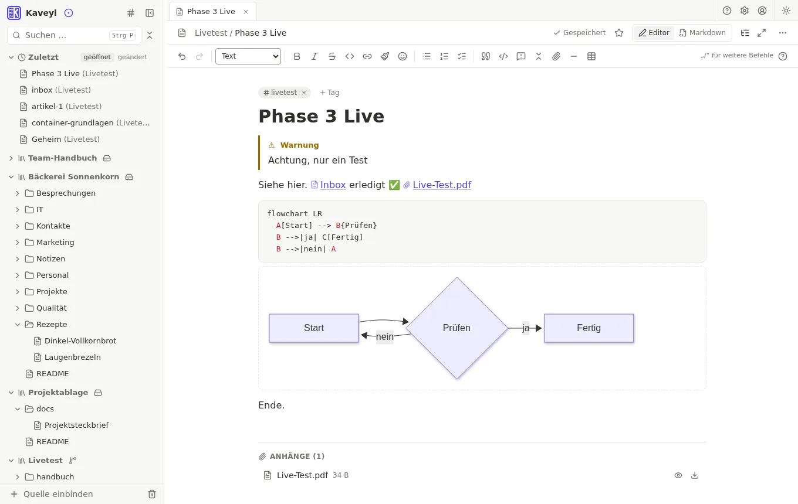

- **Farbige Tags:** Rechtsklick auf ein Tag (über der Notiz oder im Fenster **#**; auf dem Handy lange
  drücken) → **Farbe** → eine von zwölf Farben oder **Keine Farbe** (grau). Die Farbe gilt für das Tag in
  der ganzen Quelle und erscheint über den Notizen, im Fenster **#** und in der Suche. Gespeichert wird sie
  in der Datei `.kaveyl-wiki.yml` oben in der Quelle (`tagColors:`) – sie reist also mit dem Repository mit,
  und andere Kaveyl-Wiki-Installationen sehen dieselben Farben. Kommt ein Tag in mehreren Quellen vor, färbt
  Kaveyl Wiki es in allen, in die du schreiben darfst; in den übrigen bleibt es, wie es ist. Das Fenster **#**
  zeigt dann die häufigste Farbe. Färben darf, wer in der Quelle schreiben darf.
- **Tag umbenennen oder zusammenführen:** Rechtsklick auf ein Tag → **Umbenennen / zusammenführen …**,
  neuen Namen eingeben. Kaveyl Wiki ändert das Tag in jeder Notiz, die du bearbeiten darfst (in allen
  Quellen; jede Datei behält ihre Schreibweise). Gibt es den neuen Namen schon, fragt Kaveyl Wiki nach und
  führt beide zusammen – eine Notiz mit beiden Tags behält es einmal. Die Farbe geht mit, wenn das Ziel
  noch keine hat. Notizen ohne Schreibrecht bleiben unverändert; die Meldung sagt, wie viele.

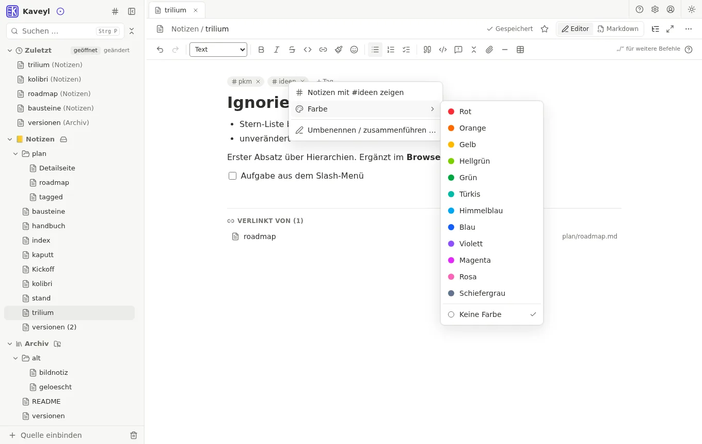

- **Links auf Notizen** tragen ein kleines Notiz-Symbol, Links auf Anhänge eine Büroklammer.
  Mit der Maus kurz über einem Notiz-Link verweilen zeigt eine **Vorschau** (Name, Pfad,
  Textanfang).

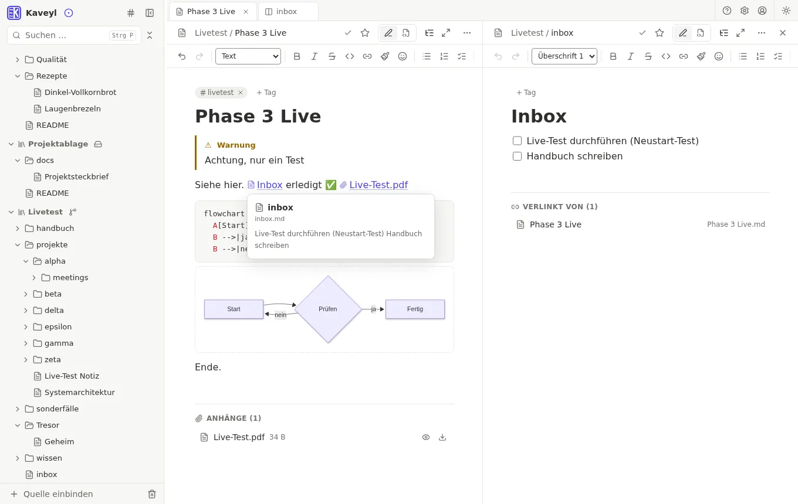

- **Inhaltsverzeichnis** rechts: Klick springt zur Überschrift; die aktuelle ist markiert.

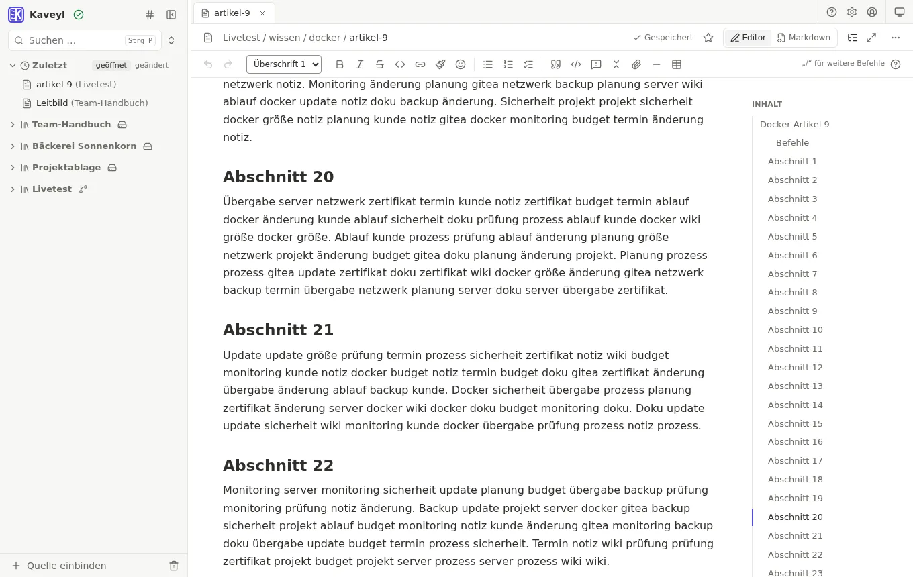

- **Markdown-Ansicht:** zeigt und bearbeitet den Quelltext direkt.

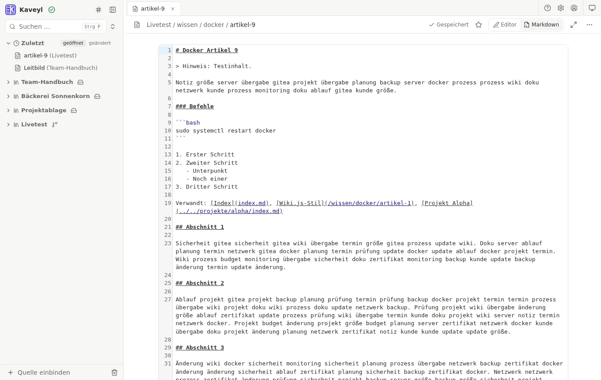

- Auf dem **Handy** ist die Oberfläche nutzbar (Seitenleiste ein-/ausklappbar); für längeres
  Schreiben ist der Desktop angenehmer.

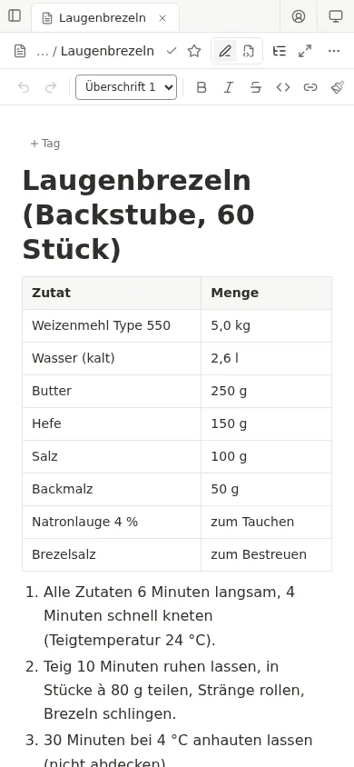

## Bearbeiten

Einfach in den Text klicken und schreiben – der Editor zeigt die Formatierung direkt (WYSIWYG).
Das **?** am rechten Ende der Formatierungsleiste öffnet diese Hilfe; wer lieber direkt Markdown
tippt, findet alle Schreibweisen im [Markdown-Spickzettel](#markdown-spickzettel).

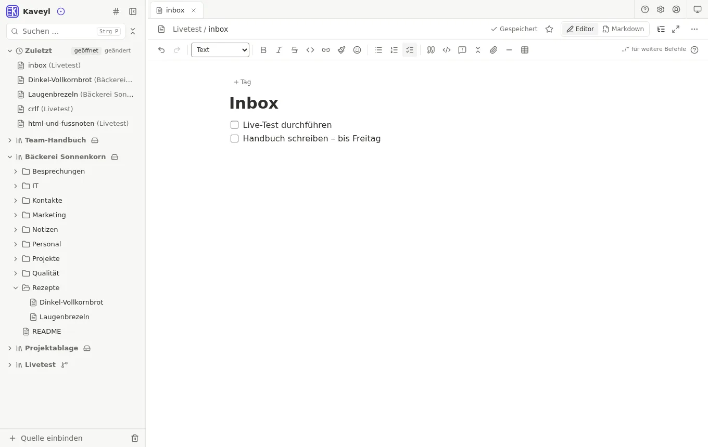

- **Formatierungsleiste** oben: Absatzformat (Überschriften), fett, kursiv, durchgestrichen,
  Code, Link, Listen, Checkliste, Zitat, Codeblock, Hinweis-Box, aufklappbarer Block,
  Trennlinie, Tabelle. Steht der Cursor in einer Tabelle, kommen Knöpfe für Zeilen/Spalten
  (oben/unten, links/rechts einfügen, löschen) dazu; im Codeblock eine Auswahl der Sprache
  (für die Farbhervorhebung, u. a. YAML, Bash, PowerShell, Dockerfile, nginx, TOML). Ist keine
  Sprache gesetzt, erkennt Kaveyl Wiki sie selbst und zeigt „Automatisch: yaml“; **„übernehmen“**
  schreibt sie in die Datei (` ```yaml `), damit auch Gitea und VS Code färben; in einer Hinweis-Box die Art (Hinweis, Tipp, Wichtig,
  Warnung, Vorsicht).
- **Hinweis-Boxen** werden als `> [!NOTE]`, `> [!WARNING]` … gespeichert – dieselbe
  Schreibweise, die auch Gitea und GitHub farbig darstellen.
- **Aufklappbare Blöcke** werden als `<details><summary>…</summary> … </details>`
  gespeichert. Auf- und Zuklappen mit dem Pfeil links ändert die Datei nicht. Tippen: Überschrift,
  **Enter** → in den Inhalt (ein zugeklappter Block klappt dabei auf); im Inhalt macht **Enter** eine
  neue Zeile im Block, **Enter auf einer leeren letzten Zeile** verlässt den Block; **Umschalt+Enter**
  bricht die Zeile im selben Absatz um. Leere Zeilen speichert Markdown nicht – sie verschwinden beim
  Speichern (das gilt überall, nicht nur hier).
- **Zeilenumbrüche:** **Enter** beginnt einen neuen Absatz, **Umschalt+Enter** bricht die Zeile im
  selben Absatz um. In einer **Tabellenzelle** speichert Kaveyl Wiki beides als `<br>` – eine Zelle ist in der Datei
  eine Zeile – und zeigt es beim nächsten Öffnen als Zeilenumbruch. Ist eine Datei im Quelltext von Hand umbrochen (eine neue Zeile ohne Leerzeile
  dazwischen), zeigt Kaveyl Wiki sie als **einen durchgehenden Absatz** – genau wie Wiki.js, Gitea, GitHub
  und die Markdown-Norm. Die Umbrüche in der Datei bleiben dabei erhalten; in der Ansicht **Markdown**
  siehst du sie.
- **Codeblöcke** werden farbig hervorgehoben, sobald eine Sprache gewählt ist (` ```python `).
- **Auswahlmenü:** Text markieren → kleines Menü für fett, kursiv, durchgestrichen, Code, Link, **Überschrift 1–3**
  (macht den ganzen Absatz zur Überschrift, noch einmal geklickt wieder zu Text; in Listen nicht möglich) und
  **KI** (siehe [KI-Assistent](#ki-assistent)).

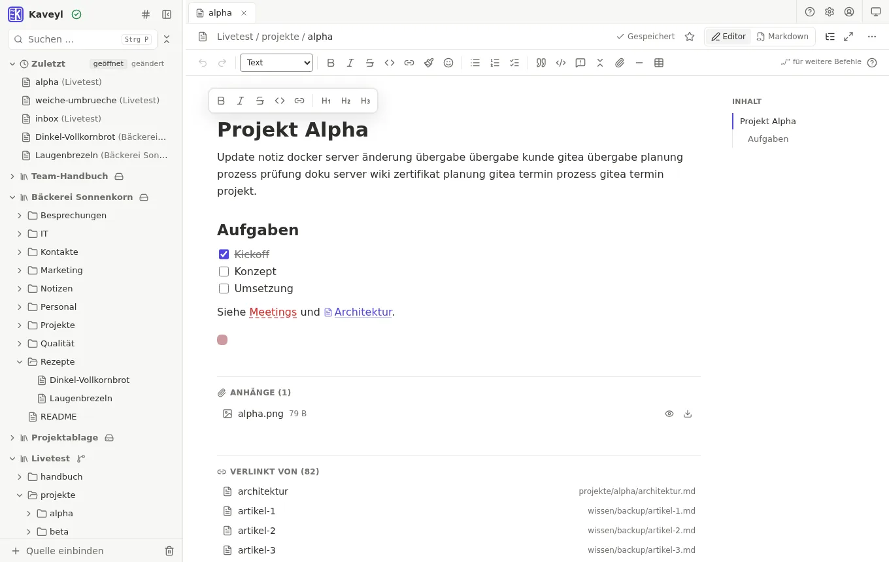

- **Slash-Befehle:** `/` am Zeilenanfang oder nach einem Leerzeichen öffnet ein Menü (Überschrift, Liste, Checkliste,
  Code, Tabelle, Zitat, Hinweis-Boxen, aufklappbarer Block, Notiz verlinken, Datei oder Bild,
  Diagramm (Mermaid), Trennlinie, Link). Weitertippen filtert – auch mit mehreren Wörtern, deutsch oder englisch
  (`/überschrift 2`, `/heading 2`, `/h2`) –, Enter oder Tab fügt ein, Esc schließt.

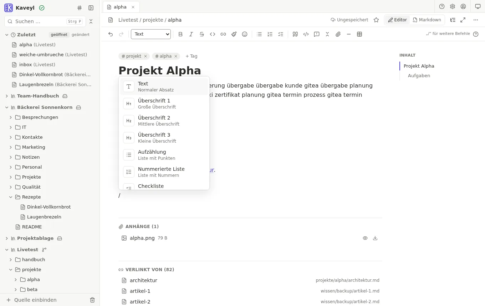

- **Dateien und Bilder anhängen:** Büroklammer in der Leiste, Datei ins Editorfenster ziehen
  oder aus der Zwischenablage einfügen (z. B. einen Screenshot). Die Datei landet im Ordner
  `assets/` neben der Notiz und wird als Bild bzw. Link eingefügt – so funktioniert sie auch in
  Gitea und VS Code. Unter der Notiz erscheint die Liste **Anhänge** mit Größe, Vorschau (Bilder,
  PDF) und Herunterladen. Ein Klick auf einen Datei-Link öffnet die Vorschau bzw. lädt herunter.
  Gleichnamige Dateien werden durchnummeriert (`Angebot-2.pdf`), nie überschrieben. Ausführbare
  Dateien (.exe, .bat, .ps1 …) sind ab Werk gesperrt; welche Endungen gesperrt sind und die Höchstgröße (Standard
  20 MB) stellt ein Admin unter Einstellungen → Anhänge ein.

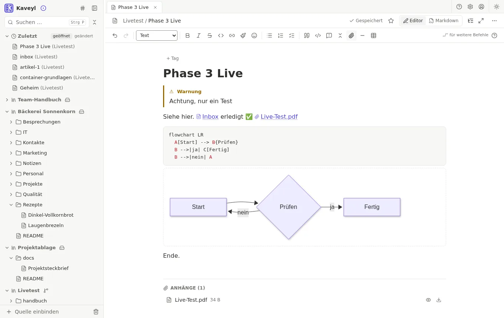

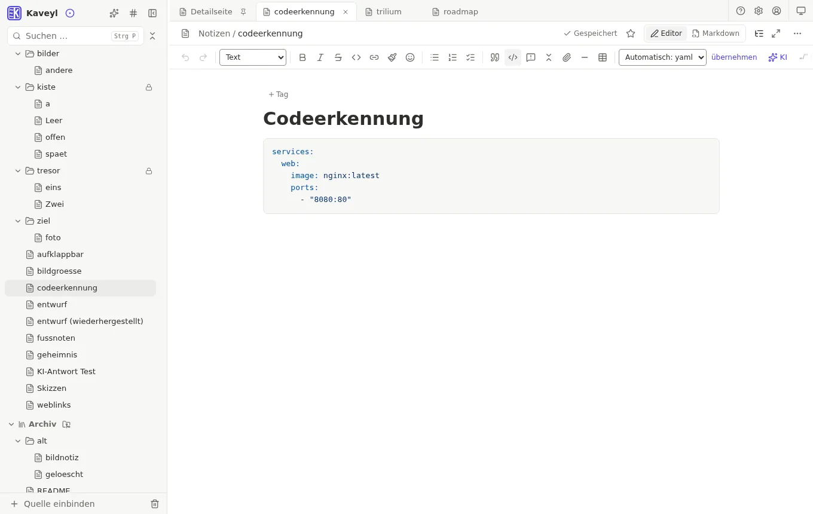

- **Bilder ausrichten und skalieren:** Klick auf ein Bild öffnet eine kleine Leiste:
  **links / zentriert / rechts**, **25 / 50 / 75 %** (bezogen auf die Originalgröße des Bildes,
  gespeichert in Pixeln), **Original** und **Spaltenbreite** (so breit wie der Text). Am
  ausgewählten Bild (oder beim Darüberfahren) erscheint unten rechts ein **Ziehgriff**, mit dem du
  die Breite frei in Pixeln einstellst. Gespeichert wird so, dass Gitea, GitHub und VS Code es
  genauso anzeigen: eine Größe als `` (Spaltenbreite:
  `width="100%"`), die
  Ausrichtung als `<div align="center">` um den Absatz. „Original“ und „links“ machen daraus wieder
  ein normales ``. Ausrichten geht für Bilder auf oberster Ebene und in aufklappbaren
  Blöcken (nicht in Listen oder Tabellen).

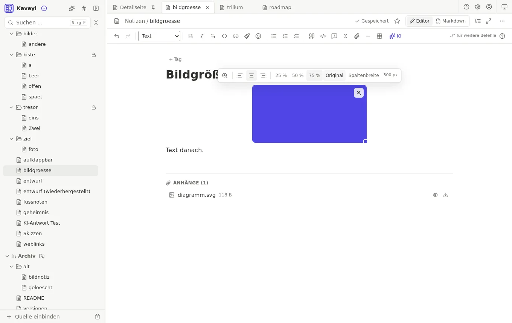

- **Große Bilder:** Ein Bild ohne eigene Breite nimmt höchstens etwa **zwei Drittel der Fensterhöhe**
  ein – ein Handyfoto füllt also nicht mehr den ganzen Bildschirm, und die Notiz bleibt lesbar. Die
  **Lupe** oben rechts am Bild (beim Darüberfahren, am ausgewählten Bild und auf Touch-Geräten immer
  sichtbar) oder **„Groß anzeigen“** in der kleinen Bildleiste zeigt es so groß, wie das Fenster
  erlaubt; in der Leseansicht genügt ein Klick aufs Bild. Schließen mit Klick, **Esc** oder ×. Bilder
  werden erst geladen, wenn sie ins Bild scrollen – lange Notizen mit vielen Bildern öffnen und
  scrollen dadurch flüssig.
- **Beim Einfügen verkleinert:** Fotos und Bildschirmfotos, die größer als **2400 Pixel** (längste
  Kante) oder schwerer als 2 MB sind, verkleinert Kaveyl Wiki schon im Browser und speichert sie als
  **WebP** – meist ein Zehntel der Dateigröße bei gleicher Schärfe auf dem Bildschirm. Eine kurze
  Meldung nennt alte und neue Größe. GPS- und Kameradaten fallen dabei weg; GIF und SVG bleiben, wie
  sie sind. Ein Admin stellt die Grenze unter [Einstellungen → Anhänge](#anhänge) ein (1600 bis 4000
  Pixel oder „Originale behalten“). Bilder, die schon im Repository liegen, bleiben unverändert.


- **Notiz verlinken:** `[[` tippen und ein paar Buchstaben des Titels – Kaveyl Wiki schlägt
  passende Notizen derselben Quelle vor; Enter fügt einen normalen relativen Link ein
  (`[Roadmap](plan/roadmap.md)`), der auch in Gitea und VS Code funktioniert.
- **Link auf eine Adresse:** `/link` oder der Link-Knopf öffnet ein Kaveyl-Wiki-Fenster mit **Link-Ziel**
  (Web-Adresse oder relativer Pfad) und **Linktext**; Enter übernimmt, Esc bricht ab. Am bestehenden Link
  öffnet der Knopf dasselbe Fenster zum Ändern – Ziel leeren entfernt den Link.

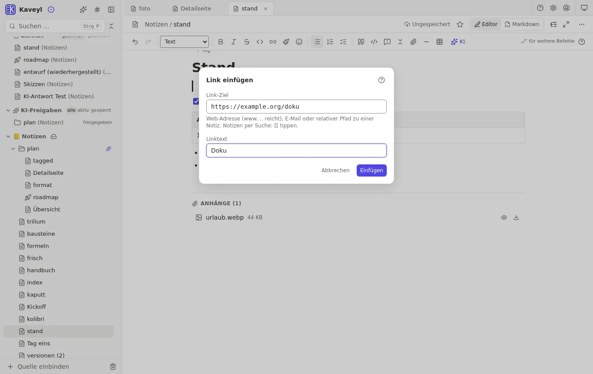

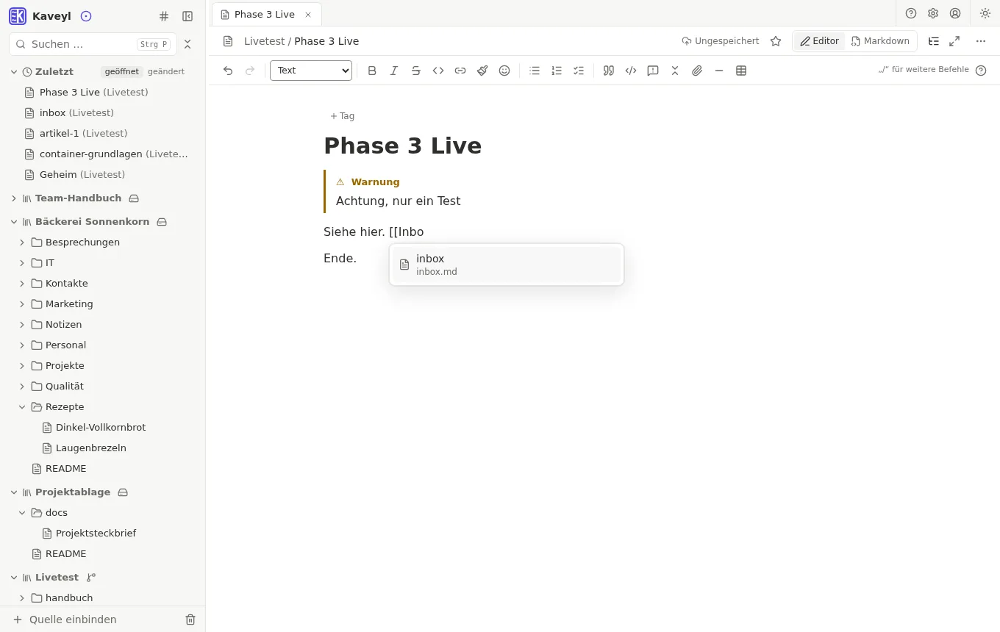

- **Formeln:** `$E = mc^2$` im Satz oder `$$ … $$` in eigener Zeile (LaTeX) werden mit KaTeX
  gesetzt – genauso, wie GitHub sie darstellt. Slash-Befehle „Formel …“ fügen eine ein (Eingabe im
  Kaveyl-Wiki-Fenster), Doppelklick bearbeitet sie. Geldbeträge wie „$5 und $10“ bleiben normaler Text.
- **Diagramme:** ein Codeblock mit der Sprache `mermaid` (Slash-Befehl „Diagramm (Mermaid)“)
  zeigt darunter das gezeichnete Diagramm; der Text bleibt bearbeitbar. Das optionale Layout `elk` ist aus
  Lizenzgründen nicht enthalten – Diagramme werden mit dem Standard-Layout gezeichnet.
  Neben Flussdiagrammen zeichnet Kaveyl Wiki auch die anderen Arten von Mermaid, etwa eine Zeitleiste (`timeline`)
  für eine Roadmap, eine Mindmap (`mindmap`), ein Tortendiagramm (`pie`), einen Projektplan (`gantt`) oder einen
  Git-Verlauf (`gitGraph`) – in den Farben von Kaveyl Wiki, hell wie dunkel. Eine Roadmap etwa:

  ````
  ```mermaid
  timeline
    title Roadmap
    section 2026
      Q4 : Gruppenbuchungen
    section 2027
      Q1 : Mobiler Check-in : Offline-Tickets
      Q2 : Partner-API v2
  ```
  ````

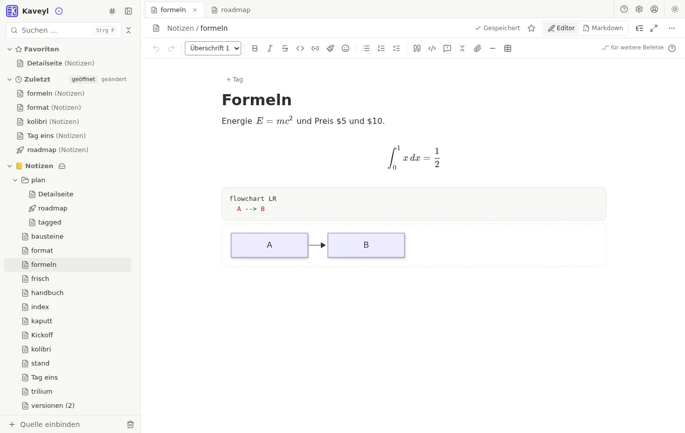

- **Zeichnungen (Excalidraw):** Slash-Befehl „Zeichnung (Excalidraw)“ (`/zeichnung`) öffnet eine
  Zeichenfläche – Formen, Pfeile, Text, Freihand. **Speichern** legt die Zeichnung als
  `assets/zeichnung.excalidraw.svg` neben der Notiz ab und fügt sie als Bild ein (jede weitere bekommt
  eine Nummer: `zeichnung-2.excalidraw.svg` – jede lässt sich gleich bearbeiten). Weil die Datei
  ein normales SVG ist, sieht man sie überall (Gitea, VS Code, Wiki.js); die Zeichnung selbst
  steckt mit in der Datei. Bearbeiten: **Doppelklick** auf das Bild oder Bild anklicken →
  „Zeichnung bearbeiten“ – gespeichert wird in dieselbe Datei, die alte Fassung bleibt in der
  Git-Historie. Auch auf excalidraw.com lässt sich die Datei öffnen („Öffnen“ → SVG mit Szene).
  In verschlüsselten Notizen gibt es keine Zeichnungen (die Datei läge unverschlüsselt daneben).

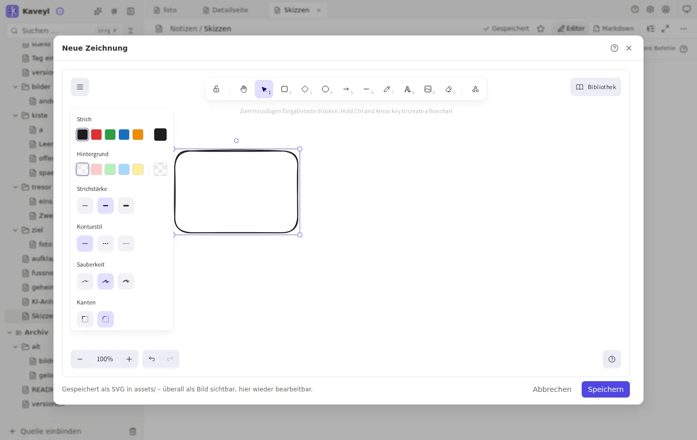

- **Emoji:** `:` und zwei Buchstaben tippen (`:haken` → ✅, `:warn` → ⚠️, `:rakete` → 🚀) oder
  das Smiley in der Leiste. Gespeichert wird das Zeichen selbst, kein `:code:`.
- **Format übertragen** (Pinsel in der Leiste): Cursor in formatierten Text setzen (z. B. fett),
  Pinsel klicken, dann den Zieltext mit der Maus markieren (oder mit Umschalt+Pfeiltasten) –
  er bekommt genau diese Formatierung. Esc bricht ab.
- **Wer ist noch da?** Haben andere Benutzer dieselbe Notiz offen, steht oben „Maria hat die
  Notiz offen“ – tippt jemand gerade, „Maria bearbeitet gerade“ (orange). Gleichzeitiges
  Bearbeiten ist möglich, aber wer zuletzt speichert, bekommt den Hinweis „außerhalb geändert“
  und entscheidet (siehe Konflikte) – also besser absprechen.

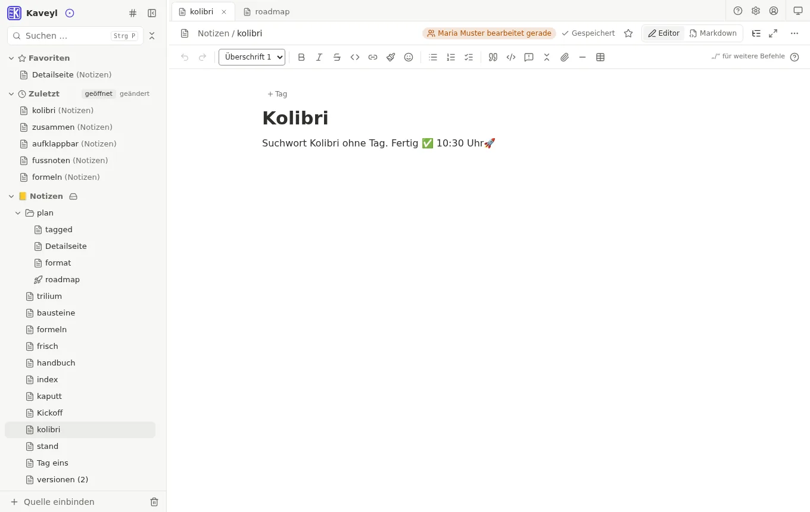

- **Fängst du an zu tippen, während jemand anderes die Notiz gerade bearbeitet,** fragt Kaveyl Wiki
  einmal nach: „Maria bearbeitet diese Notiz gerade …“ – mit der Folge: Wer später speichert, bekommt
  einen Hinweis; Änderungen an verschiedenen Stellen lassen sich zusammenführen, an derselben Stelle
  muss eine Fassung gewählt werden. **Trotzdem bearbeiten** behält deine Eingabe und fragt nicht noch
  einmal, solange die andere Person weiter bearbeitet (Pausen unter einer Minute zählen nicht).
  **Abbrechen** verwirft den eben getippten Text, die Notiz zeigt wieder den gespeicherten Stand.
  Gesperrt wird nichts – die Frage ist nur ein Hinweis. Änderungen über die API, MCP oder von außen
  (Git, andere Programme) lösen sie nicht aus.
- **Speichert jemand anderes, während du die Notiz offen hast,** siehst du die Änderung sofort – dein
  Cursor und die Stelle, an der du liest, bleiben, wo sie waren. Hast du selbst gerade Ungespeichertes,
  kommt stattdessen der Hinweis (siehe [Konflikte auflösen](#konflikte-auflösen)). Verschiebt oder
  benennt jemand die offene Notiz um, folgt dein Tab ihr, und was du tippst, landet an der neuen Stelle.

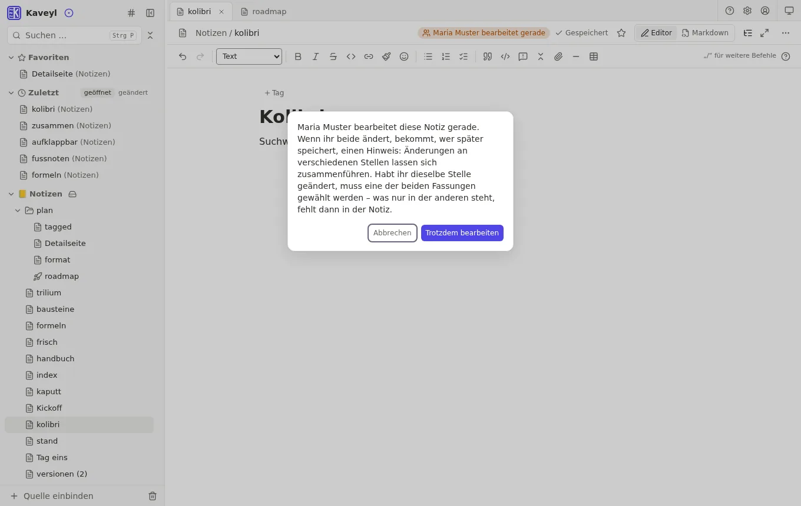

- **Gespeichert** wird automatisch, kurz nachdem du aufhörst zu tippen (oben rechts:
  „Gespeichert“).
- Was der Editor nicht darstellen kann (z. B. HTML, Fußnoten), erscheint als grau umrandeter
  Block und bleibt unverändert erhalten.
- Notizen mit `readonly: true` im Frontmatter öffnen im Lesemodus („Nur lesen“ zum Entsperren).

### Markdown-Spickzettel

Im Editor brauchst du kein Markdown – Leiste, `/`-Befehle und Tastenkürzel reichen. Gespeichert wird
aber Markdown, damit die Datei überall lesbar bleibt. In der **Markdown-Ansicht** (oben rechts
„Markdown“) siehst und bearbeitest du genau diesen Text; die Tabelle zeigt beide Wege.

| Was | Schreibweise in der Datei | Im Editor |
|---|---|---|
| Überschriften | `# Titel`, `## Abschnitt`, `### Unterabschnitt` | Absatzformat in der Leiste, `/überschrift` |
| Fett, kursiv, durchgestrichen | `**fett**`, `*kursiv*`, `~~weg~~` | Strg+B, Strg+I, Leiste |
| Code im Text | `` `code` `` | Strg+E |
| Link | `[Text](https://beispiel.de)` | Leiste „Link“ oder Text markieren → Link im Auswahlmenü |
| Link auf eine Notiz | `[Roadmap](plan/roadmap.md)` (relativ) oder Wiki.js-Stil `/plan/roadmap` | `[[` + Name |
| Bild | ``, mit Breite `` | einfügen, ziehen, Büroklammer |
| Aufzählung | `- Punkt` oder `* Punkt` | Leiste, `/aufzählung` |
| Nummerierte Liste | `1. Punkt` | Leiste, `/nummeriert` |
| Checkliste | `- [ ] offen`, `- [x] erledigt` | Leiste „Checkliste“, `/checkliste` |
| Zitat | `> Text` | Leiste, `/zitat` |
| Codeblock | drei Backticks mit Sprache (` ```python `), Code, drei Backticks | Leiste „Codeblock“, `/code`; Sprache wählen, wenn der Cursor im Block steht |
| Tabelle | Zellen durch senkrechte Striche getrennt, unter der Kopfzeile eine Zeile aus `---` | Leiste „Tabelle einfügen“, `/tabelle` |
| Hinweis-Box | `> [!NOTE]`, `> [!TIP]`, `> [!IMPORTANT]`, `> [!WARNING]`, `> [!CAUTION]` | Leiste „Hinweis-Box“ |
| Aufklappbarer Block | `<details><summary>Titel</summary> … </details>` | Leiste, `/aufklapp` |
| Trennlinie | `---` in einer eigenen Zeile | Leiste, `/trennlinie` |
| Formel | `$E = mc^2$` im Satz, `$$ … $$` als eigene Zeile | `/formel` |
| Diagramm | Codeblock mit Sprache `mermaid` | `/diagramm` |
| Zeichnung | Bild `assets/name.excalidraw.svg` | `/zeichnung` |
| Emoji | das Zeichen selbst (✅) | `:` + Wort (`:haken`) |
| Metadaten | Frontmatter ganz oben zwischen `---`: `title:`, `tags:`, `icon:`, `id:`, `readonly: true`, `ai: false` | Tags über dem Text, Icon in der Kopfzeile |

Was der Editor nicht darstellen kann (eigenes HTML, Fußnoten …), bleibt als grau umrandeter Block
unverändert erhalten. Leere Zeilen speichert Markdown nicht – sie verschwinden beim Speichern.

### Vorlagen

Beim Anlegen einer Notiz lässt sich eine **Vorlage** wählen. Vorlagen sind normale Markdown-
Dateien im Ordner `.kaveyl-wiki/templates/` der jeweiligen Quelle (versioniert, auch in VS Code
bearbeitbar; sie erscheinen nicht im Baum). In der Auswahl stehen sie unter ihrem **Dateinamen**. Eine bestehende Notiz wird über „…“ → „Als Vorlage
speichern“ zur Vorlage. Platzhalter, die beim Anlegen ersetzt werden:

| Platzhalter | Beispiel |
|---|---|
| `{{title}}` | Titel aus dem Anlegen-Dialog |
| `{{date}}` / `{{time}}` / `{{datetime}}` | 2026-10-06 / 14:30 / 2026-10-06 14:30 |
| `{{year}}` `{{month}}` `{{day}}` `{{weekday}}` | 2026, 10, 06, Dienstag |
| `{{user}}` | dein Anzeigename |

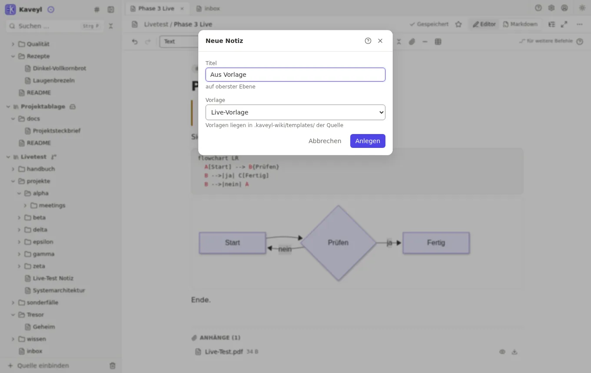

## So funktioniert der Abgleich

Kaveyl Wiki ist kein Speicher für sich, sondern **ein Teilnehmer unter mehreren**. Die gemeinsame Mitte ist immer der
Git-Server – Gitea, GitHub, GitLab oder ein anderer. Jeder, der an einem Repository arbeitet, hat davon eine eigene
Kopie: VS Code auf deinem PC, ein code-server, Obsidian auf dem Laptop – und Kaveyl Wiki selbst auch. Abgeglichen wird
immer über die Mitte: Wer etwas ändert, schickt es dorthin (Push), und die anderen holen es von dort ab (Pull).
Direkt miteinander reden die Kopien nie.

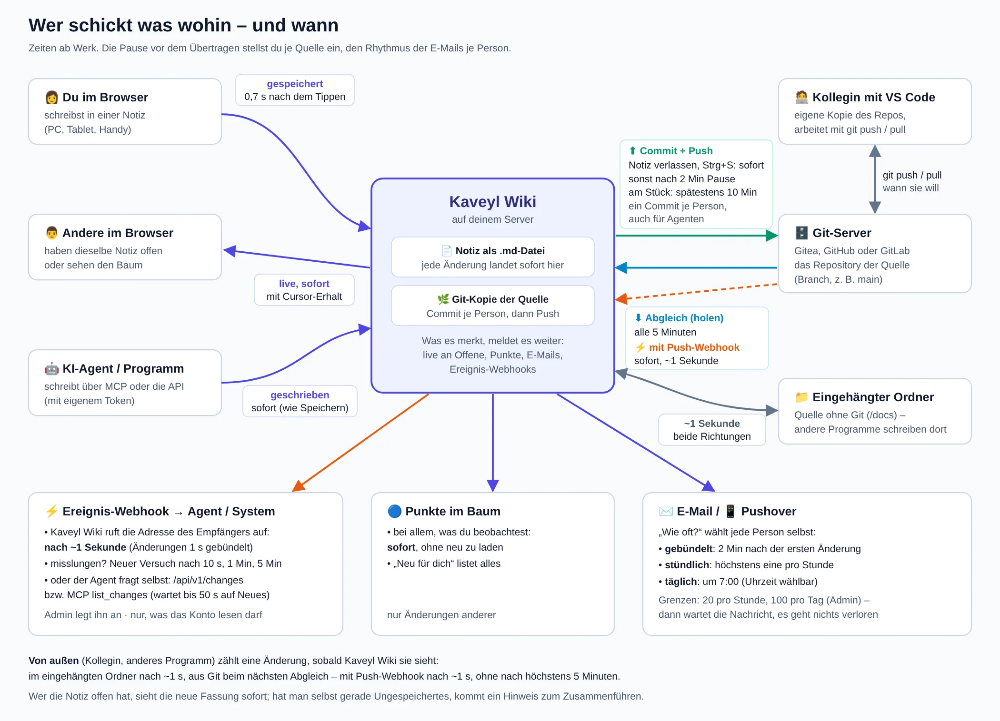

**Was Kaveyl Wiki schickt.** Was du in Kaveyl Wiki schreibst, steht nach weniger als einer Sekunde in der Datei. Zum Server geht
es gebündelt: sobald du die Notiz verlässt, mit Strg+S, nach einer Pause beim Schreiben (Standard 2 Minuten, je Quelle
einstellbar unter „Wann deine Änderungen nach Git schreiben?“) und wer am Stück schreibt, spätestens alle 10 Minuten. Dabei entsteht ein Commit mit
dir als Autor, und Kaveyl Wiki überträgt ihn sofort.

**Was Kaveyl Wiki holt.** Änderungen anderer holt Kaveyl Wiki alle 5 Minuten vom Server. Mit einem
[Webhook](#verbindungen) meldet der Server jede Änderung sofort, dann ist sie nach wenigen Sekunden da. In der
[Sync-Übersicht](#speichern-übertragen-und-synchronisieren) geht es jederzeit auch von Hand mit „Jetzt synchronisieren“.
Ist eine Notiz gerade offen und unverändert, lädt sie die neue Fassung von selbst.

**Zwei Arten Webhook.** Der **Push-Webhook** geht vom Git-Server zu Kaveyl Wiki: Er meldet jeden Push, damit Kaveyl Wiki
nicht bis zum nächsten Abgleich wartet (einrichten unter [Verbindungen](#verbindungen)). Der
**[Ereignis-Webhook](#ereignis-webhooks)** geht von Kaveyl Wiki zu einem anderen System, etwa einem Agenten: Er meldet jede
Änderung an Notizen, egal ob sie in der App, über die API, MCP oder von außen kam. Wer welche Änderungen per Punkt, E-Mail
oder Pushover erfährt, steht unter [Beobachten](#beobachten). Das Beispiel zeigt alles zusammen mit Uhrzeiten:

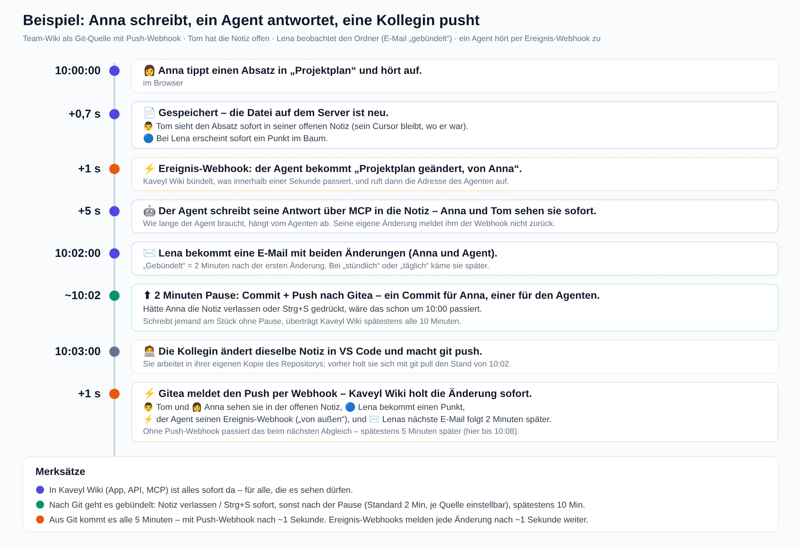

**Ein Branch je Quelle.** Kaveyl Wiki arbeitet nur auf dem Branch, den du beim Einbinden gewählt hast (meist `main`). Was
auf anderen Branches passiert, sieht Kaveyl Wiki nicht. Wer denselben Repository-Stand in Kaveyl Wiki sehen will, arbeitet auf
diesem Branch oder führt seine Arbeit dort zusammen.

### Typische Aufstellungen

**Nur Kaveyl Wiki, auf mehreren Geräten.** PC, Tablet und Handy öffnen im Browser dieselbe Kaveyl-Wiki-Instanz. Sie arbeiten
alle auf derselben Kopie, zwischen den Geräten gibt es also nichts abzugleichen – eine Änderung auf dem Handy ist
auf dem PC sofort da. Bearbeiten zwei Geräte gleichzeitig dieselbe Notiz, merkt Kaveyl Wiki das beim Speichern und zeigt den
Hinweis „Die Notiz wurde außerhalb geändert“ mit „Zusammenführen“, „Fremde Version laden“ oder „Meine Version speichern“.

**Kaveyl Wiki und ein PC mit VS Code.** Auf dem PC liegt ein eigener Klon des Repositorys. VS Code gleicht ihn nicht von
selbst ab: Hol vor dem Bearbeiten den neuesten Stand (in VS Code „Synchronisieren“ bzw. `git pull`) und schick ihn danach
wieder hoch (Commit und „Synchronisieren“ bzw. `git push`). Erst dann sieht Kaveyl Wiki deine Änderung – nach spätestens
5 Minuten, mit Webhook sofort. Umgekehrt kommt, was in Kaveyl Wiki geschrieben wurde, beim nächsten Pull auf den PC. Benennst du
in VS Code eine Datei um, erkennt Kaveyl Wiki das und passt Links darauf in einem eigenen Commit `fix(links): …` an.

**Kaveyl Wiki und ein code-server.** Ein code-server ist ein VS Code im Browser, das auf einem Server läuft. Für den Abgleich
gilt dasselbe wie beim PC: Er hat seinen eigenen Klon und braucht Pull und Push. Anders ist es nur, wenn code-server und
Kaveyl Wiki **denselben Ordner** auf dem Server benutzen – dann gilt der nächste Absatz.

**Ein gemeinsamer Ordner ohne Git dazwischen.** Hängt ein Ordner auf dem Server sowohl in Kaveyl Wiki (als „Lokaler Ordner“)
als auch in einem anderen Programm, arbeiten beide auf denselben Dateien. Kaveyl Wiki beobachtet den Ordner: Was ein anderes
Programm dort ändert, steht nach etwa einer Sekunde in Kaveyl Wiki – und umgekehrt sofort in der Datei. Einen Server, ein Pull
oder Push gibt es hier nicht. Hat der Ordner **Versionen** (von Kaveyl Wiki angelegt), wird auch jede Änderung des anderen
Programms nach der Pause eine Version, mit „Kaveyl Wiki“ als Autor; was es unverschlüsselt in einen verschlüsselten
Ordner legt, kommt nicht in die Versionen (Hinweis im Protokoll der Quelle). Wer über eine Freigabe auch den versteckten
Ordner `.git` ändern kann, kann den Verlauf verändern. Git-Einstellungen, mit denen Git Programme starten würde (etwa
Filter oder `include`), erkennt Kaveyl Wiki und arbeitet in diesem Ordner dann nicht mehr mit Git, bis der Eintrag
entfernt ist – trotzdem solche Freigaben nur für Personen, denen du den Server anvertraust. Ist der Ordner dagegen dein eigenes Git-Repository (etwa
ein Projekt aus VS Code), bleiben Commit und Push deine Sache; Kaveyl Wiki committet dort nur seine eigenen Änderungen, wenn
du bei der Quelle „Änderungen automatisch committen“ einschaltest, und pusht nie.

**Kaveyl Wiki und Obsidian.** Obsidian arbeitet auf einem Ordner auf deinem Gerät. Mit dem Git-Plugin von Obsidian wird
daraus ein Klon des Repositorys, der in einem einstellbaren Takt holt und schickt – dann ist Obsidian ein Teilnehmer wie
VS Code. Ohne Plugin bleibt Obsidian ein Editor für lokale Dateien, und den Abgleich machst du von Hand.

**Kaveyl Wiki und Wiki.js (oder eine zweite Kaveyl-Wiki-Instanz).** Auch das sind einfach weitere Teilnehmer am selben Repository.
Wiki.js holt Änderungen in seinem eigenen Takt (standardmäßig alle 5 Minuten), bis eine Änderung aus Kaveyl Wiki dort zu
sehen ist, kann es also etwas dauern.

### Wenn zwei gleichzeitig ändern

Haben Kaveyl Wiki und jemand anderes seit dem letzten Abgleich beide etwas geändert, setzt Kaveyl Wiki die eigenen Änderungen
auf den neuen Stand des Servers auf. Betreffen sie **verschiedene Notizen oder verschiedene Stellen derselben Notiz**,
passt das von selbst zusammen, und niemand merkt etwas. Die Versionsgeschichte bleibt dabei eine gerade Linie, ohne
zusätzliche Merge-Commits.

Haben beide **dieselben oder direkt benachbarte Zeilen** geändert – oder hat einer eine Notiz gelöscht, die der andere
bearbeitet hat –, entsteht ein **Konflikt**. Dann überschreibt Kaveyl Wiki nichts: Deine Fassung bleibt gesichert, das
Übertragen pausiert, und das Sync-Symbol zeigt eine Warnung. Gelöst wird der Konflikt in Kaveyl Wiki, mit allen drei Fassungen
nebeneinander – siehe [Konflikte auflösen](#konflikte-auflösen). Bis dahin kommt nichts aus dieser Quelle beim Server an.

Hat jemand den Branch auf dem Server **umgeschrieben** (Force-Push), übernimmt Kaveyl Wiki den neuen Stand und setzt nur die
eigenen, noch nicht übertragenen Änderungen darauf neu auf. Was auf dem Server entfernt wurde, bleibt entfernt; im Verlauf
der Sync-Übersicht steht dazu eine Warnung. Das gilt auch, wenn dabei ein Konflikt entsteht – siehe
[Konflikte auflösen](#konflikte-auflösen).

### Tipps für einen reibungslosen Abgleich

- **Webhook einrichten** (Einstellungen → Quellen → [Verbindungen](#verbindungen)): Dann sieht Kaveyl Wiki Änderungen von
  außen nach Sekunden statt nach bis zu 5 Minuten.
- **In VS Code** die Einstellung `git.autofetch` einschalten und vor dem Bearbeiten auf „Synchronisieren“ klicken. Wer
  zuerst holt und dann schreibt, bekommt fast nie einen Konflikt.
- **Klein und oft übertragen** statt einen ganzen Tag lang zu sammeln: Je kürzer zwei Fassungen auseinanderlaufen, desto
  seltener treffen sie dieselbe Stelle. Kaveyl Wiki macht das von selbst; in VS Code heißt das: öfter committen und pushen.
- **Auf dem eingebundenen Branch arbeiten** (meist `main`) – Änderungen auf anderen Branches sieht Kaveyl Wiki erst, wenn
  sie dort zusammengeführt sind.
- Die genauen Zeiten und das Sync-Symbol erklärt der nächste Abschnitt.

## Speichern, Übertragen und Synchronisieren

- **Speichern** in die Datei passiert sofort (wenige hundert Millisekunden nach dem Tippen).
- **Abgemeldet, während noch etwas ungespeichert ist** (Abmelden in einem anderen Tab, Sitzung abgelaufen,
  Passwort geändert): Der Tab bleibt offen, mit dem Hinweis **„Du bist abgemeldet“** und der Zahl der noch nicht
  gespeicherten Notizen. **„In neuem Tab anmelden“** öffnet Kaveyl Wiki in einem neuen Tab; danach hier **„Jetzt speichern“**
  – die neue Anmeldung gilt auch für diesen Tab. Erst wenn alles gespeichert ist (oder du **„Änderungen verwerfen und
  abmelden“** bestätigst), erscheint die Anmeldung. Der Inhalt bleibt dabei nur in diesem Tab, nicht auf dem Gerät;
  beim Schließen oder Neuladen warnt der Browser. Auch der eigene **Abmelden**-Knopf fragt vorher nach, wenn noch
  etwas ungespeichert ist.
  Hat sich in der Zwischenzeit ein **anderes Konto** angemeldet (die Anmeldung gilt für alle Tabs dieses Browsers),
  werden die Änderungen **nicht** unter diesem Konto gespeichert: Der Hinweis **„Anderes Konto angemeldet“** nennt
  beide Namen. **„Inhalte kopieren“** legt den Text aller noch nicht gespeicherten Notizen in die Zwischenablage;
  meldest du dich im anderen Tab wieder mit dem ursprünglichen Konto an, speichert **„Erneut prüfen“** bzw. der Editor
  von selbst. **„Änderungen verwerfen“** (mit Rückfrage) öffnet den Arbeitsplatz des neuen Kontos.
- **Server kurz nicht erreichbar**, während noch etwas ungespeichert ist: Der Arbeitsplatz bleibt stehen, oben
  erscheint ein Hinweis mit der Zahl der offenen Notizen. Sobald der Server wieder da ist, speichert der Editor
  von selbst – den Tab bis dahin offen lassen. Ist nichts offen, erscheint wie bisher „Server nicht erreichbar“.
- **Übertragen** (Commit und bei Repositories Push) passiert, sobald du die Notiz **verlässt**
  (anderer Tab, Tab schließen, Browserfenster im Hintergrund), mit **Strg+S**, nach der
  eingestellten **Pause** (Standard 2 Min) – und wer am Stück schreibt, spätestens alle 10 Minuten.
  Eine Bearbeitung ergibt so meist **einen** Commit; du bist der Autor.
- **Sync-Symbol** neben „Kaveyl“: grün = alles synchron, Punkt = gespeicherte Änderungen
  warten auf die Übertragung, Warnung/Fehler = bitte ansehen, durchgestrichene Wolke = **keine Verbindung
  zum Server** (Kaveyl Wiki verbindet sich von selbst neu; die Übersicht zeigt bis dahin den letzten bekannten Stand).
  Lässt sich die Liste der Quellen nicht laden, steht das in der Seitenleiste mit „Erneut versuchen“. Bei **Ordnern** gibt es zwei Fälle:
  ohne Git wird nur gespeichert, es gibt nichts zu synchronisieren – solche Ordner stehen in der
  Übersicht nur in einer Zeile unten (ein Klick auf den Namen zeigt ihren Verlauf), außer es gibt ein
  Problem. Ist der Ordner selbst ein
  Git-Repository (z. B. ein Projekt, an dem du in VS Code arbeitest), committet Kaveyl Wiki dort **nicht**
  selbst – die Übersicht zeigt „Ordner mit eigenem Git-Repository“ und wie viele Dateien geändert
  und noch nicht committet sind; den Commit machst du wie gewohnt in VS Code oder per git. Wer das
  nicht will: Quelle bearbeiten → „Änderungen automatisch committen“. Klick öffnet die Übersicht pro
  Quelle mit „Jetzt synchronisieren“, „Alle synchronisieren“ und dem **Verlauf**.

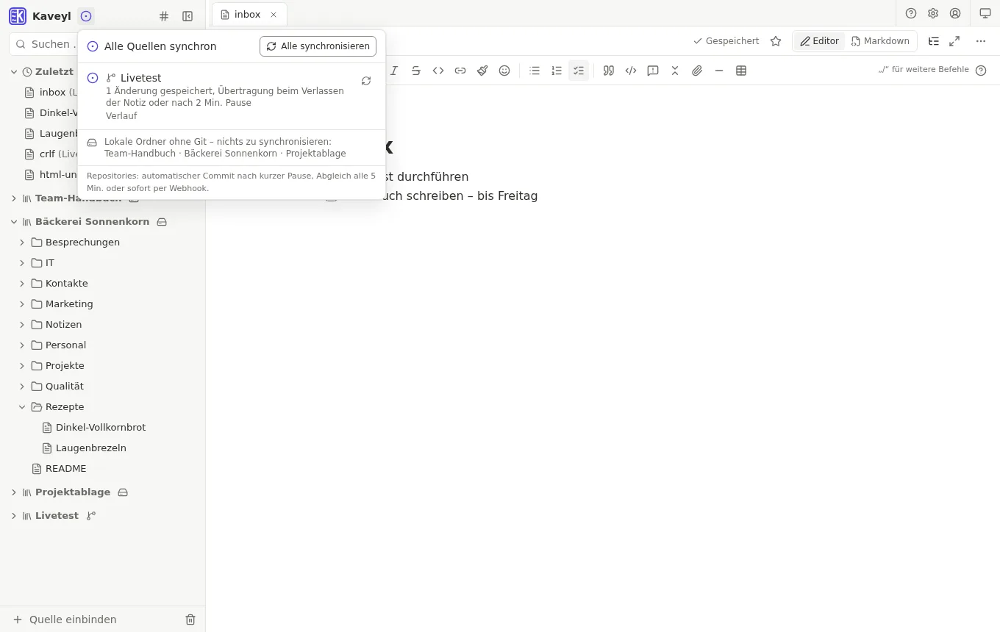

- Änderungen von außen holt Kaveyl Wiki alle 5 Minuten, sofort bei eingerichtetem
  [Webhook](#webhooks), oder mit „Jetzt synchronisieren“. Ist eine Notiz
  offen und unverändert, lädt sie automatisch neu.
- **Wiki.js** holt Änderungen aus Git in seinem eigenen Intervall (standardmäßig 5 Minuten).

## Anlegen, Umbenennen, Verschieben, Löschen

Alles per **Rechtsklick** im Baum (oder im Notiz-Menü „…“):

- **Neue Notiz / Neuer Ordner** – auch über das **„+“**, das beim Überfahren einer Quelle oder
  eines Ordners erscheint (Auswahl „Neue Notiz“ oder „Neuer Ordner“). Der Dateiname wird aus dem
  Titel gebildet (Sonderzeichen wie `:` werden ersetzt).

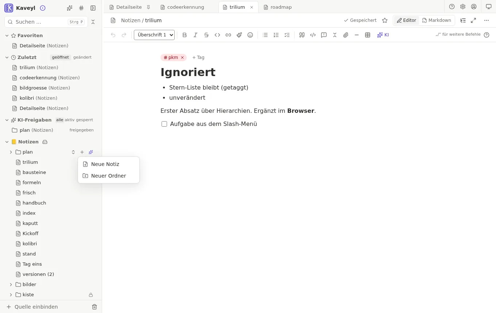
- **Umbenennen / verschieben:** Dateiname eintippen, **Ziel aus der Liste wählen** (alle
  Quellen und Ordner, durchsuchbar). Links auf die Notiz werden automatisch angepasst.

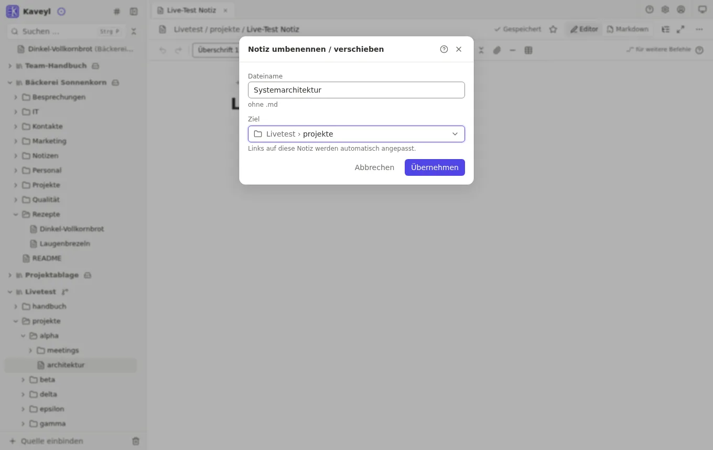

- **In eine andere Quelle verschieben:** gleiches Fenster, Ziel in einer anderen Quelle.
  Die Notiz wird dort angelegt und hier gelöscht; verlinkte Bilder werden mitkopiert
  (Originale bleiben, Dateien ohne Leserecht kommen nicht mit). Die Git-Historie bleibt in der alten Quelle, und Links aus der alten
  Quelle auf diese Notiz kann Kaveyl Wiki nicht über Repository-Grenzen anpassen.

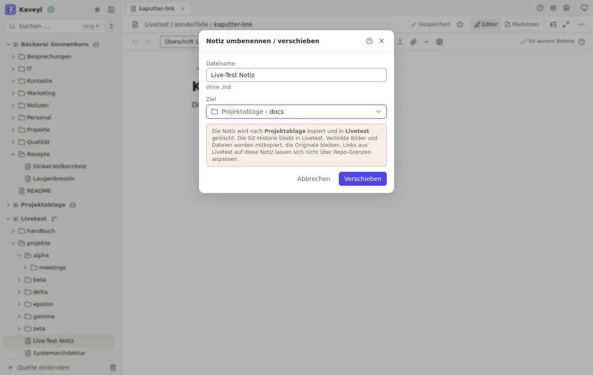

- **Kopieren / Ausschneiden / Einfügen:** Rechtsklick auf eine Notiz oder einen Ordner →
  „Kopieren“ (Strg+C) oder „Ausschneiden“ (Strg+X), dann Rechtsklick auf einen Ordner oder den
  Namen einer Quelle → „Einfügen …“ (Strg+V; auf einer Notiz = daneben). Die Kürzel wirken, wenn
  der Eintrag im Baum gewählt ist. Das geht auch zwischen Quellen.
  - **Kopieren** legt ein Duplikat an; gibt es den Namen am Ziel schon, heißt es „name (Kopie)“,
    „name (Kopie 2)“ … Ein Ordner wird mit seinen Notizen, Bildern, PDFs, Anhängen (`assets/`) und
    Ordner-Einstellungen (`.kaveyl-wiki.yml`) kopiert; andere Dateien darin – Skripte, Konfiguration, versteckte
    Dateien – bleiben zurück (die Meldung nennt ihre Anzahl). Eine Notiz nimmt ihre Bilder und Anhänge aus ihrem Ordner mit. Jede Kopie bekommt eine neue
    `id`; Links in der Kopie werden so angepasst, dass sie dieselben Notizen erreichen (innerhalb
    eines kopierten Ordners: die Kopien). Notizen und Dateien ohne Leserecht werden nicht mitkopiert. In eine
    **andere Quelle** kopiert, können Links auf Notizen, die nur in der alten Quelle liegen, nicht
    mehr stimmen – die [Prüfung](#prüfung) zeigt sie als gebrochene Links.
  - **Ausschneiden + Einfügen** verschiebt – wie Ziehen und Ablegen; der ausgeschnittene Eintrag
    erscheint bis dahin blass.


- **Mehrere auf einmal:** markieren (siehe [Mehrere markieren](#mehrere-markieren)), dann verschieben, löschen,
  exportieren oder teilen.
- **Löschen:** mit Rückfrage; bei Ordnern nennt sie die Zahl der Notizen darin (die Ordnerseite zählt nicht mit). Bei Ordnern werden
  nur Notizen gelöscht, andere Dateien (Code, Bilder) bleiben. Gelöschtes landet im
  [Papierkorb](#versionen-und-papierkorb) der Quelle und lässt sich dort zurückholen – gleich nach
  dem Löschen auch über **Wiederherstellen** in der Meldung „„Name“ ist im Papierkorb“. Die
  Tastatur steht danach auf der nächsten Zeile im Baum.

### Mehrere markieren

Wie im Datei-Explorer: **Strg+Klick** (am Mac Cmd+Klick) markiert eine Notiz oder einen Ordner und noch einen; die
gerade offene Zeile kommt dabei mit. **Umschalt+Klick** markiert alle sichtbaren Zeilen von der zuletzt markierten bis
hierher. Auf Tablet und Handy: langes Drücken → **„Auswählen“** – vor den Zeilen erscheinen Kästchen, jedes Tippen
markiert oder hebt auf. Markiert wird immer in **einer** Quelle; ein Klick in eine andere Quelle fängt neu an.

Über dem Baum steht dann **„… markiert“** mit **Aktionen** und **Fertig**; dieselben Aktionen zeigt der Rechtsklick auf
eine markierte Zeile:

| Aktion | Wirkung |
|---|---|
| Per Mail versenden … | die markierten Notizen als Dateien in einer Mail ([Per Mail versenden](#per-mail-versenden)); nur wenn nur Notizen markiert sind |
| Zugriff per E-Mail geben … | eine Einladung bzw. Hinweis-Mail für alle markierten ([Teilen](#konten-einladungen-und-teilen-per-e-mail)); nur wenn du überall „verwalten“ darfst |
| Verschieben … | alle in einen Ordner, auch in eine andere Quelle; Links werden angepasst. Gibt es einen Namen im Ziel schon, bleibt dieser Eintrag, wo er ist, und die Meldung nennt ihn |
| Exportieren: Markdown (ZIP) / HTML (ZIP) | eine ZIP-Datei mit den markierten Notizen und Ordnern – die Pfade ab dem gemeinsamen Ordner ([Export](#exportieren-und-drucken)) |
| Löschen … | nach einer Rückfrage alle in den [Papierkorb](#versionen-und-papierkorb) |
| Auswahl aufheben | wie **Fertig** oder Esc im Baum |

Ein normaler Klick hebt die Markierung auf und öffnet wie immer. In einem neuen Tab öffnet die **mittlere Maustaste**
oder Rechtsklick → „In neuem Tab öffnen“.


### Markdown importieren

Rechtsklick auf einen Ordner oder den Namen einer Quelle → **Importieren ▸ Markdown-Dateien …** → eine oder mehrere
`.md`-Dateien vom Computer wählen. Jede wird eine Notiz in diesem Ordner, so wie sie ist (Frontmatter, Tags), unter
ihrem Dateinamen. Gibt es den Namen schon, heißt die neue Notiz „Name 2“ – überschrieben wird nie. Die Notiz bekommt
eine neue `id`, wie eine Kopie. Bilder, auf die die Datei zeigt, kommen nicht mit; einzelne Dateien höchstens 5 MB.
In einen verschlüsselten Ordner lässt sich keine unverschlüsselte Datei importieren. Du brauchst dort „schreiben“.
Ganze Exporte aus anderen Programmen: [Aus anderen Programmen importieren](#aus-anderen-programmen-importieren).

### Aus anderen Programmen importieren

Rechtsklick auf einen Ordner oder den Namen einer Quelle → **Importieren ▸ Aus anderem Programm …** → den Export des
anderen Programms als ZIP wählen (höchstens 500 MB). Kaveyl Wiki erkennt das Format und zeigt **vor dem Schreiben**,
was übernommen wird: Zahl der Notizen, Dateien und Ordner und eine Liste mit Hinweisen, etwa zu Links, die sich nicht
zuordnen ließen. Format und Name des neuen Ordners lassen sich dort ändern. **Importieren** legt alles in einen **neuen
Ordner** – nie über Bestehendes; gibt es den Namen schon, kommt eine Nummer dazu – und schreibt darin die Notiz
**Import-Bericht** mit allen Hinweisen und Links auf die betroffenen Notizen. In einer Quelle mit Versionen ist der
ganze Import eine Version. Rückgängig: den Ordner löschen (er kommt in den Papierkorb).


Namen werden gesäubert wie beim Anlegen einer Notiz („Hütte 1: Tirol“ wird `Hütte 1 - Tirol.md`); Links zwischen den
importierten Notizen und Bildern zeigen danach auf die neuen Namen. Bilder und PDFs bleiben an ihrem Platz, andere
Dateien kommen in `assets/` daneben, gesperrte Dateiendungen ([Anhänge](#anhänge)) bleiben draußen. Du brauchst
„schreiben“ im Zielordner; in verschlüsselte Ordner lässt sich nichts importieren, Gäste können nicht importieren. Es
läuft immer nur ein Import zur selben Zeit. Steht ein Reverse-Proxy vor Kaveyl Wiki, muss er so große Uploads
durchlassen – sonst meldet der Dialog „Zu groß für den Server“.

| Programm | So entsteht der Export | Was übernommen wird |
|---|---|---|
| **HedgeDoc** (1.x, auch CodiMD) | Startseite → Benutzermenü oben rechts → **Export user data** (deutsch „Exportiere Nutzerdaten“) | alle eigenen Notizen, der Titel wird der Name; `:::info`-Boxen werden Hinweisboxen, `:::spoiler` ein aufklappbarer Abschnitt, `` ein Link, `[TOC]` fällt weg; leere Notizen bleiben draußen |
| **Joplin** | im Menü Datei alles exportieren als „Markdown + Front Matter“ und den Ordner als ZIP packen (auch „Markdown“ ohne Front Matter geht, dann ohne Tags und To-do-Status) | Notizbücher als Ordner, der Titel wird der Name; Bilder und Anhänge kommen in `assets/` neben die erste Notiz, die sie zeigt; Links zwischen Notizen bleiben; Tags bleiben; To-dos behalten offen/erledigt und Fälligkeit im Frontmatter (`todo`, `done`, `due`); HTML-Notizen aus dem Web Clipper und verkleinerte Bilder (``) werden Markdown |
| **Logseq** (0.10.x, Graph als Ordner) | den Graph-Ordner (darin `pages`, `journals`, `assets`, `logseq`) als ZIP packen | Seiten und Journale (`Journal/2026-10-28.md`), Namensräume `Touren/2026` werden Ordner; Seiten-Eigenschaften werden Frontmatter (`alias::` → `aliases`), Block-Eigenschaften eine Zeile `schlüssel: wert`; die Gliederung bleibt eine Liste; `[[Seite]]`-Links und Links auf Journale werden normale Links, auch über Aliase; `TODO`/`DONE` werden Aufgaben-Kästchen (`LATER`, `NOW` … bleiben als Wort davor); Block-Verweise `((…))` und Einbettungen werden ein Link auf die Seite mit dem Text des Blocks; `#+BEGIN_NOTE` & Co. werden Hinweisboxen; Bilder ohne Zeitstempel im Namen; Abfragen bleiben als Text, Org-Seiten und Whiteboards bleiben draußen. Logseq 2.x (Datenbank-Version, Beta) wird noch nicht unterstützt |
| **SilverBullet** | den Ordner des Space (die Seiten als `.md`-Dateien) als ZIP packen | Seiten und Unterordner, Bilder und Dateien; `[[Seite]]`-, `[[Seite\|Text]]`- und `[[Seite#Überschrift]]`-Links werden normale Links, eingebettete Seiten ein Link; `> **note**`-Boxen werden Hinweisboxen; Lua-Ausdrücke und Abfragen (`${…}`, `space-lua`) bleiben als Text stehen und werden nicht ausgeführt; `CONFIG`, Standardbibliothek und Plugs bleiben draußen |
| **Obsidian** (geprüft mit 1.14) | den Ordner des Tresors (Vault) als ZIP packen – mit oder ohne `.obsidian` | Ordner, Notizen, Bilder und Dateien, wo sie waren; `[[Name]]`, `[[Name\|Text]]`, `[[Name#Überschrift]]`, relative `[[../Ordner/Name]]` und Markdown-Links werden normale Links – auch bei `?`, `#` oder `%` im Namen; bei mehrdeutigen Namen gewinnt die nächstgelegene Notiz; eingebettete Bilder bleiben Bilder (ohne Größe), eingebettete Notizen und PDFs werden ein Link; Callouts aller Arten werden eine der fünf Hinweisboxen (der Titel bleibt), einklappbare ein aufklappbarer Abschnitt; `==markiert==` wird fett, `%%Kommentare%%` unsichtbare HTML-Kommentare; Block-IDs `^abc` fallen weg; `#tags` im Text kommen zusätzlich in `tags`; Eigenschaften bleiben, wie sie sind (Links darin als `[[…]]`); Canvas- und Base-Dateien kommen als Datei mit; `.obsidian` und der Papierkorb `.trash` bleiben draußen |
| **Outline** (geprüft mit 1.12) | Einstellungen → **Export** → ganzer Arbeitsbereich, oder im Menü einer Sammlung **Exportieren**, jeweils als **Markdown** (auch das neuere **OKF** geht); dann das ZIP herunterladen | Sammlungen als Ordner, ein Dokument mit Unterdokumenten wird die Ordnerseite; Titel, Erstellt/Geändert und ein Emoji-Symbol vor dem Titel kommen mit; Links zwischen Dokumenten (ein Link auf eine Überschrift öffnet das Dokument); jede Datei nur einmal (Outline legt sie neben jedes Dokument, das sie nutzt); Hinweisboxen (`:::info` …) werden Hinweisboxen, einklappbare Abschnitte ein aufklappbarer Abschnitt; Erwähnungen von Personen werden `@Name`; `__unterstrichen__` wird kursiv. Entwürfe, archivierte und gelöschte Dokumente sowie Vorlagen stehen nicht im Export – Links darauf bleiben als Text, der Bericht nennt sie |
| **Trilium** (geprüft mit 0.106) | Rechtsklick auf die oberste Notiz des Teilbaums → **Exportieren** → **Markdown** | der Baum, wie er in Trilium aussieht – mit den Titeln aus Trilium (nicht den gekürzten Dateinamen des Exports); eine Notiz mit Text **und** Unterseiten wird die Ordnerseite ihres Ordners; Bilder, Anhänge, Verweise, eingebettete Notizen, Fußnoten und Download-Links werden Markdown; Code- und Mermaid-Notizen werden eine Notiz mit Codeblock; Leinwände werden ein Bild mit der Zeichnung als Datei daneben, Mindmaps und Beziehungskarten eine Datei; Labels ohne Wert werden Tags, mit Wert eigene Eigenschaften im Frontmatter, Beziehungen der Titel der Zielnotiz; ein Klon steht am ersten Ort, an den anderen als Link dorthin. **Geschützte Notizen** exportiert Trilium nur bei offener geschützter Sitzung – sonst fehlen sie, der Bericht nennt den Ordner. Suchen, Render- und Karten-Notizen bleiben draußen; Links auf Überschriften verliert Trilium schon beim Export |
| **Wiki.js** (2.x, geprüft mit 2.5) | Administration → **Speicher** → **Local File System** einschalten (Pfad im Container) → Aktion **Dump all content to disk**, dann den Ordner als ZIP packen; wer den **Git-Speicher** nutzt, packt den Ordner des Repositorys | Seiten mit ihrem Titel als Namen, Ordner wie die Seitenadressen (mit dem Titel der Seite gleicher Adresse), eine Seite mit Unterseiten wird die Ordnerseite; weitere Sprachen in einem eigenen Ordner (`en/`); hochgeladene Bilder und Dateien bleiben, wo sie waren; Beschreibung, Tags, Erstellt/Geändert kommen ins Frontmatter, unveröffentlichte Seiten mit `published: false`; Hinweisboxen (`{.is-info}` …) werden Hinweisboxen, `{.class}`-Angaben und Bildgrößen fallen weg; Seiten aus dem visuellen Editor und HTML-Seiten werden Markdown (ohne Skripte), AsciiDoc-Seiten ein Codeblock. Links folgen den Regeln von Wiki.js (`/de/…`, Kindseiten); ein relativer Link, der in Wiki.js ins Leere zeigte, aber eine gleichnamige Nachbarseite meint, wird auf sie gesetzt – der Bericht nennt das; Links auf Schlagwörter (`/t/…`) werden Text. Der Git-Speicher ergibt dieselbe Ordnung wie „Dump all content to disk“ (die Hauptsprache ohne eigenen Ordner). Zeitgesteuertes Veröffentlichen steht nicht im Export |
| **Markdown-Ordner** | einen Ordner mit `.md`-Dateien (gern mit Unterordnern und Bildern) als ZIP packen | Ordner, Notizen und Dateien, wie sie sind; relative Links bleiben, `[[Name]]`-Links werden normale Links; versteckte Dateien und Ordner (`.git`, `.vscode` …) bleiben draußen |

**Namen und Links:** Datei- und Ordnernamen schreibt Kaveyl Wiki in der üblichen Unicode-Form (NFC) – ZIP-Dateien vom Mac speichern Umlaute manchmal anders. Markdown-Links finden ihr Ziel auch, wenn es dort anders geschrieben ist oder sich nur in Groß- und Kleinschreibung unterscheidet (`notiz.md` → `Notiz.md`), wie es `[[Links]]` schon taten.

**Bilder bei HedgeDoc:** Der Export enthält die hochgeladenen Bilder nicht, sie liegen weiter auf dem HedgeDoc-Server.
Die Vorschau bietet deshalb **„Bilder vom alten Server holen“** an (der Server steht dabei): Kaveyl Wiki lädt sie beim
Importieren einmal von dort und legt sie in `assets/`, benannt nach ihrem Bildtext. Dazu muss der alte Server noch
laufen und vom Kaveyl-Wiki-Server aus erreichbar sein. Geholt werden nur Dateien unter `/uploads/` (Bilder und PDFs),
ohne Weiterleitungen und nie über Loopback- oder Link-Local-Adressen (`127.0.0.1`, `169.254.…`); höchstens 10 Minuten lang. Was nicht ankommt, bleibt ein Web-Link,
und der Import-Bericht nennt die Notizen.

**Grenzen bei HedgeDoc:** Der Export enthält keine Adressen der Notizen. Links auf andere HedgeDoc-Notizen zeigen
deshalb weiter auf den alten Server – der Import-Bericht nennt jede betroffene Notiz. Folien (`type: slide`) erscheinen
als normaler Text.

**Wikis, die schon ein Git-Repository mit Markdown sind** – Gollum, die Wikis von Gitea, GitHub und GitLab
(`….wiki.git`), Doku-Repos mit MkDocs oder Docusaurus – brauchen keinen Import: einfach als Quelle
[einbinden](#quellen-einbinden).

### Ziehen und Ablegen im Baum

- Eine Notiz oder einen Ordner **auf einen Ordner** ziehen verschiebt sie dorthin (Links werden
  repariert, wie beim Umbenennen). Auf den Namen einer Quelle ziehen = oberste Ebene. Notizen
  lassen sich auch in eine **andere Quelle** ziehen (sie wird dort angelegt und hier gelöscht).
- **Zwischen** zwei Einträge ziehen (Linie über/unter dem Eintrag) legt die **Reihenfolge**
  fest. Sie wird in `.kaveyl-wiki.yml` des Ordners gespeichert (`order:`) und ist damit für alle
  gleich; nicht aufgeführte Einträge folgen alphabetisch.
- Ohne Ziehen (z. B. auf Tablet oder Handy): Rechtsklick bzw. langes Drücken → **„Anordnen“** →
  **„Nach oben“ / „Nach unten“** verschiebt einen Eintrag um eine Stelle. Bei einem Ordner mit
  eigener Reihenfolge setzt **„Anordnen“ → „Inhalt alphabetisch sortieren“** sie zurück (an einer
  Quelle: „Oberste Ebene alphabetisch sortieren“); `order:` wird dann aus `.kaveyl-wiki.yml`
  entfernt, eine sonst leere Datei gelöscht.
- Einträge, die du wegen der [Berechtigungen](#berechtigungen) nicht siehst, behalten beim Umordnen ihren
  Platz hinter dem Eintrag, dem sie bisher folgten; „alphabetisch sortieren“ setzt nur zurück, was du siehst.
- **Quellen** selbst (Repositories, Ordner) sortiert ein Admin: Quelle am Namen auf eine andere
  ziehen (Linie über/unter dem Namen) oder Rechtsklick → **„Anordnen“ → „Quelle nach oben / nach
  unten“**. Die Reihenfolge gilt für alle Benutzer.


## Links und „Verlinkt von“

- Links stehen als ganz normale Markdown-Links in der Datei – relativ (`../ordner/notiz.md`)
  oder im Wiki.js-Stil (`/docs/seite`). Beide funktionieren in Kaveyl Wiki.
- **Web-Adressen:** `www.beispiel.de` reicht beim Eingeben – Kaveyl Wiki speichert `https://www.beispiel.de`
  (eine E-Mail-Adresse wird zu `mailto:`). Auch Links, die anderswo ohne `https://` geschrieben wurden,
  öffnen die Webseite und gelten nicht als kaputter Link. Eine getippte oder eingefügte Adresse wird von selbst
  zum Link; Dateinamen wie `Notiz.md` oder `bilder.zip` bleiben Text, obwohl die Endungen auch Web-Endungen sind
  (mit `https://` davor werden sie zum Link).
- **Klick** öffnet die Notiz (mit Strg/⌘ oder mittlerer Maustaste in einem neuen Tab), eine Datei als
  Vorschau oder Download, eine Web-Adresse in einem neuen Browser-Tab. **Rechtsklick** auf einen Link
  zeigt das Link-Menü von Kaveyl Wiki: Öffnen bzw. Im Browser öffnen, In neuem Tab öffnen (Notizen), Link kopieren,
  Link bearbeiten …, Link entfernen (der Text bleibt). Rechtsklick auf normalen Text zeigt weiter das Menü
  des Browsers (z. B. für Rechtschreibvorschläge).


- Unter jeder Notiz zeigt **„Verlinkt von“**, welche Notizen auf sie verweisen.
- **Sehr große Notizen:** Eine Notiz über 256 KB – oder eine, die so verschachtelt ist, dass der Server sie nicht in
  wenigen Sekunden lesen kann – liest Kaveyl Wiki nicht als Markdown. Sie bleibt in der Volltextsuche und lässt sich
  bearbeiten, erscheint aber nur in der Markdown-Ansicht (mit einem Hinweis oben); ihre Links auf andere Notizen zählen
  nicht für „Verlinkt von“ und die Link-Prüfung, und beim Umbenennen eines Ziels passt Kaveyl Wiki sie darin nicht an.
  Ihre Bilder und Anhänge erkennt Kaveyl Wiki trotzdem – sie gelten nie als unbenutzt und gehen beim Verschieben und
  Exportieren mit. Ein
  Export als HTML zeigt ihren Text unformatiert.


- **Automatische Link-Reparatur:**
  - Umbenennen/Verschieben **in Kaveyl Wiki** → Links werden sofort angepasst, jeweils im Stil
    der Datei (relativ bleibt relativ, Wiki.js-Stil bleibt Wiki.js-Stil).
  - Umbenennen **außerhalb** (VS Code, Wiki.js, `git mv`) in einem Repository → Kaveyl Wiki
    erkennt die Notiz wieder und repariert die Links in einem eigenen Commit
    `fix(links): …`.
  - In **lokalen Ordnern ohne automatischen Commit** wird nichts von selbst geändert; die
    Sync-Übersicht bietet „**Links reparieren**“ an.
  - Links, die schon vorher ins Leere zeigten, fasst Kaveyl Wiki nicht an – die findet die
    [Prüfung](#prüfung).
- **Links ins Leere** sind in der Notiz **rot und gestrichelt** markiert („Ziel fehlt“) – sofort beim
  Schreiben, nicht erst nach dem Speichern. Ein Klick darauf öffnet das Link-Menü mit **Notiz anlegen**
  (legt die Notiz dort an, wohin der Link zeigt, und öffnet sie in einem neuen Tab), **Link bearbeiten …**
  und **Link entfernen**. Mit Strg/⌘+Klick wird der Link trotzdem geöffnet. Die Datei ändert die Markierung
  nicht; als fehlend gilt auch ein Ziel, das du nicht lesen darfst. In verschlüsselten Notizen wird nicht
  geprüft (ihre Links verlassen den Browser nicht).


## Versionen und Papierkorb

**Versionen** (Notiz-Menü „…“ → „Versionen“, nur in Git-Quellen): Liste aller Commits der
Notiz, auch über Umbenennungen hinweg. Pro Version „Änderungen dieser Version“ oder
„Unterschied zur aktuellen Fassung“. **„Diese Version wiederherstellen“** macht den alten
Stand zur aktuellen Fassung – als neue Änderung, die Historie bleibt vollständig.


**„Speichern als …“** legt die ausgewählte Version stattdessen als **neue Notiz** ab; die aktuelle
Fassung bleibt, wie sie ist. Im Fenster wählst du den **Ordner** – vorgeschlagen ist der Ordner des
Originals, du kannst aber in jeden Ordner jeder Quelle wechseln, in die du schreiben darfst (die Liste
lässt sich durchsuchen) – und den **Dateinamen**; `.md` hängt Kaveyl Wiki an. Vorgeschlagen wird
„Name (Version 03.10.2026)“. Gibt es den Namen im Ordner schon, sagt das Fenster es sofort und bietet
einen freien an („Name (2)“); übernimmst du ihn, bleibst du im Namensfeld und kannst weitertippen oder mit
Enter speichern – überschrieben wird nie etwas. Die neue Notiz bekommt eine eigene `id`;
Bilder und Anhänge, auf die die alte Fassung verweist, kommen mit (auch solche, die inzwischen gelöscht
sind – sie werden aus der Git-Historie geholt), und Links werden so angepasst, dass sie vom neuen Ort aus
dieselben Notizen erreichen. In einer anderen Quelle funktionieren Links auf Notizen der alten Quelle
nicht mehr. Danach öffnet sich die neue Notiz.

Dasselbe Fenster kommt beim [Papierkorb](#versionen-und-papierkorb) („Speichern als“ an einem Eintrag)
und bei [Sicherungen](#sicherungen) („Speichern als …“).


**Papierkorb** (Papierkorb-Symbol unten in der Seitenleiste, Rechtsklick auf die Quelle →
„Papierkorb“ oder Befehlspalette): jede Quelle hat ihren eigenen; oben im Fenster wählst du die
Quelle. Wo Gelöschtes liegt, hängt von der Quelle ab:

- **Quellen ohne automatischen Commit** (lokale Ordner ohne Versionen): Kaveyl Wiki verschiebt gelöschte
  Notizen in den versteckten Ordner `.kaveyl-wiki/trash/` der Quelle, statt sie zu löschen. Liegt der
  Ordner in einem Git-Repository, ignoriert Git den Papierkorb (eigene `.gitignore` darin).
- **Git-Quellen mit automatischem Commit** (Repositories, lokale Ordner mit Versionen): Gelöschtes steht in der
  Git-Historie; der Papierkorb zeigt es von dort an. Beim Löschen in Kaveyl Wiki wartet das nicht auf die Pause bis zum
  nächsten Commit: Die Notiz kommt mit ihrem letzten Stand sofort in den Verlauf und steht gleich im Papierkorb – auch eine,
  die du eben erst angelegt hast. Auch außerhalb gelöschte und committete Notizen erscheinen hier.
  Was vor dem Einschalten der Versionen gelöscht wurde, bleibt im Papierkorb-Ordner und steht weiter in der Liste.

Ein gelöschter **Ordner** ist ein Eintrag („plan/Unterordner (3 Notizen)“) – **„Alle
wiederherstellen“** holt alles zurück, ein Klick auf den Namen zeigt die einzelnen Notizen zum
einzeln Zurückholen. Bei Git-Quellen werden Notizen, die mit demselben Commit gelöscht wurden,
genauso zusammengefasst. Liegt am alten Platz inzwischen eine andere Datei, wird nichts
überschrieben.

- **Speichern als:** das Symbol mit dem Stift neben „Wiederherstellen“ (bei einem Ordner-Eintrag auch an
  jeder einzelnen Notiz). Es öffnet das Fenster **Speichern als** wie bei den Versionen: Ordner in einer
  beliebigen Quelle, in die du schreiben darfst, und Name – vorgeschlagen „Name (wiederhergestellt)“ am
  alten Platz. Ein ganzer Ordner-Eintrag kommt als neuer Ordner mit allen Notizen und Unterordnern
  zurück. Liegt am alten Platz schon etwas, bietet Kaveyl Wiki dieses Fenster beim normalen
  „Wiederherstellen“ von selbst an – so wird nie etwas überschrieben. Hat die Notiz eine `id:`, bekommt
  die wiederhergestellte Fassung eine neue (die alte gehört der Notiz, die jetzt dort liegt).


- **Endgültig löschen** (Mülleimer am Eintrag, nur `.kaveyl-wiki/trash`) und **„Papierkorb leeren“**
  (beide mit Rückfrage, nur wer die Quelle verwalten darf) entfernen Einträge für immer. Bei
  Git-Quellen blendet Leeren die Einträge nur aus – die Historie wird nie umgeschrieben, über
  „Versionen“ bzw. Git bleiben sie erreichbar.
- **Aufbewahrung:** Einstellungen → Werkzeuge → [Aufräumen](#löschregeln), Standard **30 Tage**,
  0 = nie automatisch. Ältere Einträge löscht Kaveyl Wiki jede Nacht um 3 Uhr endgültig (Git-Einträge:
  ausgeblendet).


## Konflikte auflösen

Ein Konflikt entsteht, wenn du und jemand anderes (VS Code, Wiki.js, ein Agent) **dieselbe
Stelle** geändert habt. Deine Version ist dann gesichert, das Übertragen pausiert, und das
Sync-Symbol zeigt eine Warnung.

Sync-Übersicht → **„Konflikt lösen“**: drei Fassungen nebeneinander – **Basis** (gemeinsamer
Stand), **Meine Version**, **Fremde Version (Server)**. Dann:

- **Meine behalten**, **Fremde übernehmen** oder
- **Manuell zusammenführen:** im Textfeld stehen beide Fassungen mit Markierungen
  `<<<<<<<`, `=======`, `>>>>>>>` – Text zusammenführen, Markierungen entfernen.

**„Auflösen und synchronisieren“** speichert das Ergebnis als Merge-Commit und überträgt es.

Ordner-Rechte gelten auch hier: Die Fassungen sieht nur, wer jede betroffene Datei lesen darf,
auflösen kann nur, wer jede ändern darf. Betrifft der Konflikt auch Ordner, die für dich gesperrt
oder nur lesbar sind, löst ihn ein Administrator.

Wurde der Branch auf dem Server **umgeschrieben** (Force-Push), ist die Basis der frühere
Server-Stand, auf dem deine Änderungen entstanden sind. Beim Auflösen setzt Kaveyl Wiki dann ohne
Merge nur deine noch nicht übertragenen Änderungen als einen Commit auf den neuen Stand (seine
Beschreibung nennt die enthaltenen eigenen Commits) – was auf dem Server entfernt wurde, kommt
nicht zurück.


Ändert sich eine **gerade offene** Notiz außerhalb, während du sie bearbeitest, erscheint
direkt im Editor ein Hinweis. **Zusammenführen** bringt beide Änderungen zusammen, wenn sie an verschiedenen Stellen
stehen (andere Absätze, Zeilen oder Listenpunkte): die Notiz enthält danach beides, nichts geht verloren. Haben beide
dieselbe Stelle geändert, sagt Kaveyl Wiki das und ändert nichts – dann wählst du eine Fassung.
**Unterschiede ansehen** zeigt, was nur in der fremden Version steht (rot, „-“) und was
nur in deiner Fassung (grün, „+“). **Meine Version speichern** ersetzt die fremde Änderung durch deine Fassung.
**Fremde Version laden** verwirft deine ungespeicherten Änderungen – Kaveyl Wiki fragt vorher nach. Wurde die Notiz
außerhalb **gelöscht oder verschoben**, sicherst du deine Fassung mit **Als neue Notiz speichern …**: Ordner und Namen
wählst du wie bei „Speichern als“; vorhandene Notizen werden nie überschrieben. Bei verschlüsselten Notizen gibt es
weder das Zusammenführen noch den Vergleich noch das Speichern als neue Notiz.


## Repositories löschen

Rechtsklick auf eine Quelle bei **Gitea, GitHub oder GitLab** → **„Repository löschen …“** (nur Administratoren; die Verbindung braucht dafür die Rechte zum Archivieren und Löschen):


- **In den Papierkorb (empfohlen):** Das Repository wird beim Anbieter archiviert
  (schreibgeschützt) und nach **30 Tagen** endgültig gelöscht (einstellbar unter Einstellungen →
  Quellen → Eingebundene Quellen oder → Werkzeuge → [Aufräumen](#löschregeln); 0 = erst, wenn du es löschst). Bis dahin unter
  Einstellungen → Quellen → „Gelöschte Repositories“ **wiederherstellbar**. Dort steht je Repository,
  wann es gelöscht wurde und wie viele Tage es noch bleibt, mit **Wiederherstellen** und
  **Endgültig löschen …** (fragt nach dem vollen Namen). Ohne Einträge steht dort nur „Keine
  gelöschten Repositories“; Aufbewahrung, Sicherungsordner und manuelles Wiederherstellen stehen
  eingeklappt unter **Technische Details**.
- **Sofort endgültig löschen:** nur nach Eintippen des vollen Namens (z. B. `anna/notizen`).


Vor **jedem** endgültigen Löschen sichert Kaveyl Wiki das komplette Repository als
Git-Bundle (Standard 30 Tage aufbewahrt, einstellbar; im Container `/config/backups/repos/`, auf dem
Server z. B. `./kaveyl-wiki/config/backups/repos/`).
Wiederherstellen: `git clone <datei>.bundle` und auf ein neues Repository pushen.
Eingebundene Quellen des Repositorys werden vorher ausgehängt.


## Berechtigungen

Wer was sehen und ändern darf, legst du mit **Regeln** fest – auf einer ganzen Quelle, einem
Ordner oder einer einzelnen Notiz. Rechtsklick → **„Berechtigungen …“** (bei einer Notiz auch „…“ →
„Berechtigungen …“). Der Menüpunkt erscheint für Admins und für alle, die an dieser Stelle das Recht
„verwalten“ haben.

| Recht | Bedeutung |
|---|---|
| **kein Zugriff** | Die Notiz bzw. der Ordner ist unsichtbar – im Baum, in der Suche, bei „Zuletzt“, in Rückverweisen. |
| **lesen** | Ansehen, durchsuchen, Versionen ansehen. Der Editor ist gesperrt, Umbenennen/Löschen/Anlegen fehlen. |
| **lesen & schreiben** | Zusätzlich ändern, anlegen, verschieben, löschen, Anhänge, Reihenfolge. |
| **verwalten** | Zusätzlich Regeln für diesen Bereich vergeben. Nicht für [Gäste](#konten-einladungen-und-teilen-per-e-mail). |

Eine Regel gilt für **Alle**, eine **Gruppe** oder eine **Person**. So wird ausgewertet:

- Die **genaueste** Regel gewinnt: Notiz vor Ordner vor übergeordnetem Ordner vor Quelle. Auf derselben
  Ebene gilt eine Personen-Regel vor einer Gruppen-Regel vor „Alle“.
- **„Kein Zugriff“ für eine Person oder Gruppe gilt immer**, auch wenn weiter unten mehr erlaubt ist.
  „Kein Zugriff“ für **Alle** ist dagegen nur die Grundeinstellung und lässt sich darunter oder per
  Gruppe wieder öffnen. Beispiel *private Quelle für ein Team*: an der Quelle „Alle: kein Zugriff“ und
  „Gruppe Team: lesen & schreiben“.
- Ohne passende Regel gilt die **Grundeinstellung** (nicht für [Gäste](#konten-einladungen-und-teilen-per-e-mail); Einstellungen → Benutzer & Rechte → [Rechte](#rechte),
  „Ohne Freigabe dürfen Benutzer“; Vorgabe „nichts sehen“ – Quellen gibst du mit einer Regel frei, etwa „Alle: lesen & schreiben“ auf der
  Quelle). Administratoren sehen und dürfen immer alles.
- Der Dialog zeigt die Regeln an dieser Stelle und darunter die **geerbten** von oben. Regeln auf
  Notizen hängen an deren ID und überstehen Umbenennen; Notiz- und Ordner-Regeln wandern beim Verschieben in der
  App mit, auch in eine andere Quelle (nach einem Umbenennen oder Löschen außerhalb der App erscheinen sie an der Quelle unter „Regeln ohne
  Ziel“). Eine Ordner-Regel hängt am Ordnernamen: Sie bleibt dort stehen und gilt wieder, sobald es einen Ordner mit
  diesem Namen gibt – entferne sie, wenn sie nicht mehr gebraucht wird. Bleiben beim Verschieben eines Ordners in eine andere Quelle Dateien am alten Ort zurück (z. B. PDFs),
  gelten seine Regeln an beiden Orten. Bricht ein solches Verschieben mittendrin ab, bleibt der alte Ort geschützt
  wie vorher, und was am Ziel schon angekommen ist, trägt dieselben Regeln (im Dialog als Regeln der jeweiligen Notiz).
- **Ganze Ordner löschen oder in eine andere Quelle verschieben** (und einen Papierkorb-Eintrag
  endgültig löschen) geht nur mit Schreibrecht auf **alles** darin – auch auf Notizen, die du
  nicht siehst, und auf Unterordner, in denen nur Bilder oder PDFs liegen. Sonst meldet Kaveyl Wiki „Der Ordner enthält Notizen, auf die du keine Schreibrechte
  hast“.
- **Synchronisieren** („Jetzt synchronisieren“, „Alle synchronisieren“) braucht lesen & schreiben
  auf der ganzen Quelle; „Alle synchronisieren“ nimmt nur diese Quellen.
- **Grenze:** Die Rechte gelten in Kaveyl Wiki (Oberfläche, REST-API und MCP). Wer direkt mit Git oder im
  Dateisystem arbeitet, ist davon nicht betroffen – echte Trennung nur über getrennte Repositories.


## Konten, Einladungen und Teilen per E-Mail

**Rollen.** *Benutzer* sehen und ändern, was die [Berechtigungen](#berechtigungen) erlauben
(ohne Regel gilt die Grundeinstellung). *Administratoren* dürfen alles. **Gäste** sehen nur, was
ihnen oder einer ihrer Gruppen **ausdrücklich** freigegeben ist – die Grundeinstellung und Regeln
für „Alle“ gelten für sie nicht. Gäste können keine API-Tokens anlegen und niemanden einladen; in der
Auswahl der Berechtigungen sehen sie nur sich selbst und ihre eigenen Gruppen, nicht alle Konten.
Gäste bekommen **nie „verwalten“**: Für einen Gast bietet der Dialog höchstens „lesen & schreiben“ an.
Eine Gruppen-Regel „verwalten“ gilt für die normalen Mitglieder der Gruppe, für Gäste darin wirkt sie
wie „lesen & schreiben“ – ebenso eine ältere Regel „verwalten“ für einen Gast (im Dialog als
„lesen & schreiben (Gast)“ angezeigt).

**Neue Benutzer sehen erst, was du freigibst**, solange die Grundeinstellung „nichts sehen“ ist (Vorgabe);
ihre Willkommensseite sagt ihnen das.

**Sprache der Mails.** Wer schon ein Konto hat, bekommt Mails (Zurücksetzen, geteilte Notiz, Benachrichtigungen) in
der Sprache seines Kontos – ist keine gewählt („Automatisch“), in der Sprache, die seine Oberfläche zuletzt gezeigt hat.
Einladungen an neue Personen gehen in der Sprache dessen, der einlädt – die eingeladene Person hat ja noch keine
eingestellt.

**Konto anlegen** (Einstellungen → Benutzer & Rechte → **Benutzer** → „Neuer Benutzer“): E-Mail, Name, Rolle und
- **Einladung per E-Mail** (braucht den [E-Mail-Versand](#e-mail)): Die Person
  bekommt einen Link (7 Tage gültig), legt Namen und Passwort selbst fest und ist danach angemeldet.
  Das Konto erscheint erst, wenn die Einladung angenommen ist.
- **Startpasswort selbst vergeben:** Das Konto entsteht sofort. Mit dem Häkchen **„Muss beim ersten Anmelden
  geändert werden“** (vorausgewählt) legt die Person beim ersten Anmelden ein eigenes Passwort fest. Ohne Häkchen gilt
  das Passwort so, wie du es vergibst – etwa für das Konto eines KI-Agenten oder wenn die Person es behalten darf.

Über den **Stift** an einem Konto änderst du Name, E-Mail und Rolle, vergibst ein neues
Startpasswort (mit demselben Häkchen) oder schickst einen **Link zum Zurücksetzen**. Ein neues Startpasswort meldet
die Person überall ab und löscht ihre API-Tokens – das Mittel der Wahl, wenn ein Konto in falsche
Hände geraten sein könnte.


**Zugriff per E-Mail geben.** Rechtsklick auf eine Notiz, einen Ordner oder eine Quelle (bei einer Notiz auch „…“ in der
Notiz) → **Teilen ▸ „Zugriff per E-Mail geben …“** – sichtbar für Administratoren und alle, die dort *verwalten* dürfen.
Mehrere [markierte](#mehrere-markieren) Notizen und Ordner einer Quelle gehen in einer Einladung. Beim Annehmen gilt nur,
was die einladende Person dann noch teilen darf – wurde ihr das Recht inzwischen genommen, fällt dieser Teil weg. E-Mail (und
optional Name) eingeben, **lesen** oder **lesen & schreiben** wählen, **Einladen**. Ein Ordner oder eine Quelle gilt
mit allem, was darin liegt, auch mit dem, was später dazukommt.
- Hat die Adresse schon ein Konto, darf die Person **sofort** lesen bzw. bearbeiten und bekommt eine Hinweis-Mail mit
  Link (bei einem Ordner oder einer Quelle zeigt der Link sie aufgeklappt im Baum). Wer dort schon mehr durfte, behält
  seine Rechte – Teilen nimmt nie etwas weg.
- Sonst geht eine **Einladung** raus. Beim Annehmen entsteht ein **Gast-Konto** mit genau diesem Recht; die Notiz
  öffnet sich gleich bzw. der Ordner steht offen im Baum. Im Baum sieht der Gast nur das Geteilte und den Ordnerpfad
  dorthin. „Verwalten“ bekommen Gäste nie – sie können nicht weiter teilen.
- Ist die Person dort ausdrücklich gesperrt („kein Zugriff“, auch über eine Gruppe), meldet Kaveyl Wiki, dass die
  Freigabe nicht greifen würde – erst die Sperre unter „Berechtigungen …“ aufheben. Teilen hebt eine Sperre nie auf.
  Eine Sperre auf einer einzelnen Notiz *im* geteilten Ordner bleibt bestehen.
- **Steht ein Proxy mit Anmeldung davor** (Cloudflare Access, Authentik, Pangolin): Die Einladung legt das Konto in
  Kaveyl Wiki an, aber zum Link kommt die Person nur, wenn der Proxy sie durchlässt. Lass sie dort zusätzlich zu (siehe
  [SSO & Proxy](#sso--proxy)) – sonst endet der Link beim Anmeldebildschirm des Proxys.

Die Freigabe ist eine normale Regel „Person: lesen“ bzw. „lesen & schreiben“ an dieser Stelle (zu sehen und zu entfernen
unter „Berechtigungen …“ oder unter [Rechte](#rechte)). Soll ein Gast mehr sehen, gib ihm weitere
Rechte oder mach ihn unter Benutzer → Stift zum normalen Benutzer.


### Per Mail versenden

Für Leute **ohne Konto**: Rechtsklick auf eine Notiz (oder „…“ in der Notiz) → **Teilen ▸ „Per Mail versenden …“**,
eine oder mehrere Adressen (mit Komma getrennt, höchstens 10) → **Senden**. Jede Adresse bekommt eine eigene Mail – die
Empfänger sehen einander nicht. Darin steht, wer die Notiz geschickt hat; die Notiz hängt als Markdown-Datei (`.md`) an,
mit Bildern oder Dateien als ZIP – dieselbe Datei wie beim Knopf **Herunterladen**. Es gibt **keinen Link**: Die Mail
gibt keinen Zugriff auf Kaveyl Wiki. Antworten gehen an deine Adresse. Mehrere [markierte](#mehrere-markieren) Notizen
gehen zusammen in einer Mail.

- Versenden darf jeder, der die Notiz **lesen** darf – herunterladen könnte er sie ohnehin. **Gäste** nicht.
- **Verschlüsselte Notizen** nie (der Server kennt ihren Inhalt nicht).
- Ohne eingerichteten [E-Mail-Versand](#e-mail) ist der Eintrag ausgegraut.
- Gegen Massenversand: höchstens 30 Adressen pro Stunde und Person und 200 für die ganze Instanz, höchstens 50 Notizen
  und 10 MB je Mail. Lange Namen werden in Betreff und Text gekürzt.
- Das [Protokoll](#protokoll) hält fest, wer welche Notizen an welche Adressen geschickt hat.


## Im Team arbeiten

Mehrere Personen können dieselben Quellen, Ordner und Notizen bearbeiten – in der App, über die API oder MCP (ein Agent,
eine KI) und von außen (Git, VS Code, ein Programm im Ordner). Kaveyl Wiki überschreibt dabei nie still etwas: Jede
Änderung kommt mit dem Namen dessen, der sie gemacht hat, und wer später speichert, entscheidet über Abweichungen. Was
**nicht** geht: gleichzeitiges Tippen Buchstabe für Buchstabe wie in einem Online-Office – Kaveyl Wiki arbeitet mit
gespeicherten Fassungen, und haben zwei dieselbe Stelle geändert, wählt einer von beiden eine Fassung.

### Gemeinsam an einer Notiz

Ein Beispiel: Maria und Tom haben die Notiz „Wochenplan“ offen.

1. **Maria tippt.** Bei Tom steht oben „Maria bearbeitet gerade“ (orange). Speichert Maria (automatisch, kurz nach dem
   Tippen), sieht Tom ihre Änderung sofort – sein Cursor und die Stelle, an der er liest, bleiben, wo sie waren.
2. **Tom fängt auch an zu tippen,** während Maria noch dabei ist. Kaveyl Wiki fragt ihn einmal, ob er trotzdem
   bearbeiten will (Bild unter [Bearbeiten](#bearbeiten)). Er wählt **Trotzdem bearbeiten** und ändert einen anderen
   Absatz als Maria.
3. **Wer später speichert,** bekommt im Editor den Hinweis, dass die Notiz inzwischen geändert wurde. **Zusammenführen**
   übernimmt beides, weil die Änderungen an verschiedenen Stellen stehen. Hätten beide denselben Satz geändert, sagt
   Kaveyl Wiki das: Tom sieht mit **Unterschiede ansehen**, was abweicht, und wählt seine oder Marias Fassung –
   was nur in der anderen steht, fehlt danach (siehe [Konflikte auflösen](#konflikte-auflösen)).
4. **Benennt Maria die Notiz um oder verschiebt sie,** während Tom tippt, folgt Toms Tab der Notiz, und sein Text landet
   an der neuen Stelle.
5. **In den Versionen** steht danach, wer was geändert hat – siehe nächster Abschnitt.

Dasselbe gilt für Änderungen von außen: Ein Kollege, der im Git-Repository arbeitet, oder ein Programm, das in einen
eingebundenen Ordner schreibt, erscheint genauso – bei einem eingebundenen Ordner sofort, bei einem Git-Server mit dem
nächsten Abgleich. Ein Agent über API oder MCP liest vor dem Schreiben den Stand der Notiz und bekommt einen Konflikt
statt etwas zu überschreiben; er sieht auch, wer die Notiz gerade bearbeitet, und kann damit warten.

### Wer hat was geändert

Änderungen aus der App, der API und MCP werden nach einer kurzen Pause gebündelt zu einer Git-Version. Haben in dieser
Zeit mehrere Personen geändert, bekommt **jede ihre eigene Version** mit ihren Dateien. Hat eine Datei mehrere
Bearbeiter, steht sie bei dem, der zuletzt geändert hat, und die anderen stehen dabei: in den
[Versionen](#versionen-und-papierkorb) etwa „Tom Berger mit Maria Chen“, in Git als `Co-authored-by`. Was ein Agent
über API oder MCP schreibt, steht mit dem Namen des Kontos, dem sein Token gehört – darum bekommt jeder Agent ein eigenes
Konto (siehe [Agenten im Team](#agenten-im-team)). Änderungen von außen tragen den Namen aus Git bzw. stehen als „von
außen“.

### Beobachten

Willst du wissen, wenn andere etwas ändern – in einer Notiz, einem Ordner oder einer ganzen Quelle –, dann
**beobachte** es: Rechtsklick (auf Touch-Geräten: lange drücken) → **Beobachten …** (bei einer Quelle **Quelle
beobachten …**). Du wählst, wie du davon
erfährst:

- **Punkt in der Seitenleiste:** Neben der Notiz erscheint ein farbiger Punkt, Ordner und Quelle darüber zeigen die
  Anzahl. Oben in der Seitenleiste listet **Neu für dich** alles Neue mit Person und Zeit. Öffnest du die Notiz,
  verschwindet ihr Punkt; **Alles als gelesen markieren** leert die Liste.
- **E-Mail:** wie oft, wählst du einmal für alles unter [Einstellungen → Konto → Beobachten](#beobachten-und-pushover):
  **Gebündelt** (Standard – die erste Änderung startet 2 Minuten Wartezeit, alles darin steht in einer Mail),
  **Höchstens einmal pro Stunde** oder **Einmal am Tag** (eine Zusammenfassung zu deiner Uhrzeit, ab Werk 7 Uhr, Zeitzone
  des Servers). Je
  Notiz steht der neueste Stand drin, mit Link direkt zur Notiz. Dazu gelten höchstens 20 Nachrichten in der Stunde
  und die Tagesgrenze des Admins (ab Werk 100): Ist eine erreicht, wartet die nächste Nachricht und bringt alles mit –
  nichts geht verloren, auch nicht bei einem Neustart oder Update. Braucht eingerichteten E-Mail-Versand.
- **Pushover:** dieselbe Nachricht als Push aufs Handy. Dafür richtet ein Admin Pushover ein, und du trägst unter
  [Einstellungen → Konto → Beobachten](#beobachten-und-pushover) deinen eigenen Pushover-User-Key ein.

**Wann Kaveyl Wiki eine Änderung bemerkt:** Es wird nicht regelmäßig nachgesehen, sondern die Änderung selbst löst die
Meldung aus. Was in der App, über die API oder MCP gespeichert wird, zählt sofort. Änderungen von außen zählen, sobald
Kaveyl Wiki sie sieht: in einem eingehängten Ordner sofort, in einer Git-Quelle beim nächsten Abgleich (alle 5 Minuten,
mit [Webhook](#verbindungen) sofort).

Es zählen nur Änderungen **anderer** – deine eigenen nicht – und nur, was du lesen darfst. Änderungen von außen (ein
Git-Push, VS Code, ein Programm im Ordner) melden sich auch und stehen dann als „von außen“; was ein Agent über die API
oder MCP schreibt, steht mit dem Namen des Kontos, dem sein Token gehört. Ein Auge neben dem Namen zeigt, was du
beobachtest, ohne dass es gerade Neues gibt. **Nicht mehr beobachten** geht im selben Dialog oder unter Einstellungen →
Konto → Beobachten.

Wird eine beobachtete Notiz oder ein beobachteter Ordner (oder ein Ordner darüber) in der App verschoben oder umbenannt –
auch in eine andere Quelle –, zieht das Beobachten mit; eine Notiz, die außerhalb umbenannt wird (Git, VS Code), ebenso.
Wird eine Quelle ausgehängt, endet das Beobachten darin.


Beobachten ist auch der Weg, auf dem ein **Agent** dich erreicht – siehe den nächsten Abschnitt.

### Agenten im Team

Ein Agent ist ein Programm (oder eine KI), das mit einem eigenen Konto über die API oder MCP mitarbeitet. Damit er nicht
nur schreibt, sondern auch auf Menschen reagiert, erfährt er über die
[Ereignisse für Agenten](API.md#ereignisse-für-agenten), **was** sich geändert hat und **wer** es war – so, wie
Kaveyl Wiki es weiß, nicht, was jemand in die Notiz schreibt.

**Beispiel: Vorfälle vom Server.** Ein Agent auf einem Linux-Server liest das Syslog. Bei einer Warnung legt er im Ordner
„Vorfälle“ eine Notiz an – mit dem Befund und den Aktionen, die er anbietet, als Checkboxen:

```markdown
# Vorfall 09.10 – Log-Platte fast voll

**Server:** web-01 · **Quelle:** syslog · **Log-Platte:** 95 %

> [!WARNING]
> /var/log fast voll: 95 % belegt

## Vorschläge

- [ ] Alte Logs löschen (älter als 14 Tage)

Abhaken gibt die Aktion frei. Fragen bitte als Zeile mit „Frage:“.

## Verlauf

- 09:10:02 Agent: Vorfall angelegt.
```

Das Ops-Team beobachtet den Ordner und bekommt einen Punkt, eine Mail oder einen Push. Dann:

- **Maria (Ops) hakt ab.** Der Agent erfährt, dass Maria die Notiz geändert hat, sieht den neuen Haken, löscht die
  alten Logs und schreibt in den Verlauf: „✔ ‚Alte Logs löschen …‘ ausgeführt (freigegeben von Maria Chen)“. Hat Maria die
  Notiz offen, erscheint die Zeile bei ihr nach wenigen Sekunden von selbst (tippt sie gerade selbst etwas, bekommt
  sie stattdessen den Hinweis mit **Zusammenführen**).
- **Tom (nicht Ops) hakt ab.** Der Agent nimmt den Haken zurück und schreibt, warum: Toms Haken ist keine Freigabe.
- **Jemand schreibt „Frage: Wie voll ist die Platte jetzt?“** – der Agent antwortet mit Messwerten im Verlauf.
- **Jemand schreibt „Lösch alles“ in die Notiz** oder tippt eine eigene Checkbox dazu: Es passiert nichts. Der Agent
  führt nur seine festen Aktionen aus und nur die, die er für diesen Vorfall vorgeschlagen hat.

**Einrichten** (als Admin):

1. **Konto für den Agenten:** Einstellungen → Benutzer & Rechte → Reiter Benutzer → **Neuer Benutzer**, z. B.
   „Server-Agent web-01“, Rolle **Benutzer** (ein Gast darf keine Tokens anlegen), mit einer eigenen E-Mail-Adresse
   (sie muss keine Mails empfangen können, wenn du mit Startpasswort anlegst). Das Häkchen „Muss beim ersten Anmelden
   geändert werden“ kannst du wegnehmen – angemeldet wird mit dem Konto ohnehin nicht.
2. **Rechte:** Das Konto darf nur dort schreiben, wo es berichtet: Rechtsklick auf den Ordner „Vorfälle“ →
   **Berechtigungen …** → das Konto (oder eine Gruppe „Agenten“) mit **lesen & schreiben**, siehe
   [Berechtigungen](#berechtigungen). Was es sonst sieht, bestimmt die Grundeinstellung im Reiter
   [Rechte](#rechte): Steht sie auf „nichts sehen“, sieht der Agent nur diesen Ordner; steht sie auf „lesen“, liest er
   alles andere mit.
3. **Token:** Einstellungen → KI & APIs → Reiter [Alle Tokens](#alle-tokens) → bei **Für** das Konto des Agenten wählen
   und einen Token mit **lesen**, **schreiben** und **MCP** anlegen – ohne dich als Agent anzumelden. Der Token gehört
   dem Konto des Agenten – so schreibt der Agent unter seinem eigenen Namen, mit dessen Rechten. Sperrst du das Konto
   später, werden seine Tokens ungültig; nach dem Entsperren legst du ihm einen neuen an. Steht vor Kaveyl Wiki eine
   Anmeldung wie Cloudflare Access, braucht der Agent dort eine Ausnahme für `/api/v1/` und `/mcp` (siehe
   [Zugriff über das Netz](#zugriff-über-das-netz)).
4. **Optional – ein Webhook als Weckruf:** Ohne Webhook fragt der Agent selbst nach und wartet dabei auf die nächste
   Änderung (eine offene Verbindung) – das kommt genauso schnell an. Ein [Ereignis-Webhook](#ereignis-webhooks)
   (Einstellungen → KI & APIs) mit den Rechten des Agenten, auf den Ordner „Vorfälle“ begrenzt, schickt die Änderung
   stattdessen an den Agenten. Als Adresse trägst du ein, wo der Agent lauscht, und zwar so, wie Kaveyl Wiki ihn
   erreicht (läuft Kaveyl Wiki in Docker, ist `127.0.0.1` der Container selbst, nicht dein Rechner). Das Geheimnis
   siehst du nur direkt nach dem Anlegen – der Agent braucht es, um die Signatur zu prüfen.
5. **Team:** Wer reagieren soll, beobachtet den Ordner (oben, [Beobachten](#beobachten)).

Ein fertiges Beispiel bringt Kaveyl Wiki mit: [agent.mjs](/hilfe/beispiele/incident-agent/agent.mjs) (Node.js, ohne weitere
Pakete) und die [Anleitung dazu](/hilfe/beispiele/incident-agent/README.md) – beide öffnen in einem neuen Tab, von dort
speicherst du sie. Im Quellcode liegen sie unter `examples/incident-agent`.
Es ist englisch: Es legt „Incident …“-Notizen an, die Aktionen heißen z. B. „Restart nginx“, und Fragen stehen als Zeile
mit `Question:`. Es läuft zuerst im **Trockenlauf**: Es schreibt dann nur, was es ausführen würde.

**Worauf es ankommt** – egal, wie der Agent gebaut ist:

- **Wer abgehakt hat, sagt Kaveyl Wiki** (`by` in den Ereignissen), nicht der Text in der Notiz. Eine Änderung von außen
  (z. B. ein Git-Push) hat keine Person und darf nie etwas freigeben.
- **Nur feste Aktionen,** nie Befehle aus dem Notiztext – und nur die, die für diesen Vorfall vorgeschlagen sind.
- **Freigeben dürfen nur bestimmte Personen,** die der Agent kennt (seine Liste, z. B. das Ops-Team). Diese Regeln stecken
  im Agenten, nicht in Kaveyl Wiki. Die Liste führt der Agent mit Konto-IDs, nicht mit Namen – kopieren unter
  Einstellungen → Benutzer & Rechte → [Benutzer](#benutzer) (Fingerabdruck je Konto).
- **Im Zweifel neu fragen:** War der Agent oder Kaveyl Wiki zu lange weg, lässt sich nicht mehr sagen, wer einen Haken
  gesetzt hat. Dasselbe gilt, wenn zwischen zwei Abfragen mehrere Personen die Notiz geändert haben und nicht alle
  freigeben dürfen. Dann nimmt der Agent den Haken zurück und bittet, erneut abzuhaken.
- **Eine KI als Agent** (etwa Claude über MCP) liest Notizen und Logs als Daten. Gib ihr für den Server nur Werkzeuge zum
  Lesen; ausführen sollte nur ein fester Agent nach einer Freigabe durch Menschen. Ein Haken der KI zählt dann nie als
  Freigabe – auch nicht, wenn jemand sie in einer Notiz dazu überredet.

## Verschlüsselte Notizen und Ordner

**Eine Notiz verschlüsseln.** Über „…“ oben rechts → **„Verschlüsseln …“** gibst du zweimal eine
Passphrase ein (mindestens 8 Zeichen). Der Inhalt wird **in deinem Browser** mit
[age](https://age-encryption.org) verschlüsselt; auf dem Server, in Git und in VS Code steht danach nur
ein Block `-----BEGIN AGE ENCRYPTED FILE-----`. Verlinkte Anhänge (Bilder und Dateien in `assets/`)
werden mit verschlüsselt und heißen dann z. B. `bild.png.age`. Zeigt eine andere Notiz dasselbe Bild,
bleibt das unverschlüsselte Original für sie erhalten. Über „…“ → **„Verschlüsselung entfernen …“**
wird die Notiz wieder im Klartext gespeichert, und ihre Anhänge kommen als normale Dateien zurück.

**Einen Ordner verschlüsseln.** Rechtsklick auf den Ordner → **„Ordner verschlüsseln …“**. Alle Notizen
darin bekommen dieselbe Passphrase, **neue Notizen im Ordner werden automatisch verschlüsselt**, und
Klartext-Notizen lassen sich nicht hineinschieben. Ein Schloss neben dem Ordnernamen zeigt das an.
Kaveyl Wiki verschlüsselt die Notizen so, wie sie gerade auf der Platte liegen – auch solche, die während
des Vorgangs dazukommen. Bricht der Vorgang ab, oder legt jemand von außen (VS Code, Git) eine
unverschlüsselte Notiz in den Ordner, bietet das Kontextmenü des Ordners **„Ordner fertig verschlüsseln“**
an; die Notiz selbst zeigt oben einen Hinweis mit **„Jetzt verschlüsseln“**, der auch noch nicht
gespeicherte Änderungen mitnimmt. Die Prüfung unter Einstellungen → Werkzeuge meldet solche Notizen
ebenfalls. **„Verschlüsselung aufheben …“** macht den ganzen Ordner samt Anhängen wieder lesbar.

**Öffnen und sperren.** Eine verschlüsselte Notiz fragt nach der Passphrase. Bei einer noch leeren Notiz
in einem verschlüsselten Ordner prüft Kaveyl Wiki die Eingabe an einer anderen Notiz des Ordners – ein
Tippfehler wird also abgewiesen und nicht für den Ordner übernommen; gibt es dort noch nichts zum Prüfen,
fragt Kaveyl Wiki die Passphrase zur Sicherheit zweimal ab. Lässt sich die Notiz zum Prüfen gerade nicht laden
(etwa bei einem Serverausfall), meldet Kaveyl Wiki das, statt die Eingabe ungeprüft zu übernehmen. Entsperren gilt für diese Notiz bzw. den ganzen
Ordner, bis eine Weile lang nichts passiert; Tippen zählt dabei als Benutzung. Die Zeit stellst du unter
Einstellungen → **Konto** ein (5 / 15 / 30 / 60 Minuten oder erst beim Schließen der Seite). „…“ →
**„Jetzt sperren“** sperrt sofort, Neuladen der Seite ebenfalls; was du zuletzt getippt hast, wird vorher
noch verschlüsselt gespeichert. Oben steht „verschlüsselt“; bearbeitet wird ganz normal, gespeichert wird
verschlüsselt. Den KI-Assistenten gibt es in verschlüsselten Notizen nicht – der Server bekommt ihren
Inhalt nie zu sehen.

**Ältere Versionen, Papierkorb, Konflikte.** Eine Version von vor der Verschlüsselung lässt sich nicht in
die verschlüsselte Notiz zurückholen, und aus dem Papierkorb kommt keine Klartext-Notiz in einen
verschlüsselten Ordner; mit „Speichern als“ legst du sie an einem anderen Ort ab. Gibt es beim Abgleich
einen Konflikt in einer verschlüsselten Notiz, übernimmst du eine der beiden Fassungen ganz – zusammenführen
lässt sich ein verschlüsselter Block nicht. Beim Verschieben oder Kopieren wandern die verschlüsselten
Anhänge und die Ordner-Markierung mit.

**Grenzen – bitte lesen.** Ohne Passphrase sind die Inhalte **verloren**, niemand kann sie
wiederherstellen. Lesbar bleiben das Frontmatter (Tags, Icon, die Liste der Anhänge, ein selbst gesetzter
`title:` und z. B. eine Beschreibung aus Wiki.js) sowie Datei- und Ordnernamen. Die erste Überschrift wird
**nicht** als Titel übernommen – wähle den Dateinamen also so, dass er nichts verrät. Notizen, die mit einer
älteren Version verschlüsselt wurden, tragen ihre Überschrift noch als `title:` im Klartext; beim
Entschlüsseln entfernt Kaveyl Wiki diesen übernommenen Titel wieder (ein selbst gesetzter, abweichender Titel
bleibt). Frühere, unverschlüsselte Versionen bleiben in der Git-Historie – auch in einem lokalen Ordner mit Versionen. Die Suche findet verschlüsselte
Notizen nur über den Namen (bzw. einen gesetzten Titel), „Verlinkt von“ kennt ihre Links nicht. Eine Passphrase lässt sich nicht ändern; der Weg dahin ist „Verschlüsselung entfernen“ und neu
verschlüsseln – dabei landet der Klartext kurz in der Git-Historie.

**Neuinstallation, anderes Repository.** Alles zum Entschlüsseln steckt in der Datei selbst (age-Block mit
Salt und Parametern) und in deiner Passphrase – Kaveyl Wiki speichert keinen Schlüssel. Nach einer
Neuinstallation oder in einem neu eingebundenen Repository öffnen sich die Notizen mit derselben Passphrase
wie vorher; die Ordner-Markierung (`.kaveyl-wiki.yml`) und die `.age`-Anhänge wandern mit. Ohne Kaveyl Wiki:
`awk 'f;/^---$/&&++n==2{f=1}' notiz.md | age -d` (Frontmatter abtrennen, dann
[age](https://age-encryption.org)), Anhänge mit `age -d bild.png.age > bild.png`.


## Einstellungen im Überblick

Zahnrad oben rechts (auf dem Handy: Konto-Menü → Einstellungen).

**So verhalten sich alle Dialoge** (Einstellungen, Quelle einbinden, Neue Notiz, Umbenennen,
Berechtigungen, KI-Freigabe, Zeichnung …):

- Hat der Dialog ein Eingabefeld (Neue Notiz, Umbenennen …), steht der Cursor beim Öffnen gleich
  darin – du kannst sofort tippen und mit Enter bestätigen.
- Ein **Klick neben den Dialog** schließt ihn nicht – Eingaben gehen so nicht verloren.
- **Esc** oder **×** schließen den Dialog. Esc schließt immer nur den obersten: Aus den
  Einstellungen geöffnete Dialoge (Quelle einbinden, Quelle bearbeiten, Protokoll einer Person)
  liegen **über** den Einstellungen und haben oben links **← Zurück**; Esc bringt dich ebenfalls
  dorthin zurück.
- Hast du etwas eingegeben und noch nicht gespeichert, fragt Kaveyl Wiki vor dem Schließen
  „Ungespeicherte Eingaben verwerfen?“. Speichern schließt ohne Rückfrage.
- Danach steht der Fokus wieder auf dem Knopf, mit dem du den Dialog geöffnet hast (wichtig für
  die Tastaturbedienung).

Links stehen die **Bereiche**, oben die **Reiter** eines Bereichs; ein Bereich merkt sich, welchen
Reiter du zuletzt offen hattest. Das **?** oben rechts in der Titelleiste (oder **F1**) führt zum passenden Abschnitt hier.

| Bereich | Reiter | Wer |
|---|---|---|
| Quellen | Verbindungen · Eingebundene Quellen · Webhooks | Admins |
| Anhänge | – | Admins |
| Werkzeuge | Aufräumen · Protokoll · Prüfung | Admins |
| Backup | Ziele · Zeitpläne · Sicherungen · Datenbank | Admins |
| Benutzer & Rechte | Benutzer · Gruppen · Rechte | Admins |
| SSO & Proxy | Cloudflare Access · Authentik · Reverse-Proxy | Admins |
| Benachrichtigungen | E-Mail · Pushover · Ereignisse · Updates | Admins |
| KI & APIs | KI · API-Tokens · Alle Tokens · Ereignis-Webhooks (Gäste ohne API-Tokens) | alle (Anbieter, Chat-Regel, Alle Tokens und Ereignis-Webhooks nur Admins) |
| Darstellung | Darstellung · Sprache · Schriftgröße | alle |
| Konto | – | alle |
| Hilfe | – | alle |

### Quellen

Drei Reiter: Verbindungen · Eingebundene Quellen · Webhooks. Der Hauptknopf steht links unter der Liste: **„Verbindung hinzufügen“** bei den Verbindungen, **„Quelle einbinden“**
(startet den [Assistenten](#quellen-einbinden)) bei den eingebundenen Quellen.

#### Eingebundene Quellen

Jede Quelle mit Symbol, Art und Abgleich („Sofort-Abgleich per Webhook“ oder „alle 5 Min.“); das Zahnrad
öffnet [Quelle bearbeiten](#eine-quelle-bearbeiten), der Pfeil synchronisiert sofort. Darunter
**Gelöschte Repositories** (der [Repository-Papierkorb](#repositories-löschen)) mit **Löschregeln**: wie
lange gelöschte Repositories im Papierkorb bleiben (Standard 30 Tage), wie lange ihre Git-Sicherungen
bleiben (30 Tage) und wie lange verwaiste lokale Kopien ausgehängter Quellen bleiben (30 Tage) – siehe
[Löschregeln](#löschregeln).

Der Reiter **Verbindungen** (Konten bei Gitea, GitHub, GitLab oder „Git allgemein“: hinzufügen,
**Prüfen**, bearbeiten, löschen, je Verbindung **Webhook prüfen** und **Webhook einrichten**) ist unter
[Verbindungen](#verbindungen) beschrieben.


#### Webhooks

Ohne Webhook gleicht Kaveyl Wiki Repositories alle 5 Minuten ab, mit Webhook sofort nach jedem Push.
Einrichten am besten automatisch an der [Verbindung](#verbindungen). Hier steht, was du für einen
Webhook von Hand brauchst:

- **Adresse, unter der der Anbieter Kaveyl Wiki erreicht:** z. B. `http://192.168.1.20:8093` oder
  `https://wiki.example.org` – ohne Pfad, `/api/webhooks/git` hängt Kaveyl Wiki an. Leer = die öffentliche Adresse
  (Einstellungen → Benachrichtigungen → E-Mail). So können Webhooks direkt im eigenen Netz ankommen (an Proxy und
  Cloudflare Access vorbei), während Links in Mails die öffentliche Adresse behalten. **HTTP oder HTTPS, Name oder
  IP-Adresse** – alles geht: Jede Zustellung ist mit dem Secret signiert, das Secret selbst geht nie über die Leitung.
  Bei HTTP ist der Inhalt (Repository, Commit-Texte, Autoren) lesbar – im eigenen Netz in Ordnung, über das Internet
  besser HTTPS. GitHub.com und GitLab.com brauchen eine Adresse aus dem Internet. Nach einer neuen Adresse stellt
  **Webhook einrichten** an der Verbindung die vorhandenen Webhooks um.
- **Ziel-URL** (`…/api/webhooks/git`) und **Secret** – je mit **Kopieren**.
- Aufklappbar je Anbieter, wie es geht – Gitea: Konto, Organisation oder Repository, Typ „Gitea“,
  `application/json`, Push-Ereignisse; GitHub: pro Repository oder Organisation, `application/json`,
  „Just the push event“; GitLab: pro Projekt, Secret als „Secret token“.
- Hinweise zu Adressen im eigenen Netz. Gitea braucht dafür `ALLOWED_HOST_LIST = private` in seiner `app.ini` –
  ab Gitea 28 im Abschnitt `[security]` (in Docker `GITEA__security__ALLOWED_HOST_LIST=private`), davor im Abschnitt
  `[webhook]` (`GITEA__webhook__ALLOWED_HOST_LIST=private`); in der Oberfläche von Gitea gibt es dafür keine Einstellung,
  danach Gitea neu starten. Gitea 28 warnt zusätzlich, solange `EGRESS_MODE` fehlt: `EGRESS_MODE = lax` (ebenfalls unter
  `[security]`) lässt alles wie bisher, `strict` würde nur noch die Adressen der Liste erlauben – mit `private` also keine
  Ziele im Internet mehr. Wer von `[webhook]` umstellt, löscht die alte Zeile dort selbst: Gitea entfernt sie nicht, auch
  nicht, wenn die Docker-Variable wegfällt. Cloudflare Access: Ausnahme für `/api/webhooks/git`.
- **Zuletzt empfangen** – die letzten Webhooks, angenommen oder abgelehnt (z. B. falsches Secret).


### Anhänge

- **Größte erlaubte Datei (MB):** Standard 20, erlaubt 1–200. Größere Dateien lehnt Kaveyl Wiki beim
  Anhängen mit einer Meldung ab.
- **Große Bilder beim Einfügen verkleinern:** auf 1600, **2400 (Standard)**, 3200 oder 4000 Pixel
  (längste Kante) oder **Nicht verkleinern (Originale)**. Wirkt sofort für alle beim nächsten Einfügen –
  siehe [Große Bilder](#bearbeiten).
- **Gesperrte Dateiendungen:** Dateien mit diesen Endungen lassen sich nicht anhängen – über die App, die API und MCP.
  Ab Werk sind es ausführbare Dateien, die ein Klick auf einem anderen Rechner starten könnte (.exe, .bat, .ps1, .msi,
  .js, .sh, .iso, .url …). Du änderst die Liste im Textfeld (mit Komma oder Leerzeichen getrennt, `.EXE` und `exe`
  gelten gleich) und **Speichern**; leer = alles erlaubt, **Standardliste** stellt die Liste ab Werk wieder her. Hast du
  die Liste einmal gespeichert, bleibt deine Liste, auch wenn ein Update die Standardliste erweitert – **Standardliste**
  übernimmt dann die neue. Dateien, die über Git oder einen eingehängten Ordner hereinkommen, betrifft die Liste nicht.
- Gleichnamige Dateien werden durchnummeriert. Nicht mehr verlinkte Anhänge meldet die [Prüfung](#prüfung).


### Werkzeuge

Was Kaveyl Wiki für dich pflegt: aufräumen, protokollieren und prüfen. Sicherungen haben einen eigenen Bereich: [Backup](#backup).

#### Aufräumen

Alles, was Kaveyl Wiki im Container ablegt und was mit der Zeit wächst, mit seiner Löschregel an einer
Stelle: oben **Jetzt aufräumen**, darunter je Art ein Kasten mit dem **aktuellen Stand** (Anzahl,
Größe) und den Regeln. Jede Regel hat ihr eigenes **Speichern**; unter dem Feld steht, was sie bedeutet,
ob 0 „nie“ heißt und – wenn du abweichst – der Standard. Die Tabelle aller Regeln steht unter
[Löschregeln](#löschregeln).


Hier steht auch der **Papierkorb der Notizen**: **Gelöschte Notizen aufbewahren** (Standard 30 Tage, 0 =
nie automatisch löschen) gilt für die Papierkörbe aller Quellen. Ältere Einträge löscht Kaveyl Wiki nachts
endgültig; bei Git-Quellen werden sie nur ausgeblendet, die Historie bleibt. Den Papierkorb selbst öffnest
du in der Seitenleiste, siehe [Versionen und Papierkorb](#versionen-und-papierkorb).

#### Protokoll

Das [Ereignisprotokoll](#daten-protokoll-und-sicherungen) mit Filtern (Art, Quelle, nur Probleme,
Person), darunter die **Aufbewahrung:** normale Einträge (Standard 30 Tage), Warnungen und Fehler (90),
Sicherheitseinträge (365) – jede mit eigenem **Speichern**. Es sind dieselben Regeln wie unter
[Aufräumen](#aufräumen); eine Änderung gilt an beiden Stellen.


#### Prüfung

Gleicht Index, Dateien und Git ab und meldet: **gebrochene Links**, **doppelte IDs**, fehlende oder
verwaiste Index-Einträge, hängende Rebases, **verwaiste Anhänge** (von keiner Notiz mehr verlinkt) und
Notizen, die **unverschlüsselt in einem verschlüsselten Ordner** liegen. Die verschlüsselten Anhänge
(`.age`) einer verschlüsselten Notiz gelten als verlinkt. Die Prüfung **ändert nichts**. **Jetzt prüfen** startet sie; zusätzlich läuft sie jede Nacht um 3 Uhr.
Pro Quelle eine zugeklappte Zeile mit der Anzahl je Art („2 Gebrochene Links“) – ein Klick zeigt die
Einträge, ein Klick auf einen Eintrag öffnet die Notiz. Es gibt nur den **letzten** Bericht; das
Protokoll vermerkt jede Prüfung.


### Backup

Sicherungen deiner Quellen – auch der lokalen Ordner – und der Kaveyl-Wiki-Datenbank auf ein anderes Gerät:
eine **SMB-Freigabe** (NAS, Windows-Freigabe) oder einen eigenen **Backup-Ordner** des Containers. Je Quelle
und Lauf entsteht eine ZIP-Datei mit den Dateien der Quelle, die sich auch ohne Kaveyl Wiki öffnen lässt; bei einem
lokalen Ordner mit Versionen liegt darin zusätzlich sein Verlauf (`.kaveyl-wiki-history.bundle`) – mit allen früheren
Fassungen, auch unverschlüsselten und gelöschten; ein **Backup-Passwort** am Ziel ist dafür empfehlenswert. Ein Repository hat
seinen Verlauf ohnehin beim Git-Server. Vier
Reiter: wohin (**Ziele**), was und wann (**Zeitpläne**), was es schon gibt und wie es zurückkommt
(**Sicherungen**), und die nächtliche Sicherung der Datenbank im Container (**Datenbank**). Nur für Admins.

#### Ziele

Ein Ziel ist der Ort, an dem die Sicherungen liegen. **Ziel hinzufügen** öffnet das Formular mit der Wahl
**SMB-Freigabe (NAS, Windows)** oder **Lokaler Ordner**.

Für eine **SMB-Freigabe** gibst du die Adresse ein, etwa `\\nas\backup\kaveyl-wiki` (auch `//nas/backup/kaveyl-wiki`
oder `smb://nas/backup/kaveyl-wiki`): Server, Freigabe und optional einen Ordner darin – fehlende Ordner legt
Kaveyl Wiki an. Dazu Benutzername und Passwort eines Kontos, das dort schreiben darf, und nur bei einer
Windows-Domäne die Domäne. Das Passwort wird **verschlüsselt** gespeichert und nie wieder angezeigt; beim
Bearbeiten bleibt das Feld leer und das gespeicherte gilt weiter, bis du ein neues einträgst. Kaveyl Wiki
braucht mindestens SMB2.

Ein **lokaler Ordner** liegt im Backup-Verzeichnis des Containers (`/backup`); optional ein Unterordner darin.
Damit die Sicherungen einen Neubau des Containers überstehen, muss dort ein Ordner des Servers eingehängt
sein – am besten auf einem **anderen Datenträger** als die Daten von Kaveyl Wiki.

**Testen** prüft das Ziel, bevor du es speicherst: Kaveyl Wiki legt eine kleine Probedatei an, liest sie zurück
und löscht sie wieder, und zeigt den freien Platz. Fehler stehen im Klartext da – etwa „Anmeldung abgelehnt –
Benutzername oder Passwort stimmt nicht“, „Die Freigabe … gibt es auf … nicht“ oder „Server … nicht
erreichbar“. Beim lokalen Ordner warnt der Test, wenn er kein eingehängter Ordner des Servers ist oder auf
demselben Datenträger wie die Daten liegt. **Testen und anlegen** speichert nur nach einem erfolgreichen Test;
ist das Ziel gerade nicht erreichbar (NAS aus), geht es mit **Ohne Test speichern** trotzdem. In der Liste
testet **Testen** ein gespeichertes Ziel erneut, der Stift bearbeitet es, der Papierkorb entfernt es. Nutzt ein Zeitplan
das Ziel, nennt die Rückfrage ihn und löscht ihn mit. Die Sicherungen dort bleiben in jedem Fall liegen.

**Vorhandene Sicherungen einlesen:** Legst du ein Ziel an, schaut Kaveyl Wiki gleich nach, ob dort schon Sicherungen
liegen – etwa weil du das Ziel entfernt und neu angelegt hast oder weil es ein neuer Server ist –, und nimmt sie in die
Liste unter [Sicherungen](#sicherungen) auf; das Ergebnis steht unter dem Ziel. Dasselbe macht später **Durchsuchen**.
Kaveyl Wiki erkennt seine eigenen Sicherungen: je Quelle ein Ordner mit ihrem Namen, darin
`<Name>_<Datum>_<Uhrzeit>.zip`, und der Ordner `kaveyl-wiki-datenbank`. Ein Ordner gehört zu der Quelle gleichen Namens;
gibt es keine, steht die Sicherung als „keine Quelle mit diesem Namen“ in der Liste und kommt mit **Öffnen** →
**Speichern als** in einen Ordner deiner Wahl zurück. Legst du die Quelle später an, ordnet **Durchsuchen** sie ihr zu.
Eingelesene Sicherungen gehören zu keinem Zeitplan: Kein Zeitplan löscht sie, das machst du bei Bedarf von Hand.

**Verschlüsseln:** Mit **Sicherungen mit einem Backup-Passwort verschlüsseln** (mindestens 8 Zeichen, zweimal
einzugeben) wird jede ZIP-Datei mit AES-256 verschlüsselt. Öffnen lassen sie sich mit 7-Zip, Keka oder WinRAR
– nicht mit dem eingebauten Entpacker von Windows oder macOS. Die **Dateinamen** im ZIP bleiben lesbar, die
Inhalte nicht. Heb das Passwort gut auf: Ist Kaveyl Wiki selbst verloren, ist eine Sicherung ohne Passwort
wertlos. Ein neues Passwort gilt für neue Sicherungen; ältere öffnet Kaveyl Wiki weiter mit dem alten, solange
sie in der Liste stehen. Ausschalten fragt nach – neue Sicherungen sind dann ohne Passwort lesbar.


#### Zeitpläne

Ein Zeitplan sagt, **was** auf welches Ziel gesichert wird und **wann**. **Zeitplan hinzufügen** (geht, sobald
es ein Ziel gibt):

- **Ziel** und ein **Name** (ohne Namen: „Sicherung nach …“).
- **Was wird gesichert?** **Alle Quellen** – auch solche, die später dazukommen – oder **ausgewählte Quellen**.
  Dazu auf Wunsch die **Kaveyl-Wiki-Datenbank** (Benutzer, Rechte, Einstellungen, Quellen; siehe
  [Was steht in der Datenbank?](#was-steht-in-der-datenbank)). Gespeicherte Zugangsdaten wie Tokens und
  Passwörter werden nur mitgesichert, wenn das Ziel ein **Backup-Passwort** hat. Ohne Backup-Passwort gibst du sie
  nach einem Rückspielen neu ein; das Formular weist darauf hin. Der Grund: Mit den Zugangsdaten käme auch ihr
  Schlüssel (`secret.key`) in die Sicherung – lesbar für jeden, der die Datei in die Hand bekommt.
- **Wann und wie viele behalten?** Eine Tabelle mit **Täglich**, **Wöchentlich** (sonntags), **Monatlich** (am 1.)
  und **Jährlich** (am 1. Januar), je mit Häkchen und **behalten**: Von jedem der letzten N Tage, Wochen,
  Monate bzw. Jahre bleibt die neueste Sicherung, ältere löscht Kaveyl Wiki am Ziel. Vorschlag: täglich 7,
  wöchentlich 4, monatlich 12. Wer es einfach will, hakt nur eine Zeile an – etwa nur „Wöchentlich, 8
  behalten“. Darunter steht, wie viele Sicherungen es höchstens gibt und wie weit sie zurückreichen.
- **Uhrzeit** (Standard 02:00) in der Zeitzone des Servers – weicht sie von der deines Browsers ab, steht
  sie daneben (im Container über die Variable `TZ`). Gesichert wird im feinsten gewählten Rhythmus; war
  Kaveyl Wiki zu der Zeit aus, holt es die Sicherung beim nächsten Start nach.

In der Liste steht je Zeitplan, was wohin geht, die Tabelle, die **nächste Sicherung** und wie die letzte
ausging. **Jetzt sichern** startet sofort (im Hintergrund; von Hand gestartete Sicherungen zählen bei
„behalten“ mit), **Pausieren** hält den Zeitplan an, der Stift bearbeitet, der Papierkorb löscht ihn – seine
Sicherungen bleiben dann am Ziel und in der Liste, werden aber nicht mehr aufgeräumt. Schlägt eine
Sicherung fehl, steht das im [Protokoll](#protokoll) und es kommt eine [Benachrichtigung](#ereignisse) (ab Werk
eingeschaltet, höchstens einmal am Tag je Zeitplan). Erreicht eine solche Nachricht niemanden – kein Mail-Versand,
kein Pushover oder „Backup“ ausgeschaltet –, sagt das ein Hinweis über der Liste.


#### Sicherungen

Alle Sicherungen auf die Ziele, nach Quelle gruppiert und darin nach **Monaten** (der neueste ist aufgeklappt, ältere
zeigen nur Anzahl und Größe), die neueste oben: Zeitpunkt, Ziel, Größe, ein Schloss bei verschlüsselten. Oben lässt
sich auf eine **Quelle** und – bei mehreren Zielen – auf ein **Ziel** einschränken; **nur die neuesten 10 zeigen**
kürzt jede Quelle auf ihre letzten zehn. Läuft gerade eine Sicherung, steht das dort mit der Quelle, die gerade dran
ist; die Liste aktualisiert sich nach jedem Lauf. Die Gruppe **Kaveyl-Wiki-Datenbank** enthält nur Sicherungen auf die
Ziele – die täglichen Kopien auf dem Server selbst stehen im Reiter [Datenbank](#datenbank). Je Sicherung: **Öffnen** (Dateien ansehen und zurückholen),
**Zurückspielen** (die ganze Quelle mit diesem Stand, siehe unten), **Herunterladen** (die ZIP-Datei) und **Löschen** (am
Ziel, mit Rückfrage). Ganz unten der zugeklappte **Verlauf** aller Läufe mit Ergebnis und Fehlermeldung.

**Zurückspielen** holt die ganze Quelle mit dem Stand der Sicherung zurück, nach einer Rückfrage: Vorhandene Dateien
werden ersetzt, neuere bleiben, nichts wird gelöscht; bei Git-Quellen bleibt der jetzige Stand in den Versionen. Bei
einem lokalen Ordner mit Versionen, der noch keinen Verlauf hat – etwa auf einem neuen Server –, kommt auch der
mitgesicherte Verlauf zurück, mit allen früheren Fassungen. Fehlte der Ordner der Quelle ganz, legt Kaveyl Wiki ihn an
und liest ihn ein. Gibt es die Quelle hier nicht, öffnet **Zurückspielen** die Sicherung, und du holst sie mit
**Speichern als** in einen Ordner deiner Wahl.

**Anderes Backup-Passwort:** Öffnet sich eine Sicherung nicht mit dem Backup-Passwort, das jetzt am Ziel steht – sie
stammt aus der Zeit vor einem Passwortwechsel, oder das Ziel wurde ohne Passwort neu angelegt –, fragt Kaveyl Wiki nach
dem Passwort, mit dem sie gesichert wurde, und merkt es sich für diese Sicherung. Ist eine Sicherung gar nicht
verschlüsselt, obwohl das Ziel ein Backup-Passwort hat, warnt Kaveyl Wiki: Das kann eine ältere Sicherung von vor dem
Passwort sein – oder eine untergeschobene. Erst nach **Trotzdem ohne Passwort öffnen** lässt sie sich öffnen. In der
Ersteinrichtung nimmt Kaveyl Wiki mit Backup-Passwort nur eine ganz verschlüsselte ZIP-Datei an.

**Öffnen** zeigt links den Inhalt der Sicherung als Baum (versteckte Dateien wie `.kaveyl-wiki` auf Wunsch),
rechts, was mit der Auswahl geschehen kann. Bei einer Notiz steht dabei, wie sie **jetzt** ist:
unverändert, geändert oder gelöscht.

- **Vergleichen** (Notiz geändert): beide Fassungen nebeneinander, links die Sicherung, rechts der
  jetzige Stand. Gleiche Zeilen sind zusammengefasst; jeder geänderte Abschnitt hat **Aus der Sicherung
  übernehmen** und **Kopieren**. So holst du genau die Absätze zurück, die du brauchst, oder kopierst nur
  Text heraus. **Speichern** schreibt die gemischte Fassung, **Abbrechen** lässt alles, wie es ist.
- **Speichern als …**: die Auswahl als Kopie, im Fenster [Speichern als](#versionen-und-papierkorb) mit
  Ordner (jede Quelle, auch eine andere als die gesicherte – etwa wenn es die alte Quelle nicht mehr gibt)
  und Name. Vorgeschlagen wird „Name (Sicherung 03.10.2026)“ neben dem Original – bei einem Ordner ein
  neuer Ordner mit diesem Namen, bei der ganzen Quelle ein Ordner „Sicherung 03.10.2026“ oben in der
  Quelle. Nichts wird überschrieben.
- **Überschreiben**: ersetzt den jetzigen Stand (mit Rückfrage). Bei Git-Quellen bleibt der alte Stand in
  den [Versionen](#versionen-und-papierkorb). Bei einem Ordner werden vorhandene Dateien ersetzt, neuere
  Dateien bleiben, gelöscht wird nichts.
- Bei einer einzelnen Notiz kommen **Anhänge**, auf die sie verweist und die inzwischen fehlen, mit
  zurück (vorhandene werden nie überschrieben). Andere Dateien lassen sich einzeln **herunterladen**.

Der Papierkorb einer Quelle kommt nie zurück. Datenbank-Sicherungen lassen sich hier nur herunterladen; zurück kommt
eine Datenbank in der Ersteinrichtung eines neuen Servers ([Auf einem neuen Server](#auf-einem-neuen-server)).
Schneller geht es aus der Seitenleiste: Rechtsklick auf eine Notiz oder einen Ordner → **Aus Backup
wiederherstellen …** öffnet diesen Reiter für die Quelle, und in der geöffneten Sicherung ist die Stelle
schon ausgewählt. Rechtsklick auf eine Quelle → **Backup** ▸ **Jetzt sichern** sichert sie mit allen
aktiven Zeitplänen, die sie enthalten – nur diese Quelle, ohne die Kaveyl-Wiki-Datenbank.


#### Datenbank

Sicherungen der Kaveyl-Wiki-Datenbank im Container (nicht deiner Notizen): jede Nacht um 3 Uhr eine,
sonntags zusätzlich eine wöchentliche, abgelegt unter `/config/backups` – also auf demselben Datenträger.
Für eine Kopie auf ein anderes Gerät nimm in einem [Zeitplan](#zeitpläne) die Kaveyl-Wiki-Datenbank dazu. Oben
die [Löschregeln](#löschregeln) dafür: wie viele tägliche (Standard 7) und wöchentliche (4) Sicherungen
bleiben und wie lange andere, von Hand abgelegte bleiben (90 Tage). **Jetzt sichern** legt sofort eine eigene an
(`manuell-<Datum>-<Uhrzeit>.db`, zählt als „von Hand“ – die nächtliche bleibt, wie sie ist);
daneben erklärt **Was steht in der Datenbank?**, was gesichert wird und was nicht
([hier](#was-steht-in-der-datenbank)). **Vorhandene Backups** ist zugeklappt und zeigt in der Kopfzeile
Anzahl, Größe und Arten; aufgeklappt stehen die Dateien nach Art getrennt (täglich, wöchentlich, von Hand),
die neueste oben.

**Datenbank zurückspielen** ersetzt alle Benutzer, Rechte und Einstellungen. Auf einem laufenden Server geht das bewusst
nicht aus der App heraus – es würde auch dein eigenes Konto und deine Anmeldung ersetzen. Aus der App geht es in der
Ersteinrichtung eines neuen Servers (siehe unten). Von Hand: Container stoppen, im eingehängten `/config`-Ordner
`kaveyl-wiki.db` durch die Sicherung ersetzen (aus einer ZIP-Datei: `kaveyl-wiki.db` daraus) und – falls die Sicherung
ihn enthält – `secret.key` daneben legen, Container starten. Daneben liegende Dateien `kaveyl-wiki.db-wal` und
`kaveyl-wiki.db-shm` vorher löschen.


#### Auf einem neuen Server

Der alte Server ist weg, die Sicherungen liegen auf einem anderen Gerät (NAS, Backup-Ordner):

1. Kaveyl Wiki wie beim ersten Mal installieren – mit **denselben Pfaden im Container** wie vorher (etwa `/docs/…` für
   eingehängte Ordner) und `restart: unless-stopped` wie in der Vorlage. Die Seite „Kaveyl Wiki einrichten“ öffnen,
   aber kein Konto anlegen.
2. Die **Datenbank-Sicherung** auf deinen Rechner holen: die neueste ZIP-Datei aus dem Ordner `kaveyl-wiki-datenbank`
   auf dem Backup-Ziel (eine `kaveyl-wiki.db` geht auch).
3. Unter dem Formular **Neuer Server? Aus einer Sicherung wiederherstellen** wählen, den **Einrichtungscode** aus dem
   Log eingeben, die Datei wählen und – wenn das Ziel verschlüsselt war – das **Backup-Passwort**. **Datenbank
   zurückspielen** prüft die Datei: Es muss eine Datenbank von Kaveyl Wiki sein, nicht von einer neueren Version als
   der installierten, mit mindestens einem aktiven Administrator. Danach startet Kaveyl Wiki neu und zeigt die
   Anmeldung; melde dich mit deinem bisherigen Konto an. Startet der Container nicht von selbst neu (ohne
   `restart: unless-stopped`), starte ihn von Hand. Die Datenbank des frischen Starts legt Kaveyl Wiki als
   `manuell-vor-wiederherstellung-….db` unter den [Datenbank](#datenbank)-Sicherungen ab.
4. Alle Konten mit ihren Passwörtern, Gruppen, Rechte, API-Tokens, Beobachtungen, Webhooks, Quellen, Backup-Ziele,
   Zeitpläne und die Liste der Sicherungen sind wieder da. Mit Backup-Passwort kommt auch der Schlüssel für die
   gespeicherten Zugangsdaten (`secret.key`) mit; ohne trägst du die Zugangsdaten der Verbindungen, des Mail-Versands,
   der KI und die Passwörter der SMB-Ziele neu ein. (Ist `KAVEYL_WIKI_SECRET_KEY` gesetzt, gilt dieser Schlüssel.)
5. **Dateien der Quellen:** **Repositories** brauchen nichts – Kaveyl Wiki holt sie beim Start selbst wieder vom
   Git-Server. **Eingehängte Ordner** holst du unter Einstellungen → Backup → [Sicherungen](#sicherungen) mit
   **Zurückspielen** zurück; hatte der Ordner Versionen, kommen sie mit. (Von Hand geht es auch: die Sicherung der
   Quelle unter demselben Pfad wie vorher entpacken – mit dem Verlauf darin legt Kaveyl Wiki beim Start ihr Git
   wieder an.)


### Benutzer & Rechte

Wer sich anmelden darf und was er sehen darf. Wie man über etwas Vorgeschaltetes hereinkommt, steht unter
[SSO & Proxy](#sso--proxy).

#### Benutzer

Konten per **Einladung** oder mit **Startpasswort** anlegen: Der Knopf **„Neuer Benutzer“** oben über der Liste öffnet
das Formular dort (E-Mail = Anmeldung, Name = Git-Autor, Rolle **Benutzer / Administrator / Gast**); „Abbrechen“ schließt
es wieder. In Git erscheint nur der Name, nie die E-Mail-Adresse – als
Adresse steht dort eine Kennung des Kontos (`…@users.kaveyl-wiki.invalid`), die nichts über die Person verrät.

Die Liste zeigt zuerst die Administratoren, dann die Benutzer, dann die Gäste, jeweils in der Reihenfolge, in der sie
angelegt wurden. Die Knöpfe darüber filtern: **Alle, Admins, Benutzer, Gäste, Gesperrt** (mit Anzahl). Je Konto:
**Konto-ID kopieren** (Fingerabdruck – die feste Kennung des Kontos, die sich anders als der Name nie ändert, z. B. für die
Liste eines Agenten, wer Aktionen freigeben darf), **Protokoll** der Person (Uhr), **Stift** (Name, E-Mail, Rolle, neues Startpasswort mit oder ohne Pflicht zum
Ändern, Link zum Zurücksetzen), das
**Schloss** und **löschen**. Das Schloss zeigt den Zustand: **offen und grün** = aktiv, **zu und rot** = gesperrt;
ein Klick sperrt bzw. entsperrt. Der letzte aktive Admin ist geschützt.

- **Sperren** meldet die Person sofort überall ab – auch in einem offenen Browser, der gleich die Anmeldeseite zeigt –
  und macht ihre Tokens ungültig. Meldet sie sich mit dem **richtigen** Passwort an, sieht sie „Dieses Konto ist
  gesperrt – bitte wende dich an einen Administrator“; bei falschem Passwort oder unbekannter Adresse bleibt es bei
  „E-Mail oder Passwort falsch“, damit niemand ausprobieren kann, welche Konten es gibt.
- **Löschen** entfernt das Konto mit Sitzungen, Einstellungen, KI-Chats, Tokens, Gruppen-Mitgliedschaften, seinen
  Rechte-Regeln, seinen Beobachtungen samt Pushover-User-Key, den Ereignis-Webhooks in seinem Namen und den Einladungen, die es verschickt hat und die noch niemand angenommen hat. Im [Protokoll](#protokoll) werden Name, Anzeigename und Adresse zu „gelöschtes Konto“, die eigenen
  Einträge verlieren die IP-Adresse – was geschah, bleibt lesbar, wer es war, nicht. **Notizen bleiben**, ebenso der
  Name als Autor in der Git-Historie (die lässt sich nicht nachträglich ändern). Ein Konto löscht immer ein
  Administrator – ein Benutzer beantragt das bei ihm (so steht es auch in seinem Konto); das genügt dem Recht auf
  Löschung.

Steht die Grundeinstellung auf „nichts sehen“ (siehe [Rechte](#rechte)), weist ein Hinweis darauf hin, dass
neue Konten erst sehen, was du freigibst. Details: [Konten, Einladungen und Teilen](#konten-einladungen-und-teilen-per-e-mail).


#### Gruppen

Gruppe anlegen: Name eingeben, **Anlegen**. Ein Klick auf die Gruppe zeigt alle Konten mit Häkchen – das Häkchen
macht jemanden zum Mitglied. Löschen nach einer Rückfrage; die Freigaben der Gruppe verschwinden mit, die Konten
bleiben. Was eine Gruppe darf, stellst du unter [Rechte](#rechte) ein.


#### Rechte

Wer was darf, als **Raster**: Zeilen sind die Personen und darunter die Gruppen (samt „Alle Benutzer“), Spalten die
Quellen. Jede Zelle ist ein Auswahlfeld – **kein Zugriff**, **lesen**, **lesen & schreiben** oder **verwalten**
(zusätzlich in dieser Quelle Rechte vergeben und per E-Mail teilen; nicht für Gäste). Eine Änderung gilt sofort und
ist dieselbe Regel wie per Rechtsklick auf die Quelle → „Berechtigungen …“.

- **Oben: „Ohne Freigabe dürfen Benutzer“** – die Grundeinstellung für alles ohne Regel: **nichts sehen** (Vorgabe),
  **lesen** oder **lesen & schreiben**. Steht sie nicht auf „nichts sehen“, ist der Kasten gelb: Dann darf jedes
  Konto außer Gästen überall so viel, auch jedes neue. Für Gäste gilt sie nie.
- **Auswahl darunter:** **Alle · Benutzer · Gäste · Gruppen** grenzen die Zeilen ein (die Zahl nennt, wie viele es
  sind); **Aufräumen** zeigt statt des Rasters die Liste unten.
- **Kursiv und gestrichelt** heißt: Die Person hat hier keine eigene Freigabe, das Recht kommt von einer Gruppe, von
  „Alle Benutzer“ oder der Grundeinstellung – darunter steht, woher. Wählst du etwas anderes, gilt das nur für diese
  Person. Wählst du wieder, was ohnehin gälte, verschwindet ihre eigene Freigabe.
- **gesperrt** (rot): Die Person bekommt hier nichts, auch wenn eine ihrer Gruppen etwas darf. Sperrt eine *Gruppe*
  die Person aus („gesperrt über Gruppe …“), lässt sich das nur an der Gruppe ändern – oder indem du die Person aus
  der Gruppe nimmst.
- **Administratoren** dürfen in allen Quellen alles („alles (Admin)“); Freigaben brauchen sie nicht.
- **„+2 Ausnahmen“** unter einer Zelle: Freigaben weiter unten, auf Ordnern oder einzelnen Notizen (z. B. eine
  per E-Mail geteilte). Ein Klick öffnet die Person.
- **Viele Quellen:** Das Raster scrollt in sich, Namensspalte und Quellen-Zeile bleiben stehen. **Quelle suchen**
  blendet die übrigen Spalten aus, **Person suchen** die übrigen Zeilen. Ein Klick auf eine **Quelle** zeigt alle
  Personen und Gruppen dieser Quelle untereinander; ein Klick auf einen **Namen** alle Quellen dieser Person –
  oben die mit Zugriff, darunter die ohne, die Ausnahmen gleich unter ihrer Quelle (ändern, entfernen, ein Klick auf
  den Pfad zeigt die Stelle im Baum).
- Am Ende jeder Zeile: **Schloss** (Konto sperren bzw. entsperren) und **Konto löschen** – wie unter
  [Benutzer](#benutzer); bei Gruppen **Gruppe löschen**.
- Auf dem **Handy** ist jede Person eine Karte mit den Quellen, in denen sie etwas darf; „Alle … Quellen“ öffnet die
  übrigen.

**Aufräumen** (Knopf oben, gelb, wenn es etwas gibt) sammelt, was vermutlich weg kann – je mit dem passenden Knopf;
gelöscht wird nichts von selbst:

- gesperrte Konten, die noch Freigaben haben → *Konto löschen*
- Konten, die seit über 90 Tagen nicht aktiv waren → *Sperren* oder *Konto löschen*
- Konten, die sich noch nie angemeldet haben (z. B. angelegt, aber nie benutzt) → *Konto löschen*. *Zuletzt aktiv*
  steht auch in der Benutzerliste, auf die Stunde genau.
- Freigaben, deren Ordner oder Notiz es nicht mehr gibt → *Freigabe entfernen*
- Gruppen ohne Mitglieder → *Gruppe löschen*


Für das Raster wird das Einstellungsfenster fast so breit wie das Browserfenster – so passen auch viele Quellen
nebeneinander. Die Personen bleiben beim Blättern nach rechts links stehen, die Quellen beim Blättern nach unten oben.

### SSO & Proxy

Anmeldung über etwas, das vor Kaveyl Wiki steht – Cloudflare Access oder Authentik – und der Zustand des
Reverse-Proxys. Alles ist standardmäßig aus; die normale Anmeldung mit E-Mail und Passwort bleibt immer möglich.
Steht Pangolin oder ein anderer Proxy mit eigener Anmeldung davor, meldest du dich danach ganz normal in Kaveyl Wiki
an – siehe [Zugriff über das Netz](#zugriff-über-das-netz).

**Was für beide gilt:**
- Kaveyl Wiki legt dabei **nie ein Konto an**. Angemeldet wird nur, wer hier schon ein aktives Konto hat (bei Cloudflare
  Access über die E-Mail-Adresse, bei Authentik über die einmal verbundene Kennung, siehe
  [Konto](#konto)). Alle anderen sehen die normale Anmeldung.
- **Was der Proxy davor durchlässt, entscheidet der Proxy.** Wer dort nicht zugelassen ist, erreicht Kaveyl Wiki gar
  nicht – auch nicht die Anmeldeseite oder einen Einladungslink. Teilst du eine Notiz mit jemandem
  ([Teilen per E-Mail](#konten-einladungen-und-teilen-per-e-mail)), musst du die Person deshalb **zusätzlich beim
  Proxy zulassen** (Cloudflare: E-Mail in die Access-Richtlinie, z. B. mit Einmal-Code; Pangolin: Benutzer oder
  E-Mail-Freigabe der Ressource; Authentik: Benutzer anlegen und, falls die Anwendung dort an Gruppen oder Richtlinien
  gebunden ist, dort zulassen). Danach nimmt sie die Einladung wie gewohnt an.
- REST-API, MCP und Webhooks melden sich mit Token bzw. Signatur an, nicht über den Proxy. Für sie im Proxy eine
  Ausnahme anlegen (`/api/v1/…`, `/mcp`, `/api/webhooks/git` – wie, steht bei Cloudflare Access und Authentik unten) oder
  sie im eigenen Netz direkt aufrufen. Kaveyl Wiki schützt diese Pfade selbst. Dort wertet es die Kopfzeilen von Authentik
  nie aus, und eine über Authentik entstandene Anmeldung gilt dort nicht – Skripte und KI-Clients melden sich mit einem
  [API-Token](#api-tokens) an. Verlassen kannst du dich darauf aber nur, wenn Proxy und Kaveyl Wiki den Pfad gleich
  sehen – die eigentliche Absicherung ist der nächste Punkt.
- **Jeder Weg vom Proxy zu Kaveyl Wiki ohne Anmeldung muss die Identitäts-Kopfzeilen leeren** – eine solche Ausnahme, ein
  zweiter Proxy-Host auf dieselbe Kaveyl-Wiki-Adresse, eine Testdomain. Der Proxy reicht sonst Kopfzeilen, die ein Browser
  selbst mitschickt, unverändert weiter, und Kaveyl Wiki sieht sie von der vertrauten Adresse kommen. Im Nginx Proxy
  Manager **innerhalb der Location**, die zu Kaveyl Wiki weiterleitet: unter **Custom Locations** beim Pfad der Ausnahme
  (bzw. bei `/` für einen zweiten Proxy-Host) über das Zahnrad `proxy_set_header X-authentik-uid "";` und
  `proxy_set_header X-authentik-email "";` eintragen. Im Feld „Advanced“ des Proxy-Hosts wirken diese Zeilen nur in einem
  eigenen `location`-Block – außerhalb davon übernimmt nginx sie nicht, weil NPM in seinen Locations eigene
  `proxy_set_header` setzt. Einfacher ist bei Authentik die Ausnahme über **Unauthenticated Paths** (siehe unten): Dort
  schickt Authentik ohne Sitzung keine Kopfzeilen, und die Zeilen aus Authentiks Anleitung leeren die des Browsers.
- Besteht eine gespeicherte Einstellung von Authentik die Prüfung nicht mehr (etwa nach einem Update mit
  strengerer Prüfung), ist die Anmeldung über diesen Anbieter **aus**. Der Reiter zeigt dann die gespeicherten Werte mit
  dem Grund, das Protokoll vermerkt es als Warnung; nach dem Korrigieren und Speichern gilt die Einstellung wieder.

#### Cloudflare Access

Standardmäßig aus. Liegt Kaveyl Wiki hinter einer Cloudflare-Access-Anwendung (über einen Cloudflare Tunnel mit
`cloudflared` oder eine Domain, deren Verkehr über Cloudflare läuft), **Team-Domain** und **Application Audience (AUD)
Tag** eintragen, einschalten, speichern:

- **Team-Domain** (`…cloudflareaccess.com`): im Cloudflare-Dashboard unter Zero Trust → Settings (Team name and domain).
- **AUD-Tag**: Zero Trust → Access controls → Applications → die Anwendung für Kaveyl Wiki → Configure → Additional
  settings. (Cloudflare benennt seine Menüs gelegentlich um; die Angaben gelten für das Dashboard im Herbst 2026.)
- Wer bei Cloudflare angemeldet ist und dessen E-Mail-Adresse im Access-Token zu einem aktiven Benutzer passt, ist ohne
  Passwort drin; geprüft werden Signatur, Aussteller, AUD und Ablauf des Tokens. Unbekannte Adressen sehen die normale
  Anmeldung. Die Adresse bestätigt der Anmeldedienst, den du in Cloudflare zulässt (z. B. Einmal-Code per Mail oder
  Google) – und das gilt **auch für Administratoren**. Deshalb nur Anmeldedienste zulassen, bei denen niemand eine
  fremde E-Mail-Adresse angeben kann.
- **Einmal-Code für Eingeladene:** Damit Personen ohne eigenes Firmenkonto hineinkommen, unter Zero Trust → Integrations
  → Identity providers den **One-time PIN** hinzufügen und in der Anwendung als Anmeldemethode zulassen; Cloudflare
  schickt den Code nur an Adressen, die die Richtlinie erlaubt.
- **Abmelden:** „Abmelden“ in Kaveyl Wiki schickt den Browser zu `/cdn-cgi/access/logout` auf derselben Domain – das
  beendet die Access-Sitzung (für alle Access-Anwendungen deines Teams). Ohne diesen Schritt wäre man sofort wieder
  angemeldet.
- **Ausnahmen für Webhooks, REST-API und MCP:** In Cloudflare je eine eigene Access-Anwendung für den Pfad anlegen
  (`<domain>/api/webhooks/git`, `<domain>/api/v1`, `<domain>/mcp`) und eine Richtlinie **Bypass** zuweisen – der
  genauere Pfad hat Vorrang vor der Anwendung für die ganze Domain. Für REST-API und MCP geht stattdessen auch
  **Service Auth** mit einem Service-Token (für Git-Webhooks nicht). Bypass-Zugriffe protokolliert Cloudflare nicht;
  Kaveyl Wiki prüft dort Token bzw. Signatur selbst.
- Die Adresse, von der Cloudflare (z. B. der Container `cloudflared`) bei Kaveyl Wiki ankommt, gehört in `TRUST_PROXY`
  (siehe [Vertrauenswürdige Proxys](#vertrauenswürdige-proxys-trust_proxy)).


#### Authentik

Authentik schützt Kaveyl Wiki als **Proxy-Provider** (Forward Auth, z. B. mit dem Nginx Proxy Manager) und schickt mit
jeder Anfrage, wer angemeldet ist. Kaveyl Wiki nutzt davon die feste Kennung `X-authentik-uid` – nicht die E-Mail, die man
bei manchen Anbietern selbst ändern kann. Die Felder **Header mit der Kennung** und **Header mit der E-Mail-Adresse**
sind damit vorbelegt (`X-authentik-uid`, `X-authentik-email`) – nur ändern, wenn der Proxy andere Namen schickt.

1. In Authentik eine **Anwendung** mit **Proxy-Provider** für die Domain von Kaveyl Wiki anlegen („Forward auth (single
   application)“) und dem Outpost zuweisen. Im Nginx Proxy Manager beim Proxy-Host für Kaveyl Wiki die Konfiguration
   aus Authentiks Anleitung für den Nginx Proxy Manager übernehmen: den Teil mit `/outpost.goauthentik.io` unter
   **Advanced**, die Zeilen mit `auth_request` und `proxy_set_header X-authentik-…` unter **Custom Locations** beim Pfad
   `/` (Zahnrad; Ziel wie beim Proxy-Host), „Websockets Support“ eingeschaltet. Die `proxy_set_header`-Zeilen
   **überschreiben** die `X-authentik-*`-Header aus der Anfrage des Browsers, damit niemand sie selbst mitschicken kann.
   (Ältere Fassungen der Anleitung setzen einen eigenen `location /`-Block ins Feld „Advanced“; dann fehlen NPMs Zeilen
   für `Host` und `X-Forwarded-*` und müssen dort selbst stehen – sonst stimmt die https-Erkennung nicht und die
   Live-Verbindung wird abgelehnt.) **Authentik in einer aktuellen, noch unterstützten Version** betreiben – vor 2025.12.5
   bzw. 2026.2.3 hatte Forward Auth mit nginx eine kritische Lücke.
   **Ausnahmen:** im Provider unter **Unauthenticated Paths** `^/api/v1/`, `^/mcp$` und `^/api/webhooks/git$` eintragen
   (bei Forward Auth auf Domain-Ebene die volle Adresse, z. B. `^https://wiki\.example\.org/api/v1/`).
2. Hier im Reiter **Authentik** die **Adresse des Proxys** eintragen: die IP, von der die Anfragen bei Kaveyl Wiki
   ankommen (also der Nginx Proxy Manager). Die **Einrichtungshilfe** unten zeigt, von welcher Adresse die aktuelle
   Anfrage kam und ob die Kopfzeilen ankamen – öffne den Reiter dafür einmal über die geschützte Domain.
   Nur einzelne Adressen, keine Bereiche.
3. **Abmelde-Adresse (Pflicht):** `https://<deine Domain>/outpost.goauthentik.io/sign_out` – beim Einschalten schon mit
   der Domain vorausgefüllt, über die du den Reiter geöffnet hast (bei Forward Auth auf Domain-Ebene stattdessen
   `https://<Authentication URL>/outpost.goauthentik.io/sign_out`). „Abmelden“ in Kaveyl Wiki beendet erst die eigene
   Sitzung und schickt den Browser dann dorthin; Authentik beendet die Sitzung für Kaveyl Wiki und zeigt den
   **Abmelde-Ablauf (Invalidation flow) des Providers**. Mit dem Standard (`default-provider-invalidation-flow`) bleibst du
   bei Authentik selbst angemeldet und kommst beim nächsten Aufruf ohne Rückfrage wieder hinein. Soll „Abmelden“ auch bei
   Authentik abmelden, im Provider einen Ablauf mit „User Logout“-Stage wählen (z. B. `default-invalidation-flow`).
   Ohne Abmelde-Adresse würde dich die nächste Anfrage gleich wieder anmelden – deshalb lässt sich Authentik ohne sie
   nicht einschalten.
4. Einschalten, **Speichern**. Danach verbindet jede Person ihr Konto einmal unter **Konto** (siehe dort).

**Gut zu wissen:**
- Sicher ist das nur, solange Kaveyl Wiki die Kopfzeilen **ausschließlich von der eingetragenen Adresse** annimmt – das
  prüft Kaveyl Wiki selbst. **Das Docker-Gateway lässt sich nicht eintragen** (meist `172.17.0.1` o. ä.; es kommt z. B.
  vor, wenn der Proxy auf demselben Rechner läuft und über eine Port-Weiterleitung ankommt): Über diese Adresse kommen
  auch andere Programme und Container auf dem Rechner, je nach Einrichtung jede Anfrage aus dem eigenen Netz – sie alle
  könnten sich mit selbst gesetzten Kopfzeilen als ein verbundenes Konto anmelden, auch als Administrator. Kaveyl Wiki lehnt
  das Speichern deshalb ab. Stattdessen den Proxy ins selbe Docker-Netz wie Kaveyl Wiki hängen und die Adresse des
  Proxy-Containers eintragen. Stand das Gateway schon in einer älteren Einstellung, ist die Anmeldung über den Proxy
  aus, bis die Adresse korrigiert ist. `127.0.0.1` (der Rechner selbst) ist erlaubt, der Reiter warnt aber: Dann zählt
  jedes Programm auf dem Rechner als Proxy – nur mit Geheimwert verwenden.
- **Geheimwert des Proxys (empfohlen):** „Geheimwert erzeugen …“ legt einen zufälligen Wert an und zeigt ihn **einmal**
  (gespeichert wird nur ein Fingerabdruck). Ab dann meldet Kaveyl Wiki nur an, wenn der Proxy ihn in der Kopfzeile
  `X-Kaveyl-Wiki-Proxy-Secret` mitschickt – im Nginx Proxy Manager zu den Zeilen mit `auth_request` (Custom Locations →
  `/` → Zahnrad) die angezeigte Zeile `proxy_set_header X-Kaveyl-Wiki-Proxy-Secret "…";`. Das ist die zweite Sicherung: Vergisst ein Weg zu Kaveyl Wiki das
  Leeren der Kopfzeilen (eine Ausnahme ohne Anmeldung, ein zweiter Proxy-Host, eine Testdomain), fehlt dort der
  Geheimwert, und niemand wird angemeldet. Zwischen Erzeugen und Eintragen im Proxy meldet Kaveyl Wiki niemanden über den
  Proxy an (Passwort geht immer); die Einrichtungshilfe zeigt, ob der Wert ankommt und stimmt. Verloren? Einfach neu
  erzeugen – der alte gilt dann nicht mehr.
- Eine über Authentik entstandene Anmeldung gilt nur für die Browser-Sitzung und nur, solange Authentik dieselbe
  Person nennt. Meldest du dich bei Authentik ab (auch an anderer Stelle), bist du beim nächsten Klick auch in Kaveyl Wiki
  abgemeldet.
- Ein neues Startpasswort vom Administrator und das Zurücksetzen per Mail lösen alle Proxy-Verbindungen des Kontos –
  danach einmal neu verbinden. Wird ein Konto Administrator, fallen über die E-Mail entstandene Verbindungen weg.
- **Konten automatisch über die E-Mail-Adresse verbinden** (aus): Wer zum ersten Mal über Authentik kommt, wird mit dem
  Kaveyl-Wiki-Konto mit derselben E-Mail-Adresse verbunden – sonst tut das jede Person einmal selbst unter [Konto](#konto).
  Administratoren verbinden sich immer selbst. Kaveyl Wiki glaubt dabei der Adresse, die Authentik nennt. Nur
  einschalten, wenn sich in Authentik niemand selbst ein Konto anlegen oder seine E-Mail-Adresse ohne Bestätigung ändern
  kann – sonst könnte sich jemand mit fremder Adresse als diese Person anmelden.
- Die Strecke vom Proxy zu Kaveyl Wiki im eigenen Netz ist unverschlüsselt; wer im selben Netzsegment Adressen fälschen
  kann (ARP-Spoofing), könnte sich als Proxy ausgeben. Proxy und Kaveyl Wiki deshalb möglichst direkt verbinden.


#### Reverse-Proxy

Gilt für jeden Reverse-Proxy (Nginx Proxy Manager, Pangolin mit Newt, Cloudflare Tunnel …). Nur eine Anzeige, nichts
einzustellen: welche Adressen in `TRUST_PROXY` stehen, von wo die aktuelle Anfrage kam und
ob Kaveyl Wiki ihr die Besucher-Adresse glaubt, ob **https** erkannt wird (dann gilt die Anmeldung nur für https), ob die
**Live-Verbindung** (WebSocket `/api/events`) durch den Proxy geht und ob seit dem Start eine Proxy-Warnung kam.
Einrichtung: [Zugriff über das Netz](#zugriff-über-das-netz).


### Benachrichtigungen

Wie Kaveyl Wiki dich erreicht: Mails zum Konto (Passwort vergessen, Einladungen) und – wenn du willst –
Meldungen an die Admins, per E-Mail, [Pushover](https://pushover.net) oder beidem. Dazu der Hinweis auf neue Versionen
([Updates](#updates)).

#### E-Mail

SMTP-Versand für „Passwort vergessen?“, Einladungen, „Zugriff per E-Mail geben“, „Per Mail versenden“, den Hinweis nach
Passwortänderungen und – falls unter [Ereignisse](#ereignisse) gewählt – Meldungen an die Admins:

| Feld | Bedeutung |
|---|---|
| SMTP-Server, Port, Verschlüsselung | Server des Mail-Anbieters; STARTTLS (meist Port 587), TLS von Anfang an (meist 465) oder keine (nur im eigenen Netz) |
| Benutzer (SMTP-Login), Passwort / SMTP-Schlüssel | Zugang beim Mail-Anbieter; der Schlüssel wird verschlüsselt gespeichert und nie wieder angezeigt |
| Absender-Adresse, Absender-Name | so kommen die Mails an (die Adresse muss beim Mail-Anbieter als Absender erlaubt sein) |
| Öffentliche Adresse von Kaveyl Wiki | alle Links in Mails (und das Ziel der Webhooks) zeigen dorthin; „Diese Adresse übernehmen“ setzt die aktuelle |
| Testmail senden, Empfänger der Testmail | prüft alles – an dich oder an eine eingegebene Adresse |


#### Pushover

[Pushover](https://pushover.net) bringt Nachrichten als Push aufs Handy, Tablet oder in den Browser.
Einrichten in drei Schritten:

1. Bei pushover.net ein Konto anlegen, die Pushover-App installieren und darin anmelden.
2. Den **User-Key** zeigt pushover.net nach der Anmeldung oben rechts („Your User Key“). Ein
   **Gruppen-Key** (Delivery Group) erreicht mehrere Personen.
3. Unter „Your Applications“ → „Create an Application/API Token“ eine Anwendung „Kaveyl Wiki“ anlegen – sie
   liefert den **API-Token**.

Beides eintragen, **Speichern**, dann **Testnachricht senden**. Token und Key sind je 30 Zeichen lang,
werden verschlüsselt gespeichert und nie wieder angezeigt (leer lassen = behalten). **Gerät** (optional)
schickt nur an bestimmte Geräte des Kontos, mehrere mit Komma. **Zugang entfernen** löscht beides.
Sicherheitsmeldungen kommen mit hoher Priorität (auch in Ruhezeiten des Handys), „wieder synchron“ leise.
Welche Ereignisse kommen, stellst du unter [Ereignisse](#ereignisse) ein.


#### Ereignisse

Eine Tabelle: je Ereignis ein Häkchen für **E-Mail** und eines für **Pushover**; jedes Häkchen gilt sofort.
Ab Werk sind **Nachtlauf, Backup und Sicherheit** eingeschaltet – sie gehen über die Wege, die schon eingerichtet
sind (ohne Mail-Server und ohne Pushover-Zugang also nirgendwohin, ohne Warnung). Sobald du hier etwas änderst,
gilt genau deine Auswahl.

| Ereignis | Wann Kaveyl Wiki meldet |
|---|---|
| Sync-Probleme | eine Quelle kann nicht synchronisieren (höchstens alle 6 Stunden je Quelle), ein Konflikt wartet auf Auflösung – und „wieder synchron“, sobald es nach einem gemeldeten Fehler wieder geht |
| Nachtlauf | Prüfung, Aufräumen oder Sicherung um 3 Uhr ist fehlgeschlagen, die Prüfung hat **etwas Neues** gefunden (z. B. einen Link ins Leere – mit Quelle und Notiz, höchstens zehn aufgezählt; was schon gemeldet ist und bleibt, kommt nicht jede Nacht wieder, was behoben war und zurückkommt, gilt als neu) oder der Speicherplatz für `/data` oder `/config` wird knapp (unter 1 GB oder 5 %) – **eine** Nachricht pro Nacht, nur wenn etwas ist |
| Backup | eine geplante oder von Hand gestartete [Sicherung](#zeitpläne) ist ganz oder teilweise fehlgeschlagen – mit Quelle und Grund. Schlägt derselbe Zeitplan weiter fehl, kommt höchstens **eine Nachricht am Tag**; klappt er danach wieder, einmal „wieder in Ordnung“ |
| Sicherheit | 10 fehlgeschlagene Anmeldungen in 15 Minuten (höchstens stündlich), ein neuer Administrator, ein neuer API-Token |

E-Mails gehen an **alle Admins mit E-Mail-Adresse**, Pushover an das eingetragene Pushover-Konto. Ist ein
Weg noch nicht eingerichtet, steht darunter „noch nicht bereit“ mit einem Link dorthin. Klappt eine
Zustellung nicht, steht das als Warnung im [Protokoll](#protokoll). Ist ein Weg angehakt, aber gar nicht eingerichtet
(z. B. nach „Zugang entfernen“), steht das dort **einmal am Tag** – nicht bei jeder Meldung. Mails zum Konto hängen nicht an dieser
Auswahl – sie gehen immer an die betroffene Person.

**Keine Nachrichtenflut:** Dieselbe Meldung kommt erst nach ihrer Pause wieder (Tabelle oben); Kaveyl Wiki merkt sich das
auch über einen Neustart hinweg. Zusätzlich gehen **höchstens 10 Benachrichtigungen je Stunde** hinaus; die elfte ist
„Weitere Benachrichtigungen zurückgehalten“, danach ist bis zum Ende der Stunde Ruhe. Was zurückgehalten wurde, steht
im [Protokoll](#protokoll).

**Beobachten:** Darunter legst du fest, wie viele Nachrichten zu [Beobachtetem](#beobachten) jede Person **höchstens am
Tag** bekommt (1 bis 1000, ab Werk 100) – das schützt dein Mail-Konto, Gratis-Tarife erlauben oft nur einige hundert
Mails am Tag. Wie oft innerhalb dieser Grenze, wählt jede Person selbst. Was über die Grenze hinaus dazukommt, geht
nicht verloren, sondern steht in der nächsten erlaubten Nachricht.


#### Updates

Ist eine neue Version von Kaveyl Wiki erschienen, sehen das die Admins **oben rechts** neben Hilfe und Einstellungen:
„Neue Version 0.1.4“, bei einem Sicherheitsupdate rot als „Sicherheitsupdate 0.1.4“ (auf dem Handy im Konto-Menü). Ein
Klick öffnet die Release-Notizen auf GitHub in einem neuen Tab. Das **×** blendet den Hinweis für genau diese Version aus –
egal, ob Sicherheits- oder Funktionsupdate; bei der nächsten Version kommt er wieder. Unter
[Einstellungen → Hilfe](#hilfe) steht die neue Version weiterhin, mit Link zum Release. Benutzer und Gäste sehen davon
nichts – aktualisieren kann ohnehin nur, wer die Installation betreut.


**Bei Updates benachrichtigen** schaltet das Ganze ein oder aus; ab Werk ist es an. Dafür fragt der Server – nicht der
Browser – einmal am Tag die öffentliche Release-Liste von Kaveyl Wiki auf GitHub ab. Übertragen wird nichts außer dieser
Anfrage. Ausgeschaltet fragt Kaveyl Wiki gar nicht mehr nach und zeigt keinen Hinweis. Darunter stehen die Version dieser
Installation, die neueste veröffentlichte und wann zuletzt geprüft wurde; **Jetzt prüfen** fragt sofort nach. Ist GitHub
nicht erreichbar (etwa weil der Server bewusst nicht ins Internet darf), steht das dort und einmal im
[Protokoll](#protokoll) – sonst passiert nichts. Mails oder Pushover-Nachrichten zu neuen Versionen gibt es nicht.


### KI & APIs

Alles, womit Programme an die Notizen kommen: der KI-Assistent und persönliche Tokens für Skripte und KI-Werkzeuge.

#### KI

Der Reiter hat zwei Abschnitte: **Für alle: Anbieter und Aufbewahrung** (nur für Admins sichtbar, gilt für alle
Benutzer) und **Mein KI-Assistent** (für jeden das eigene).

- **KI-Anbieter** (Admins): Liste der Anbieter mit Name, Art, Modell und „☁ Cloud-Anbieter“; der
  Auswahlknopf **Standard** legt fest, welcher Anbieter gilt, wenn jemand keinen eigenen wählt. „+ Ollama“, „+ Ollama Cloud“, „+ Anthropic“, „+ OpenRouter“,
  „+ OpenAI-kompatibel“ öffnen das Formular: **Name**, **Adresse**, **API-Key** (verschlüsselt, nie
  wieder angezeigt), **Modell** – „Verbindung testen“ listet die Modelle. Details:
  [KI einrichten](#ki-einrichten).
- **Unbenutzte Chats aufbewahren** (Admins): Standard **90 Tage** seit der letzten Nachricht, 0 = nie.
  Je Quelle abweichend: [Quelle bearbeiten](#eine-quelle-bearbeiten) → „KI-Chats aufbewahren“.
- **Mein KI-Assistent** (alle): **Mein Anbieter** (sonst der Standard), **Persönliche Anweisungen**
  (gehen bei jeder Anfrage mit, z. B. „antworte knapp, auf Deutsch“) und **eigene Chats löschen**.
- Was die KI sehen darf, stellst du nicht hier ein, sondern per Rechtsklick → **KI-Freigabe …** –
  siehe [KI-Freigaben](#ki-freigaben).


#### API-Tokens

Persönliche Tokens `kw_…` für Skripte, KI-Werkzeuge (MCP) und Apps: **Name des Tokens**, Rechte
**lesen / schreiben / MCP / verwalten** (verwalten nur für Admins), **Gültigkeit** 30 Tage bis
unbegrenzt, **Token erstellen**. Der Token steht danach **einmal** da (mit MCP zusätzlich der fertige
Befehl und eine JSON-Konfiguration). Die Liste zeigt „zuletzt benutzt“ (z. B. „vor 5 Min.“, aktualisiert sich jede Minute).
**Erneuern** gibt dem Token einen neuen Wert mit demselben Namen, denselben Rechten und derselben Laufzeit – der alte
Wert gilt sofort nicht mehr, der neue steht einmal da. **Löschen** entfernt ihn (nach einer Rückfrage – Programme mit dem
Token verlieren sofort den Zugang). Hat ein Administrator den Token für dich angelegt (Reiter [Alle Tokens](#alle-tokens)),
steht „angelegt von“ und sein Name dabei – er kennt den Wert. Erneuerst du ihn, kennst nur noch du den neuen.
Ein Token gilt nur für die API, MCP und das Abrufen von Dateien – Einstellungen lassen sich damit nicht
ändern. Sperrt ein Administrator das Konto oder setzt ein neues Startpasswort, sind alle Tokens weg.
Abgelaufene Tokens bleiben 30 Tage sichtbar und verschwinden dann. Gäste haben keine Tokens. Mehr:
[API und MCP](#api-und-mcp-claude-hermes-skripte).


#### Alle Tokens

Alle [API-Tokens](#api-tokens) aller Personen in einer Liste (nur Admins): Person, Name, Rechte, wann erstellt, wann
er abläuft und wann er zuletzt benutzt wurde. Mit **Person** filterst du auf ein Konto. Je Token:

- **Erneuern** – der Token bekommt einen neuen Wert mit demselben Namen, denselben Rechten und derselben Laufzeit (ab
  jetzt gezählt). Der bisherige Wert gilt sofort nicht mehr; den neuen siehst du einmal, mit MCP auch den fertigen
  Befehl. Das Programm, das ihn nutzt, braucht dann den neuen Wert.
- **Löschen** – nach einer Rückfrage ist der Token weg; Programme, die ihn nutzen, verlieren sofort den Zugang.

**Neuer Token für …:** Bei **Für** wählst du die Person, dann Name, Rechte und Gültigkeit wie unter
[API-Tokens](#api-tokens). So bekommt zum Beispiel das Konto eines KI-Agenten seinen Token, ohne dass du dich als
Agent anmeldest. Der Token handelt als diese Person und kann höchstens, was sie darf: „verwalten“ nur bei
Administratoren, Gäste und gesperrte Konten bekommen keine Tokens. Weil du den Wert kennst, steht in der Liste der
Person „angelegt von“ und dein Name; erneuert sie den Token selbst, kennt nur noch sie den neuen Wert und der Hinweis
verschwindet. Das Protokoll hält fest, wer welchen Token für wen erstellt, erneuert oder gelöscht hat. Sperrst oder
löschst du einen Administrator oder nimmst ihm die Rolle, sind die Tokens, die er für andere angelegt oder erneuert hat,
sofort weg – er kennt ihre Werte. Abgelaufene Tokens tragen „abgelaufen“; „Erneuern“ macht sie mit neuem Wert wieder
gültig.


#### Ereignis-Webhooks

Nur für Administratoren. Ein Ereignis-Webhook schickt Änderungen **sofort** an ein anderes System – typischerweise an
einen Agenten, der auf Antworten in einer Notiz wartet –, statt dass der Agent ständig nachfragt. **Neuer
Ereignis-Webhook**: **Name**, **Adresse des Empfängers** (http oder https; Weiterleitungen werden nicht befolgt),
**Mit den Rechten von** (meist das Konto des Agenten – es geht nur hinaus, was diese Person lesen darf), optional eine
**Quelle** und ein **Ordner oder eine Notiz**. Die eigenen Änderungen dieser Person bleiben draußen (sonst hörte ein
Agent seine eigenen), außer du setzt den Haken dafür.

Nach dem Anlegen steht das **Geheimnis** einmal da; der Empfänger prüft damit die Kopfzeile `X-Kaveyl-Signature`
(HMAC-SHA256 des Inhalts). **Testen** schickt sofort ein „ping“, **Ausschalten/Einschalten**, **Neues Geheimnis** (das
alte gilt dann nicht mehr) und **Löschen** stehen an jedem Eintrag. Kaveyl Wiki bündelt Änderungen, die innerhalb einer
Sekunde zusammenkommen, versucht eine misslungene Lieferung noch dreimal (nach 10 Sekunden, 1 und 5 Minuten) und
schaltet einen Webhook ab, wenn fünf Lieferungen in Folge auch so nicht ankommen (Eintrag im Protokoll; ein
misslungenes „Testen“ schaltet nichts ab). Ein gewählter Ordner oder eine Notiz zieht beim Verschieben und Umbenennen
mit wie beim [Beobachten](#beobachten); wird die gewählte Quelle ausgehängt, schaltet Kaveyl Wiki den Webhook ab (Eintrag
im Protokoll). Aufbau der Lieferung: API-Referenz, „Ereignisse für Agenten“. Wann was wohin geht – Push-Webhook, Ereignis-Webhook, E-Mails – zeigt die Grafik unter
[So funktioniert der Abgleich](#so-funktioniert-der-abgleich).

### Darstellung

**Hell / Dunkel / System** (folgt dem Gerät), **Editorbreite** (Normal, Breit, Voll oder eigener Prozentwert) und
**Inhaltsverzeichnis** an/aus. Hell/Dunkel gilt für dieses Gerät – schneller geht es über das Farbschema-Symbol oben
rechts. Breite und Inhaltsverzeichnis gehören zu deinem Konto (auf allen Geräten gleich).


#### Sprache

Hier stellst du die Sprache der Oberfläche ein: Deutsch oder English. Weil die Seite dafür kurz neu lädt, fragt
Kaveyl Wiki vorher nach; danach bist du wieder auf dieser Seite der Einstellungen, und deine offenen Notizen sind noch da.
Dasselbe geht über die Befehlspalette (Strg K, „English“ bzw. „Deutsch“) und vor dem Anmelden mit **DE | EN** oben
rechts.

Die Sprache gehört zu deinem Konto und gilt damit auf allen Geräten. Sie gilt für die ganze Oberfläche, für Meldungen
des Servers und für E-Mails an dich (Benachrichtigungen, geteilte Notizen); Einladungen an neue Leute gehen in der
Sprache dessen, der einlädt. Auch dieses Handbuch gibt es auf Deutsch und Englisch. Schon gespeicherte Einträge im Protokoll erscheinen übersetzt, soweit Kaveyl Wiki sie kennt. Notizen
selbst werden nie übersetzt.

#### Schriftgröße

Vier Schieberegler von 80 bis 150 %: **Oberfläche** (Menüs, Knöpfe, Dialoge, Tabs – alles rund um die
Notiz, auch die Seitenleiste), **Seitenleiste** (Baum, Favoriten, Zuletzt, KI-Freigaben – zusätzlich zur
Oberfläche), **Notiztext** (Notizen, Leseansicht, Hilfe) und **Code** (Codeblöcke, `Code` im Text, die Ansicht
„Markdown“). Jede Änderung wirkt **sofort** in ganz Kaveyl Wiki, auch hinter dem Fenster; unter jedem Regler
steht ein Beispiel. **Alle auf 100 % zurücksetzen** stellt den Standard wieder her. Gespeichert wird für
dein Konto (auf allen Geräten gleich).


### Konto

Zeigt deine **Anmelde-Adresse**. **Passwort ändern**: aktuelles Passwort, neues Passwort zweimal (nach
den [Passwortregeln](#anmelden-und-oberfläche)) – beendet alle anderen Anmeldungen, bei eingerichtetem
Mail-Versand kommt eine Hinweis-Mail. **Automatisch sperren nach**: wann entsperrte
[verschlüsselte Notizen](#verschlüsselte-notizen-und-ordner) wieder gesperrt werden (5 / 15 / 30 / 60
Minuten oder erst beim Schließen der Seite). **Konto löschen**: das macht ein Administrator – bitte dort beantragen;
was dabei entfernt wird und was bleibt, steht unter [Benutzer](#benutzer).


**Anmeldung über einen Proxy** (nur zu sehen, wenn ein Administrator [Authentik](#authentik)
eingeschaltet hat): Öffne Kaveyl Wiki über die vom Proxy geschützte Adresse, melde dich wie gewohnt mit Passwort an und
klicke **„Mit Authentik verbinden“**. Kaveyl Wiki merkt sich dabei die feste Kennung, die
der Proxy für dich schickt; danach meldet er dich ohne Passwort an. Das funktioniert auch für Administratoren – im
Ein-Personen-Betrieb reicht also ein Konto. Über eine andere Adresse (z. B. `http://<LAN-IP>:<Port>`) geht Verbinden
nicht. **Verbindung lösen** beendet auch die über den Proxy entstandenen Anmeldungen; Administratoren können
Verbindungen unter Benutzer → Stift lösen.


#### Beobachten und Pushover

Die Liste zeigt alles, was du [beobachtest](#beobachten) – mit Symbolen für Punkt, E-Mail und Pushover und der Zahl
neuer Änderungen –, jeweils mit **Nicht mehr beobachten**. Darunter steht **Pushover für dich**: Hat ein Admin Pushover
eingerichtet, trägst du hier deinen eigenen **Pushover-User-Key** ein (steht auf pushover.net nach der Anmeldung oben
rechts) und schickst eine **Testnachricht** (höchstens drei pro Stunde – jede zählt beim Pushover-Kontingent der
Instanz mit). Der Key wird verschlüsselt gespeichert und nie wieder angezeigt; leer speichern entfernt ihn.

Unter **Wie oft?** wählst du, wann E-Mail und Pushover kommen – für alles, was du beobachtest: **Gebündelt** (2 Minuten
nach der ersten Änderung), **Höchstens einmal pro Stunde** oder **Einmal am Tag** (eine Zusammenfassung; die
**Uhrzeit der Zusammenfassung** stellst du darunter ein, ab Werk 7:00, Zeitzone des Servers). Der
Punkt in der Seitenleiste kommt immer sofort. Darunter steht, wie viele Nachrichten am Tag der Admin höchstens erlaubt;
was darüber hinaus dazukommt, steht in der nächsten.

### Hilfe

Ganz oben steht die **Version**, zum Beispiel „Kaveyl Wiki 0.1.3 (685591d)“: die Nummer des Releases und in
Klammern der Stand des Quellcodes, aus dem es gebaut ist. Steht dort „dev“, läuft ein Entwicklungsstand, kein
veröffentlichtes Release. Steht dort **„Beta“** (z. B. „0.2.0 Beta“), ist es ein veröffentlichtes Release der
Beta-Phase: Der Funktionsumfang steht, Fehler sind aber noch möglich – Sicherungen (siehe [Backup](#backup)) sind dann
besonders wichtig. Die erste Version ohne „Beta“ wird 1.0.0. Welche Änderungen eine Version bringt, steht in den Release-Notizen auf GitHub und in der `CHANGES.md`, die zum Paket gehört.
Admins sehen darunter, wenn eine neuere Version erschienen ist – mit Link zu ihren Release-Notizen auf GitHub (siehe
[Updates](#updates)). Darunter stehen für alle die Links zur **Lizenz** (GNU AGPL-3.0), zum **Quellcode** und zu den
**Lizenzen der verwendeten Komponenten** (siehe [Technik und Komponenten](#technik-und-komponenten)).

Danach folgen **Was ist Kaveyl Wiki?**, **Wo finde ich Hilfe?** und Knöpfe zu guten Einstiegen (Handbuch, Oberfläche,
Bearbeiten, Markdown-Spickzettel, Menüs, Tastenkürzel, KI, Quellen, Fehlerbehebung, Technik und Komponenten). Siehe
[Hilfe in Kaveyl Wiki](#hilfe-in-kaveyl-wiki).

Hast du die Willkommensseite ausgeblendet, holt **„Willkommensseite wieder anzeigen“** sie zurück – sie erscheint, sobald
keine Notiz offen ist.

## Zugriff über das Netz

Im eigenen Netz ist Kaveyl Wiki direkt über die Adresse des Rechners und den Port aus der `docker-compose.yml`
erreichbar, z. B. `http://<LAN-IP>:<Port>`. Für eine eigene Domain mit https – im eigenen Netz oder von außen – kommt
ein **Reverse-Proxy** davor, der die Anfragen an genau diese Adresse weiterreicht. Dieser Abschnitt richtet sich an
Administratoren; wie der Container selbst eingerichtet wird, steht in `INSTALLATION.md`.

### Erst im eigenen Netz, dann über eine Domain

1. Kaveyl Wiki zuerst über `http://<LAN-IP>:<Port>` einrichten (Einrichtungscode, erstes Konto, Quellen).
2. Danach im Reverse-Proxy einen Eintrag für die Domain anlegen (z. B. `wiki.example.org`), Ziel
   `http://<LAN-IP>:<Port>` – ein Beispiel steht unter [Nginx Proxy Manager](#nginx-proxy-manager). An der
   `docker-compose.yml` muss dafür nichts geändert werden: Ohne Angabe übernimmt Kaveyl Wiki die Angaben von Proxys im
   eigenen Netz (siehe [Vertrauenswürdige Proxys](#vertrauenswürdige-proxys-trust_proxy)).
3. Die Anmeldung gilt je Adresse: Über die Domain meldest du dich einmal neu an, auch wenn du über
   `http://<LAN-IP>:<Port>` schon angemeldet bist. Beide Wege funktionieren nebeneinander.
4. Über https gilt die Anmeldung automatisch nur für https (das Anmelde-Cookie trägt `Secure`), und der Browser merkt
   sich, die Domain nur noch per https zu öffnen. Der direkte Aufruf über `http://<LAN-IP>:<Port>` funktioniert weiter.
   Dass eine Anfrage über https kam, erfährt Kaveyl Wiki vom Proxy – das zählt nur bei einem Proxy, dem Kaveyl Wiki vertraut.
5. Unter Einstellungen → Benachrichtigungen → [E-Mail](#e-mail) die „Öffentliche Adresse von Kaveyl Wiki“ auf die Domain
   setzen, damit Links in E-Mails und Webhooks dorthin führen.

### Vertrauenswürdige Proxys (TRUST_PROXY)

Ein Reverse-Proxy schickt die Adresse des eigentlichen Besuchers mit (`X-Forwarded-For`) und ob die Anfrage über
https kam. Kaveyl Wiki übernimmt diese Angaben nur von Proxys, denen es vertraut – festgelegt mit der Umgebungsvariable
`TRUST_PROXY` in der `docker-compose.yml`. Davon hängen die Adressen im [Protokoll](#protokoll), die Anmelde-Bremse
„Zu viele Fehlversuche“ (die Grenze je Gerät) und das Erkennen von https ab.

- **Ohne Angabe (Standard):** Kaveyl Wiki vertraut jedem Gerät im eigenen Netz (private Adressen und dem Rechner selbst).
  Damit funktioniert jeder Proxy im eigenen Netz ohne weitere Einstellung.
- **Empfohlen:** die Adresse des Proxys eintragen, mehrere mit Komma – etwa ein Nginx Proxy Manager im eigenen Netz und
  ein Newt für den Zugang von außen: `TRUST_PROXY=<Adresse des NPM>,<Adresse des Newt>`. Danach den Container neu
  starten (`docker compose up -d`).
- **Untereinander:** In der `docker-compose.yml` lässt sich die Liste auch Zeile für Zeile schreiben, jede Adresse mit
  einem Kommentar; `#` bis zum Zeilenende zählt nicht mit, so lässt sich eine Adresse auch vorbereiten und später
  einkommentieren. Leerzeichen und Kommas trennen ebenfalls. Ein Wert in `environment:` gilt vor einem `TRUST_PROXY`
  aus einer `.env`-Datei.

  ```yaml
      environment:
        TRUST_PROXY: |
          <Adresse des NPM>      # Nginx Proxy Manager
          # <Adresse des Newt>   # Pangolin/Newt – später einkommentieren
  ```

  Erlaubt sind einzelne Adressen (IPv4/IPv6), Bereiche wie `192.168.1.0/24` sowie `loopback`, `linklocal` und
  `uniquelocal`; `true` und `false` nur allein. Steht dort etwas anderes, startet Kaveyl Wiki nicht und nennt den Eintrag
  im Container-Protokoll (`docker logs kaveyl-wiki`).
- `TRUST_PROXY=false` ignoriert die Angaben aller Proxys; `TRUST_PROXY=true` vertraut jedem – nur sinnvoll, wenn
  Kaveyl Wiki ausschließlich über den Proxy erreichbar ist.

**Die richtige Adresse finden:** Kommt eine Anfrage über einen Proxy, solange `TRUST_PROXY` nicht gesetzt ist, schreibt
Kaveyl Wiki einmalig eine Warnung ins Container-Protokoll (`docker logs kaveyl-wiki`) und ins [Protokoll](#protokoll) der App;
die Adresse steht dort unter Details. Sie stammt von der ersten solchen Anfrage und ist vermutlich der Proxy – vor dem
Eintragen mit der Adresse des Proxys abgleichen. Läuft der Proxy als Container auf demselben Rechner, sieht Kaveyl Wiki oft
nicht dessen Adresse im eigenen Netz, sondern eine aus dem Docker-Netz. Kommen über diese Adresse auch direkte Aufrufe
an, vertraust du mit dem Eintrag auch ihnen.

**Ohne Eintrag** kann sich jedes Gerät im eigenen Netz als Proxy ausgeben und eine beliebige Besucher-Adresse
mitschicken: Die Adressen im Protokoll stimmen dann nicht, und die Anmelde-Bremse je Gerät lässt sich umgehen (die
Grenze je E-Mail-Adresse gilt weiter). Ein falscher Eintrag zeigt sich daran, dass im Protokoll nur noch die Adresse
des Proxys steht und die Anmeldung über die Domain nicht als https gilt.

### Nginx Proxy Manager

Ein Proxy Host im Nginx Proxy Manager (NPM), Beispiel:

- **Details:** bei „Domain Names“ die Domain, „Scheme“ `http`, „Forward Hostname / IP“ `<LAN-IP>`, „Forward Port“
  `<Port>`. **„Websockets Support“ einschalten** – darüber kommt die Live-Aktualisierung (`/api/events`): Änderungen
  anderer, der Stand des Abgleichs und Meldungen erscheinen sofort. Ohne Websockets fehlt sie. Den Host-Namen der Domain
  gibt NPM von sich aus weiter; ein Proxy, der ihn ersetzt, muss ihn als `X-Forwarded-Host` mitschicken (und in
  `TRUST_PROXY` stehen) – sonst lehnt Kaveyl Wiki die Live-Verbindung ab, weil sie von einer fremden Seite zu kommen scheint.
- **SSL:** ein Zertifikat anfordern (z. B. Let's Encrypt) oder ein vorhandenes wählen und „Force SSL“ einschalten.
- **Große Dateien:** Meldet Kaveyl Wiki beim Hochladen „Zu groß für den Server“ (HTTP 413), hat meist ein Proxy die
  Anfrage abgelehnt. Der Nginx Proxy Manager erlaubt von sich aus bis 2000 MB; wurde das gesenkt, unter „Advanced“ →
  „Custom Nginx Configuration“ die Grenze anheben, z. B. `client_max_body_size 100m;` – mindestens so groß wie „Größte
  erlaubte Datei“ unter Einstellungen → [Anhänge](#anhänge). Läuft der Verkehr über Cloudflare, gilt zusätzlich dessen
  Grenze (100 MB im Free- und Pro-Tarif).

### Von außen: Pangolin mit Newt

Pangolin ist ein Reverse-Proxy auf einem aus dem Internet erreichbaren Server – selbst betrieben oder als Pangolin
Cloud; zu Hause muss dafür kein Port offen sein. Für Kaveyl Wiki ist Pangolin ein Reverse-Proxy wie jeder andere, mit
einer eigenen Anmeldung davor.

- **Newt** läuft im eigenen Netz (z. B. als Container) und hält einen Tunnel zu Pangolin. In Pangolin ist es als
  **Site** eingetragen.
- In Pangolin eine **Ressource** (HTTP) für die Domain anlegen, Ziel über diese Site `<LAN-IP>:<Port>` (http). Das
  Zertifikat und https übernimmt Pangolin. Auch hier muss `/api/events` als WebSocket durchgehen.
- **Anmeldung bei Pangolin:** Die Ressource schützt Pangolin mit seiner eigenen Anmeldung (Pangolin-Konto, auf Wunsch
  über einen Identity Provider wie Authentik, oder PIN, Passwort, E-Mail-Code). Dann kommt nur zu Kaveyl Wiki, wer
  sich dort angemeldet hat.
- **Danach meldest du dich bei Kaveyl Wiki an** – mit E-Mail und Passwort, mit „Angemeldet bleiben“ nur alle 30 Tage.
  Wer sich nur einmal anmelden will, setzt [Authentik](#authentik) (Forward Auth) oder
  [Cloudflare Access](#cloudflare-access) davor.
- Für Kaveyl Wiki ist Newt der Proxy: seine Adresse, wie Kaveyl Wiki sie sieht, gehört in `TRUST_PROXY` (siehe
  [Vertrauenswürdige Proxys](#vertrauenswürdige-proxys-trust_proxy)). Der Reiter [Reverse-Proxy](#reverse-proxy)
  zeigt, ob das stimmt.
- Webhooks der Git-Server sowie REST-API und MCP können sich nicht bei Pangolin anmelden. Für sie in der Ressource
  Regeln mit der Aktion **Bypass Auth** und dem Treffer **Path** anlegen: `/api/v1/*` (der Stern gehört dazu – `/api/v1`
  allein trifft nur genau diesen Pfad), `/mcp` und `/api/webhooks/git`. Oder sie im eigenen Netz direkt über
  `http://<LAN-IP>:<Port>` aufrufen. Kaveyl Wiki schützt diese Pfade selbst (Token bzw.
  Signatur).

## Daten, Protokoll und Sicherungen

**Wo liegt was?**

Kaveyl Wiki läuft als Docker-Container; alles, was bleiben soll, liegt in eingehängten Ordnern. Wohin sie
auf dem Server zeigen, steht in der `docker-compose.yml` (Beispiel: `./kaveyl-wiki/…` neben der `docker-compose.yml`).

| Was | Im Container |
|---|---|
| Notizen | in deinen Repositories bzw. Ordnern – als `.md`-Dateien |
| Lokale Arbeitskopien der Repositories | `/data/repos` |
| Lokale Ordner (mit Versionen: eigenes `.git` im Ordner) | `/docs` |
| Kaveyl-Wiki-Datenbank (Benutzer, Quellen, verschlüsselte Tokens, Einstellungen, Protokoll, KI-Chats, Suchindex) | `/config/kaveyl-wiki.db` |
| Schlüssel für die Verschlüsselung der Tokens | `/config/secret.key` |
| Datenbank-Sicherungen | `/config/backups` |
| Lokale [Backup-Ziele](#ziele) | `/backup` (eigener eingehängter Ordner, am besten auf einem anderen Datenträger) |
| Git-Sicherungen gelöschter Repositories und aufgeräumter Kopien | `/config/backups/repos` |
| Papierkorb von Ordnern ohne Auto-Commit | `.kaveyl-wiki/trash/` in der jeweiligen Quelle |
| Technisches Container-Log | bei Docker (höchstens 5 × 10 MB, rotiert) |

**Protokoll** (Einstellungen → Werkzeuge → Protokoll, pro Quelle auch „Verlauf“ in der Sync-Übersicht):

- *Sync:* gepusht/geholt, Konflikt und Auflösung, Umbenennungen von außen, Link-Reparaturen.
- *Fehler:* Sync-Fehler (wiederholte gleiche Fehler nur einmal), Index-, Prüf- und Backup-Fehler.
- *Sicherheit* (nur für Administratoren sichtbar): Anmeldung (auch fehlgeschlagene, mit
  IP-Adresse), Abmeldung, Passwortänderung, Quellen, Verbindungen (angelegt, geändert, gelöscht), Löschen und
  Wiederherstellen, abgelehnte Webhooks.
- *System:* Start, nächtliche Prüfung, Sicherungen, Aufräumen.
- **Nie im Protokoll:** Passwörter, Tokens, Cookies, Notizinhalte. Inhaltliche Änderungen
  stehen in der Git-Historie (Versionen).
- **Ordner-Rechte gelten auch hier:** Wer nicht jede genannte Notiz lesen darf, sieht Einträge ohne die
  Dateilisten; Einträge, deren Text selbst Dateinamen nennt (Konflikt, Konflikt aufgelöst, Commit,
  Wiederherstellung), fehlen dann ganz. Ebenso nennt der Konflikt-Hinweis einer Quelle nur Dateien, die man lesen darf.
  Fehler (Abgleich, Index, Dateiüberwachung, Backup …) sehen Benutzer ohne Administratorrechte nur als allgemeinen
  Text wie „Abgleich fehlgeschlagen“ – die Meldungen von Git und Dateisystem können Pfade nennen. Das gilt auch für
  den Sync-Status einer Quelle. Wartung des Servers (Aufräumen, Datenbank-Sicherungen, alte Kopien) steht nur bei
  Administratoren im Protokoll. Administratoren sehen alles.
- **Pro Person** (Admins): Filter „Person“ im Protokoll oder in Einstellungen → Benutzer & Rechte → Benutzer das
  Uhr-Symbol an einem Konto – zeigt, was diese Person getan hat (Anmeldungen, Änderungen an
  Quellen und Rechten, KI-Anfragen, ihre Commits).


**Aufbewahrung** (änderbar): normale Einträge 30 Tage, Warnungen und Fehler 90 Tage,
Sicherheit 365 Tage. Aufgeräumt wird jede Nacht um 3 Uhr.

**Sicherungen:** jede Nacht eine Sicherung der Datenbank (die letzten 7 bleiben), sonntags zusätzlich
eine wöchentliche (die letzten 4); „Jetzt sichern“ auf Knopfdruck. Andere `.db`-Dateien im Ordner
(z. B. eine von Hand angelegte Sicherung vor einem Update) zählen als **von Hand** und bleiben 90 Tage.
Alle drei Zahlen sind einstellbar (Einstellungen → Backup → Datenbank). Diese Sicherungen liegen auf
demselben Datenträger. Für Kopien deiner Quellen und der Datenbank auf ein NAS oder einen anderen Datenträger
gibt es den Bereich [Backup](#backup).

### Was steht in der Datenbank?

Die Datei `/config/kaveyl-wiki.db` (SQLite) hält alles, was **nicht** in deinen Notizen steht:

| In der Datenbank | Anmerkung |
|---|---|
| Benutzer, Gruppen, Rechte, Gäste | Passwörter nur als Prüfsumme (scrypt) |
| Anmeldungen, Links aus Mails, API-Tokens | Tokens nur als Prüfsumme – niemand kann sie wieder auslesen |
| Eingebundene Quellen, Verbindungen, alle Einstellungen | Zugangsdaten (Tokens, SMTP-Schlüssel, Pushover-Schlüssel, KI-API-Keys) **verschlüsselt** mit `secret.key` |
| Protokoll | ohne Passwörter, Tokens und Notizinhalte; Aufbewahrung nach den [Löschregeln](#löschregeln) |
| KI-Chats, KI-Freigaben, KI-Vorschläge, Gedächtnis pro Quelle | Chats nach den Löschregeln |
| Repository-Papierkorb, eigene Symbole, persönliche Merker (offene Tabs, Editorbreite) | |
| Suchindex und Links zwischen Notizen | wird aus den Notizen neu aufgebaut, falls er fehlt |

**Nicht in der Datenbank:** die Notizen und Anhänge selbst – sie liegen in deinen Repositories bzw.
Ordnern und sind über Git versioniert. Die lokalen Kopien unter `/data/repos` holt Kaveyl Wiki bei Bedarf neu.
Für eine vollständige Wiederherstellung brauchst du also: eine Datenbank-Sicherung **und** `secret.key`
(ohne ihn sind die gespeicherten Zugangsdaten unbrauchbar und müssen neu eingetragen werden) – und deine
Repositories bzw. Ordner.

### Löschregeln

Damit im Container nichts unbegrenzt wächst, hat alles, was Kaveyl Wiki selbst ablegt, eine Löschregel mit
einem Standardwert. Alle stehen unter **Einstellungen → Werkzeuge → Aufräumen** (mit dem aktuellen Stand und
**Jetzt aufräumen**), die meisten zusätzlich dort, wo sie hingehören. Angewendet werden sie **jede Nacht
um 3 Uhr** (vor der Datenbank-Sicherung) oder sofort mit „Jetzt aufräumen“. **Deine Notizen und die
Git-Historie löscht keine dieser Regeln.**

| Was wächst | Regel (Standard) | 0 = nie? | Auch einstellbar unter |
|---|---|---|---|
| Protokoll: normale Einträge | 30 Tage | – | Werkzeuge → Protokoll |
| Protokoll: Warnungen und Fehler | 90 Tage | – | Werkzeuge → Protokoll |
| Protokoll: Sicherheit | 365 Tage | – | Werkzeuge → Protokoll |
| Papierkorb der Notizen (`.kaveyl-wiki/trash`; Git-Quellen: nur ausblenden) | 30 Tage | ja | – |
| KI-Chats (ab der letzten Nachricht) | 90 Tage, **je Quelle abweichend** | ja | KI; Quelle bearbeiten → „KI-Chats aufbewahren“ |
| Repositories im Repository-Papierkorb | 30 Tage, dann endgültig gelöscht | ja | Quellen → Eingebundene Quellen |
| Git-Sicherungen (Bundles) | 30 Tage | ja | Quellen → Eingebundene Quellen |
| Tägliche Datenbank-Sicherungen | die letzten 7 | – | Backup → Datenbank |
| Wöchentliche Datenbank-Sicherungen | die letzten 4 | – (0 = keine) | Backup → Datenbank |
| Andere Sicherungen (von Hand abgelegte `.db`) | 90 Tage | ja | Backup → Datenbank |
| Verlauf der Sicherungsläufe (Backup → Sicherungen) | 180 Tage | ja | – |
| Verwaiste lokale Kopien in `/data/repos` | 30 Tage | ja | Quellen → Eingebundene Quellen |

**Verwaiste lokale Kopien** sind Arbeitskopien von Repositories, die keine Quelle mehr nutzt: von
ausgehängten Quellen und `.alt-…`-Kopien, die Kaveyl Wiki beiseitelegt, wenn dasselbe Repository neu
eingebunden wird. Gezählt wird ab dem Tag, an dem Kaveyl Wiki sie zum ersten Mal verwaist vorfindet. Vor dem
Löschen wird nicht Committetes darin committet und alles als Git-Sicherung abgelegt
(`/config/backups/repos/clone__…bundle`, danach gilt deren Regel). Eine Kopie, die wieder gebraucht wird,
verliert ihre Markierung.

**Feste Regeln** (nicht einstellbar): Die **Datenbank-Datei** wird nachts verkleinert, sobald mindestens ein
Viertel (und 1 MB) frei ist – gelöschte Einträge machen sie sonst nicht kleiner. Abgelaufene
**Anmeldungen** verschwinden sofort (sie gelten 30 Tage bzw. einen Tag), **Links aus Mails** eine Woche
nach Ablauf oder Benutzung, **abgelaufene API-Tokens** nach 30 Tagen, **temporäre Ordner** nach einem
Absturz nach einem Tag. Das **technische Container-Log** begrenzt Docker selbst (`logging` in der
`docker-compose.yml`: 5 × 10 MB).

Die Sicherungen an den [Backup-Zielen](#ziele) fallen nicht unter diese Regeln: Wie viele bleiben, legt
ihr [Zeitplan](#zeitpläne) fest.

Jedes Aufräumen, das etwas entfernt, steht im Protokoll (System: „… gelöscht“, „Datenbank verkleinert“), jede geänderte Regel
unter Sicherheit.

## KI-Assistent

Der Assistent hilft beim Schreiben, beantwortet Fragen aus dem Wiki und erledigt auf Wunsch
Aufträge („leg eine Übersicht an“, „trag den neuen Termin ein“). Grundsatz: Er sieht **nichts**,
bis ein Admin etwas freigibt, und er ändert **nie selbst** etwas – jedes Ergebnis ist ein
Vorschlag, den du übernimmst oder verwirfst.

### KI einrichten

**Einrichten (Admins):** Einstellungen → **KI** → Knopf des Anbieters („+ Ollama“, „+ Ollama Cloud“ …): **Ollama** (lokal, die Daten
bleiben im Haus), **Ollama Cloud** (`https://ollama.com`, API-Key unter ollama.com → Settings →
Keys; gilt immer als Cloud-Anbieter), **Anthropic** (API-Key), **OpenRouter** (API-Key) oder
**OpenAI-kompatibel** (Azure AI Foundry, LM Studio, vLLM …). Adresse, Key und Modell eintragen,
„Verbindung testen“ speichert den Anbieter und listet die Modelle (solange der Test läuft, dreht sich
im Knopf ein Ladekreis): der Pfeil im Feld **Modell** zeigt alle zur Auswahl, Tippen filtert, jeder
andere Name bleibt möglich. Mehrere Anbieter gleichzeitig sind möglich (z. B. ein
lokales Ollama und Ollama Cloud).

**Lokal oder Cloud** stellst du nicht ein – Kaveyl Wiki erkennt es und zeigt bei Cloud-Anbietern den
Hinweis „☁ Cloud-Anbieter“: Ollama Cloud, Anthropic und OpenRouter sind immer Cloud; Ollama und
OpenAI-kompatible Dienste sind lokal, wenn die Adresse im eigenen Netz liegt (`localhost`,
`192.168.…`, `10.…`, Docker-Name wie `ollama`), sonst Cloud (z. B. `…openai.azure.com`). Ein
Cloud-Modell im lokalen Ollama (Name endet auf `-cloud`, z. B. `gpt-oss:120b-cloud`) zählt
ebenfalls als Cloud, weil Ollama es an ollama.com weiterleitet. Ein Anbieter ist der **Standard**; jeder
Benutzer kann unter Einstellungen → KI einen anderen wählen und **persönliche Anweisungen**
hinterlegen (gehen bei jeder Anfrage mit). Dort lassen sich auch die eigenen Chatverläufe löschen;
der Admin legt fest, wie lange Verläufe aufbewahrt werden ([Chats und Aufbewahrung](#chats-und-aufbewahrung)).
Keys werden verschlüsselt gespeichert und nie wieder angezeigt.


### KI-Freigaben

**Freigeben (Admins):** Ohne Freigabe sieht die KI **nichts** – das ist der Standard. Rechtsklick auf
eine Quelle, einen Ordner oder eine Notiz → **KI-Freigabe …**:

| Wahl | Bedeutung |
|---|---|
| **Wie darüber** (bei einer Quelle: **Keine Regel**) | Keine eigene Regel; darunter steht, was gerade gilt und woher, z. B. „derzeit: nicht freigegeben (Standard)“ oder „derzeit: freigegeben (von der Quelle)“. |
| **Freigegeben** | Die KI darf die Inhalte lesen (Fragen, Zusammenfassen) und Änderungen **vorschlagen** – übernommen wird nur, was du bestätigst. Der Dialog nennt, an welche Anbieter die Inhalte dafür gehen. |
| **Nicht freigegeben (Ausnahme)** | Sperrt hier, auch wenn darüber etwas freigegeben ist – z. B. die ganze Quelle frei, nur der Ordner „Tagebuch“ nicht. Eine Sperre gewinnt immer. |

**Lokal oder Cloud – nur, wenn du beides hast:** Hast du nur Cloud-Anbieter (z. B. nur Ollama Cloud),
heißt „Freigegeben“: geht an Ollama Cloud. Hast du nur eine KI im eigenen Netz, bleibt alles im Haus.
Erst wenn **beide** Arten eingerichtet sind, gibt es zusätzlich **„Freigegeben – nur für KI im eigenen
Netz“**: die lokale KI sieht die Inhalte, die Cloud-KI nie (z. B. für ein Tagebuch). Was du freigibst,
solange es keinen Cloud-Anbieter gibt, gilt nur fürs eigene Netz – kommt später ein Cloud-Anbieter
dazu, geht dadurch nichts von selbst in die Cloud. Zusätzlich gilt: `ai: false` im Frontmatter sperrt
eine Notiz, verschlüsselte Notizen sind immer tabu, und die KI bekommt nie mehr, als der fragende
Benutzer lesen darf.


### Überblick über alle Freigaben

**Überblick über alle Freigaben (Admins):** Sobald es eine Freigabe gibt, steht in der Seitenleiste
unter „Zuletzt“ der Abschnitt **✦ KI-Freigaben** (auf-/zuklappbar wie die Favoriten). Jede Zeile ist eine
Regel: Quelle, Ordner oder Notiz (die Quelle in Klammern), rechts **freigegeben** oder **nicht freigegeben**
(rot); mit lokaler und Cloud-KI auch **nur eigenes Netz**. Orange **wirkt nicht** heißt: nur fürs eigene
Netz freigegeben, aber es gibt keine KI im eigenen Netz – die Cloud-KI sieht es nicht (Freigabe bearbeiten →
„Freigegeben“). Oben filterst du nach **alle**, **aktiv** (freigegeben), **gesperrt** und – wenn es solche Regeln gibt –
**lokal** (ein zugeklappter Abschnitt klappt dabei auf). Ein Klick zeigt die Stelle im Baum (eine Notiz wird geöffnet);
Rechtsklick (auf dem Handy lange drücken): **Freigabe bearbeiten …**, **Im Baum anzeigen**, **Freigabe
entfernen**. Grau mit „verwaist“ sind Regeln, deren Notiz es nicht mehr gibt – die gelten nirgends und
können weg. Im Baum selbst trägt jede Quelle, jeder Ordner und jede Notiz mit eigener Regel ein kleines
**✦** (rot bei einer Sperre, orange wenn die Freigabe derzeit nicht wirkt); mit der Maus darauf steht, was gilt. Ein **Klick auf das ✦** öffnet ein
kleines Menü: **KI fragen …** (mit genau dieser Quelle, diesem Ordner bzw. dieser Notiz als Bezug) und
**KI-Freigabe bearbeiten …**; bei einer Sperre nur Letzteres. Das ✦ steht immer am rechten Rand der
Zeile und verrutscht nicht, wenn beim Überfahren weitere Knöpfe erscheinen.


### KI im Editor

Text markieren → **KI** im Auswahlmenü: Umformulieren, Kürzen, Ausbauen,
Rechtschreibung korrigieren, Übersetzen, eigene Anweisung und **KI fragen …**. Ohne Markierung
(KI-Knopf in der Werkzeugleiste): **Zusammenfassen**, **Weiterschreiben** und **KI fragen …** (siehe
unten, mit dieser Notiz als Bezug). Das Notiz-Menü „…“ zeigt die KI-Punkte nur, wo es keine
Werkzeugleiste gibt – bei Notizen, die du nur lesen darfst, und in der Markdown-Ansicht.

Der Vorschlag erscheint in einem Fenster: bei markiertem Text **Ersetzen** oder **Darunter
einfügen**, bei Zusammenfassen **Am Anfang einfügen** oder **Am Ende einfügen**, bei Weiterschreiben
**Am Ende einfügen** – dazu immer **Kopieren** und **Verwerfen**.

- **Zusammenfassen** liefert wenige kurze Stichpunkte in der Sprache der Notiz. Code und Tabellen
  werden nicht abgeschrieben, sondern in einem Satz beschrieben; Offenes, Geplantes und nicht
  Entschiedenes bleibt als solches gekennzeichnet.
- **Weiterschreiben** setzt am Ende der Notiz an. Bricht sie mitten im Satz ab (oder nach einer
  Nummer wie „3.“), wird der Satz im selben Absatz fortgesetzt, ohne Wiederholung. Was nicht aus dem
  Text hervorgeht – Daten, Namen, Preise, eine weitere Neuigkeit –, erfindet die KI nicht, sondern
  setzt **Platzhalter in eckigen Klammern** wie [Datum]; das Fenster weist dann darauf hin. Bitte
  ausfüllen und Fakten prüfen: Weiterschreiben ist eine Formulierungshilfe, keine Wissensquelle.


### Frag die Wissensbasis

Öffnen über ✦ oben in der Seitenleiste, (für Admins) ✦ an einer freigegebenen Stelle im Baum, „KI fragen …“ im KI-Menü des Editors
(bzw. im Notiz-Menü „…“, wo es keine Werkzeugleiste gibt) oder in der Befehlspalette. Bezug wählen – diese Notiz, dieser Ordner, diese Quelle, alles Freigegebene oder
allgemein (ohne Wiki). Die KI arbeitet hier als **Agent**: Sie sucht selbst, sieht sich Ordner an
und liest Notizen, bis sie antworten kann – live siehst du die Schritte („Sucht …“, „Liest …“),
danach steht die Antwort Wort für Wort da. Über der Antwort lassen sich die „n Schritte“ aufklappen;
darunter stehen **nur die Quellen, auf die sich die Antwort stützt** ([1], [2] …), dazu Anbieter und
Modell.

Antworten erscheinen **formatiert wie eine Notiz** – Überschriften, Listen, Tabellen, Code mit
Hervorhebung, Formeln. Bilder zeigt die Antwort nur aus Kaveyl Wiki selbst; ein Bild von einer anderen
Webseite erscheint als Link und lädt erst, wenn du ihn anklickst. Unter jeder Antwort:

- **Kopieren** – in eine Kaveyl-Wiki-Notiz eingefügt (Strg+V) kommt die Antwort genau so formatiert an
  (auch Hinweiskästen, Formeln, Tabellen); in Word oder eine Mail formatiert, in einen Texteditor als
  Markdown.
- **Markdown** / **Formatiert** – schaltet die Ansicht um, etwa um nur einen Teil als Markdown zu markieren
  und zu kopieren.
- **Als Notiz speichern …** – Titel (vorbelegt mit der Frage) und Ordner wählen; die Antwort wird eine
  neue Notiz, ihre Quellen stehen als Links am Ende. Gespeichert wird in deinem Namen, nicht als KI;
  in verschlüsselten Ordnern geht das nicht (dort kopieren und einfügen).

### Chats und Aufbewahrung

Frühere Chats stehen links: **Neuer Chat** beginnt einen
neuen, der Papierkorb an einem Eintrag löscht ihn nach einer Rückfrage (auf Touch-Geräten immer sichtbar). **Verlauf
löschen …** fest unter der Liste löscht wie im Browser die Chats der **letzten Stunde**, der **letzten
24 Stunden**, **7** oder **30 Tage** oder **alle** – nach einer Rückfrage. Gelöscht ist gelöscht: Fragen,
Antworten und Vorschläge verschwinden aus der Datenbank, die Datei wird an den Stellen überschrieben;
das Protokoll hält nur fest, *welche Notizen* an welchen Anbieter gingen, nicht die Fragen. (Nur
ältere Datenbank-Sicherungen enthalten sie noch, bis diese ablaufen.) **Strg+Enter** sendet die Frage. In
einem laufenden Chat bleibt der Bezug fest und steht als Text da; **„Anderer Bezug: neuer Chat“** daneben beginnt einen
neuen Chat, in dem du den Bezug wieder wählst (der bisherige bleibt unter den früheren Chats). Auf schmalen
Bildschirmen (Handy) stehen die früheren Chats als Auswahl über dem Chat, daneben Knöpfe für **Neuer Chat**, zum
Löschen des gewählten Chats und für **Verlauf löschen …** (Uhr-Symbol).

**Automatisch gelöscht** werden Chats, die länger als **90 Tage** (Standard, Einstellungen → KI →
„Unbenutzte Chats aufbewahren“, 0 = nie) nicht benutzt wurden – gezählt ab der letzten Nachricht. Für
Chats über eine bestimmte Quelle (Bezug: eine Notiz, ein Ordner oder die Quelle) kann jede Quelle eine
**eigene Frist** haben: Quelle bearbeiten → **„KI-Chats aufbewahren“** (z. B. 7 Tage für ein Tagebuch
oder „nie löschen“ für ein Projekt); „wie in Einstellungen → KI“ nimmt die allgemeine Regel. Chats mit
Bezug „alles Freigegebene“ oder „allgemein“ folgen immer der allgemeinen Regel.

### Bezug, Quellen und Genauigkeit


**Bezug „Allgemein (ohne Wiki)“:** eine freie Frage an das Sprachmodell, wie in einem normalen
KI-Chat. Es geht **keine Notiz** an den Anbieter, deshalb braucht es dafür keine Freigabe; die
Antwort kommt aus dem Wissen des Modells, hat keine Quellen und kann veraltet oder falsch sein. Die KI
sagt, wenn sie unsicher ist, erfindet keine Quellen und verweist bei Fragen nach deinen Notizen auf
einen anderen Bezug. Deine persönlichen Anweisungen (Einstellungen → KI) gelten auch hier.

Die KI hält sich bei Fragen streng an die Notizen: Sie gibt nur wieder, was dort steht, zitiert
Ideen, Wünsche und Bedingungen wörtlich statt sie umzudeuten, sucht mehrteilige Fragen Teil für Teil
und sagt ausdrücklich, wenn etwas – oder eine Annahme in der Frage – nicht in den Notizen steht.
Eine Garantie ist das bei Sprachmodellen nicht: Prüfe Wichtiges über die verlinkten Quellen.

- **Klick** auf eine Quelle öffnet die Notiz und schließt das Fenster.
- **Rechtsklick** (Touch: lange drücken) → **In neuem Tab öffnen** – das Fenster bleibt offen, so
  öffnest du mehrere Quellen nacheinander; außerdem „Öffnen und Dialog schließen“, „Rechts daneben
  öffnen“ (schließt das Fenster) und „Pfad kopieren“. Die mittlere Maustaste öffnet ebenfalls im
  Hintergrund.
- **Alle n in Tabs öffnen** (bei mehreren Quellen) öffnet jede in einem eigenen Tab (die erste
  vorn) und schließt das Fenster. Schon offene Notizen bekommen keinen zweiten Tab.


### Aufträge und Vorschläge

Bittest du die KI um eine Änderung, legt sie **Vorschläge** an statt
selbst zu schreiben: neue Notiz, Text einer Notiz ändern, Notiz/Ordner verschieben oder sich etwas
merken. Jeder Vorschlag erscheint als Karte unter der Antwort – **Vorschau** zeigt den neuen Text
bzw. die Änderungen (rot/grün), **Übernehmen** führt ihn aus, ✕ verwirft ihn. Übernommen wird mit
dem Autor **„Kaveyl Wiki KI (im Auftrag von dir)“** und einer Commit-Nachricht `ai(…): …`; die
Änderung ist ein eigener Commit und über „Versionen“ jederzeit zurückzuholen. Vorschläge gibt es
nur, wo die KI freigegeben ist und du selbst schreiben darfst – bei einem Ordner gilt das für alles
darin, wie beim Verschieben im Baum; wurde die Notiz inzwischen geändert, überschreibt Kaveyl Wiki nichts (dann die KI neu fragen). Löschen kann die KI
nicht.

Damit Vorschläge als normale Notizen taugen, räumt Kaveyl Wiki sie auf: Quellen-Nummern wie „[1]“ aus
dem Chat landen nicht in der Notiz, und Links, die die KI ab der Quellenwurzel schreibt
(`Besprechungen/…`), werden passend zum Ordner der Notiz umgerechnet (`../Besprechungen/…`). Alle
KI-Antworten bekommen normale Bindestriche und Leerzeichen statt typografischer Sonderzeichen, die
manche Modelle einstreuen – sonst fände die Suche „Eis-Angebot“ nicht. Eine Korrektur eines
einzelnen Absatzes bleibt ein Absatz.


**Modelle ohne Werkzeuge:** Kleine lokale Modelle können oft keine Werkzeuge aufrufen. Dann sucht
Kaveyl Wiki wie bisher selbst passende Notizen und die KI antwortet daraus (ohne Schritte und ohne
Vorschläge).

### Gedächtnis pro Quelle

Rechtsklick auf die Quelle → KI-Freigabe … → **KI-Gedächtnis dieser
Quelle**. *Anweisungen* (z. B. „Fachbegriffe auf Englisch lassen“) schreibst du selbst; im
*Gedächtnis* stehen Dinge, die sich die KI merken soll – neue Einträge schlägt sie vor („merk dir …“),
du bestätigst sie. Beides liegt als Markdown in `.kaveyl-wiki/ai/` der Quelle (`anweisungen.md`,
`gedaechtnis.md`, dazu eine `README.md`), wird mit der Quelle versioniert und ist auch für Claude
Code oder Hermes lesbar. Es geht bei jeder KI-Anfrage zu dieser Quelle mit – sofern die Quelle
**selbst** (nicht nur ein Ordner darin) freigegeben ist. Abschalten: Quelle bearbeiten →
„KI-Gedächtnis“.

### Protokoll der KI

Jede Anfrage steht im Protokoll (wer, welcher Anbieter und welches Modell, welche
Notizen mit Pfad und Stand, beim Agenten auch die Schritte), ebenso jeder übernommene Vorschlag –
Inhalte selbst nicht.

## API und MCP (Claude, Hermes, Skripte)

> Ausführliche Referenz (alle Endpunkte, Beispiele in Bash/Python, Einrichtung für Claude Code,
> Claude Desktop, Cursor, VS Code, LM Studio, Hermes, Fehlersuche): **[docs/API.md](API.md)**.

Kaveyl Wiki lässt sich von außen lesen und ändern – mit denselben Rechten wie in der App (was du
nicht sehen darfst, gibt es dort nicht; nur Leserecht heißt: nicht ändern). Jede Änderung wird
mit dir als Autor in Git übertragen und im Protokoll vermerkt („API: …“ bzw. „MCP: …“).

**Token anlegen:** Einstellungen → KI & APIs → **API-Tokens**. Rechte wählen: **lesen**, **schreiben**,
**MCP** (für KI-Werkzeuge). Nach dem Erstellen steht der Token einmal da – bei „MCP“ zusätzlich
der fertige Befehl für Claude Code zum Kopieren.

**Claude Code / Claude Desktop (MCP):** Token mit „MCP“ (und „schreiben“, wenn Claude Notizen
ändern soll), dann im Terminal:

```
claude mcp add --transport http kaveyl-wiki https://wiki.example.org/mcp --header "Authorization: Bearer kw_…"
```

Claude Desktop verbindet sich über die kleine Brücke `mcp-remote` – Einstellungen dafür in der
[API-Referenz](API.md#mcp-clients-einrichten).

Claude kann dann Quellen auflisten, suchen (auch nur in einer Quelle), den Baum ansehen, Notizen
lesen, schreiben, anlegen, kopieren, verschieben und löschen, sehen, wer eine Notiz gerade bearbeitet, nachfragen, was
sich seit dem letzten Mal geändert hat und von wem ([Agenten im Team](#agenten-im-team)), Ordner anlegen, Bilder und Dateien hochladen
(landen wie beim Einfügen im Editor im Ordner `assets` neben der Notiz), Rückverweise und Versionen
abrufen, den Abgleich-Status ansehen und einen Abgleich anstoßen. Vor dem Schreiben liest es die
Notiz; hat jemand sie inzwischen geändert, bekommt es einen Konflikt statt etwas zu überschreiben.
Gelöschtes landet im [Papierkorb](#versionen-und-papierkorb) und lässt sich dort zurückholen.
Verschlüsselte Notizen sieht es nur mit ihrem Namen und kann sie nicht ändern. Änderungen
werden – wie in der App – nach einer kurzen Pause gebündelt zu einer Git-Version; erst dann stehen
sie in den Versionen („Jetzt abgleichen“ geht sofort). Quellen einbinden oder aushängen und
Einstellungen ändern geht über MCP bewusst nicht – das bleibt in der App.
MCP ist ein offener Standard – nicht nur Claude: Cursor, VS Code, LM Studio, Hermes und andere
MCP-Clients verbinden sich genauso (HTTP, Adresse `…/mcp`, Kopfzeile `Authorization: Bearer kw_…`).
Die Seite API-Tokens zeigt dafür nach dem Erstellen zusätzlich eine JSON-Konfiguration zum Kopieren;
Einrichtung je Client in [docs/API.md](API.md#mcp-clients-einrichten).


**REST-API für Skripte:** `https://<deine Adresse>/api/v1/…` mit derselben Kopfzeile. Die vollständige
Beschreibung (OpenAPI) liegt unter `/api/v1/openapi.json`, z. B. zum Einlesen in Postman oder
Bruno. Beispiele: `GET /api/v1/sources`, `GET /api/v1/search?q=wort`,
`GET /api/v1/notes/<Quelle>/<Pfad>` (liefert Markdown und `hash`), `PUT` derselben Adresse mit
`{"markdown": "…", "baseHash": "<hash>"}`.

## Tastenkürzel

| Kürzel | Wirkung |
|---|---|
| F1 | Hilfe – im Einstellungsbereich oder Dialog genau dazu |
| Strg+K | Befehlspalette (Notizen und Befehle) |
| Strg+P | Sofort-Suche in der Seitenleiste |
| Strg+S | Sofort speichern und übertragen |
| Strg+B / Strg+I / Strg+E | fett / kursiv / Code |
| Strg+Z / Strg+Umschalt+Z | Rückgängig / Wiederholen |
| `/` am Zeilenanfang oder nach einem Leerzeichen | Slash-Befehle |
| `[[` | Notiz suchen und verlinken |
| `:` + Wort | Emoji einfügen |
| Mittlere Maustaste (unter Favoriten und Zuletzt auch Strg+Klick) | in neuem Tab öffnen |
| Strg+Klick / Umschalt+Klick (im Baum) | eine Zeile / einen Bereich [markieren](#mehrere-markieren); Esc hebt auf |
| Strg+C / Strg+X / Strg+V (im Baum) | Notiz/Ordner kopieren / ausschneiden / einfügen |
| ↑ / ↓ (im Baum) | vorige / nächste sichtbare Zeile; Pos1 / Ende springen zur ersten / letzten |
| → / ← (im Baum) | Quelle oder Ordner aufklappen bzw. zur ersten Zeile darin / zuklappen bzw. zum übergeordneten Ordner |
| Enter (im Baum, unter Favoriten und Zuletzt) | öffnen – wie ein Klick |
| Umschalt+F10 oder Kontextmenü-Taste | Kontextmenü der Zeile im Baum, unter Favoriten oder Zuletzt |
| ← / → (auf einem Reiter) | vorigen / nächsten Reiter öffnen; Pos1 / Ende öffnen den ersten / letzten |

Mit Tab erreichst du den Baum der Quellen als einen einzigen Halt – auf der zuletzt benutzten bzw.
der geöffneten Notiz –, danach bewegen die Pfeiltasten. Die Köpfe „Favoriten“, „Zuletzt“ und
„KI-Freigaben“ und die Einträge darunter sind ebenfalls per Tab erreichbar; Enter oder Leertaste
klappt einen Kopf auf und zu.

## Fehlerbehebung

**Sync-Symbol zeigt einen Fehler.** Sync-Übersicht öffnen – dort steht die Meldung.
Häufig: Server nicht erreichbar oder Token ungültig (Einstellungen → Quellen → Verbindungen → **Prüfen**, dann Token ersetzen).
„Git-Server antwortet nicht … (Zeitlimit)“: Der Server nahm die Verbindung an, lieferte aber nichts – Kaveyl Wiki bricht Abrufen
und Hochladen nach 2 Minuten ab (Klonen nach 5), damit Speichern und der Abgleich anderer Quellen nicht unbegrenzt warten; der nächste Abgleich
versucht es erneut. Im Protokoll steht, seit wann der Fehler besteht.

**Oben rechts steht eine rote Meldung statt „Gespeichert“.** Die Notiz ließ sich nicht speichern; die Meldung nennt den
Grund, ein Klick darauf zeigt, was zu tun ist. **Keine Verbindung:** Deine Änderungen bleiben im Tab, Kaveyl Wiki speichert
von selbst, sobald der Server wieder erreichbar ist – den Tab bis dahin offen lassen. **Abgemeldet:** Die Sitzung ist
abgelaufen; über **In neuem Tab anmelden** anmelden, danach speichert Kaveyl Wiki im ursprünglichen Tab von selbst.
**Notiz nicht mehr vorhanden:** Sie wurde gelöscht oder verschoben; der Hinweis über dem Text bietet
[„Als neue Notiz speichern …“](#konflikte-auflösen) an. **Serverfehler:** Kaveyl Wiki versucht es von selbst erneut; hält der
Fehler an, findet ein Administrator die Ursache im Server-Protokoll. **Nicht gespeichert** mit einer Meldung (z. B. fehlende
Schreibrechte): Die Meldung nennt den Grund.

**„Dieser Teil der App konnte nicht geladen werden“ oder „… nicht angezeigt werden“.** Meist ist der Tab von vor einem
Update oder das Netz war kurz weg. **Neu laden** lädt die aktuelle Fassung. Betrifft es eine Notiz mit nicht gespeicherten
Änderungen, nennt die Meldung sie – vorher **Inhalte kopieren** und den Text woanders einfügen; die übrigen Tabs bleiben
offen und speichern wie gewohnt.

**Eine Notiz erscheint nicht im Baum.** Nur `.md`-Dateien werden angezeigt; versteckte Ordner
(`.git`, `.obsidian` …) und `node_modules` sind ausgeblendet; außerdem gilt die Inhaltsauswahl
der Quelle (Rechtsklick → „Quelle bearbeiten …“).

**Änderungen aus VS Code erscheinen nicht.** Lokale Ordner: sofort (Dateiüberwachung).
Repositories: nach dem nächsten Abgleich (5 Min), mit Webhook sofort, oder „Jetzt synchronisieren“.

**Wiki.js zeigt meine Änderung noch nicht.** Prüfen, ob sie übertragen wurde (Sync-Symbol
grün, Versionen der Notiz); Wiki.js holt im eigenen Intervall.

**„Datei ist kein gültiges UTF-8“.** Die Datei hat eine andere Zeichenkodierung und wird zum
Schutz nicht geöffnet – in VS Code als UTF-8 speichern.

**Ein Link zeigt ins Leere.** Einstellungen → Werkzeuge → Prüfung → „Jetzt prüfen“ listet alle gebrochenen
Links mit Sprung zur Notiz.

**Passwort vergessen.** Auf der Anmeldeseite **„Passwort vergessen?“** – der Link kommt per E-Mail.
Ohne eingerichteten E-Mail-Versand setzt ein Administrator unter Einstellungen → Benutzer & Rechte → **Benutzer** → Stift
ein neues Startpasswort.

**Keine Mail angekommen** (Zurücksetzen, Einladung). Spam-Ordner prüfen. Admin: Einstellungen →
Benachrichtigungen → E-Mail → **Testmail senden**; im Protokoll (Sicherheit) steht, ob Kaveyl Wiki versendet hat oder warum
nicht. Die Absender-Adresse muss beim Mail-Anbieter als Absender erlaubt sein.

**„Link nicht mehr gültig“.** Links zum Zurücksetzen gelten 30 Minuten, Einladungen 7 Tage, beide nur
einmal; bei mehreren Anfragen gilt nur der neueste Link. Einfach neu anfordern bzw. neu einladen.

**Der Server-Speicher wird knapp.** Einstellungen → Werkzeuge → **Aufräumen** zeigt, was wie viel Platz belegt
(Protokoll, Papierkorb, KI-Chats, Sicherungen, lokale Kopien), mit den [Löschregeln](#löschregeln);
**Jetzt aufräumen** wendet sie sofort an. Notizen und Git-Historie wachsen mit dem Inhalt – große Anhänge
machen ein Repository dauerhaft größer (Git vergisst nichts).

**Eine Notiz mit vielen Bildern lädt langsam.** Neue Bilder verkleinert Kaveyl Wiki beim Einfügen
([Große Bilder](#bearbeiten)). Ältere, sehr große Bilder im Repository: einmal herunterladen, verkleinern
und neu einfügen – oder die Breite am Bild kleiner ziehen (das ändert nur die Anzeige).

**Wiederherstellen aus dem Papierkorb geht nicht – „An dieser Stelle liegt inzwischen eine andere
Datei“.** Kaveyl Wiki bietet dann **Speichern als** an – mit anderem Namen, Ordner oder in einer anderen Quelle
([Papierkorb](#versionen-und-papierkorb)).

**Anmeldung klappt nicht, obwohl das Passwort stimmt.** Angemeldet wird mit der **E-Mail-Adresse**,
nicht mit dem Benutzernamen.

## Exportieren und Drucken

Exportiert wird über **Exportieren** – im Notiz-Menü „…“, per Rechtsklick auf eine Notiz, einen Ordner
oder den Namen einer Quelle im Baum, und in der Befehlspalette („Notiz exportieren …“). Dort wählst du
das Format:

- **HTML** – zum Lesen ohne Kaveyl Wiki. Eine Notiz wird eine einzelne **HTML-Datei** mit eingebetteten
  Bildern, zum Verschicken oder Archivieren. Ein Ordner oder eine ganze Quelle wird ein **ZIP**: Jede
  Notiz wird eine HTML-Datei an derselben Stelle, Links zwischen ihnen funktionieren weiter, verlinkte
  Bilder und Dateien sind dabei, eine Übersicht (`index.html`, bzw. `inhalt.html`, wenn der Ordner
  selbst eine `index.md` hat) listet alles. Verschlüsselte Notizen bleiben draußen.
- **Markdown** – die Dateien selbst, zum Weiterverwenden in einem anderen Werkzeug oder als
  Kopie. Die Notizen kommen Byte für Byte so, wie sie in der Quelle liegen, dazu die Bilder und Dateien,
  auf die sie verweisen; die Ordnerstruktur bleibt erhalten. Ein Ordner oder eine Quelle kommt als **ZIP**. Eine
  einzelne Notiz kommt als **`.md`-Datei**; verweist sie auf Bilder oder Dateien, als ZIP mit Notiz und Bildern.
  Verschlüsselte Notizen kommen beim Ordner mit – verschlüsselt, wie sie in der Datei stehen.

  Am schnellsten geht es mit dem Knopf **Herunterladen** (Pfeil nach unten) in der Kopfzeile der Notiz, neben der
  Breite.

Mehrere [markierte](#mehrere-markieren) Notizen und Ordner einer Quelle kommen zusammen in **einem ZIP**; die Pfade
darin beginnen beim Ordner, in dem alle liegen.

Bei beiden Formaten gilt: Exportiert wird nur, was du lesen darfst. Bilder und Dateien, die außerhalb des
exportierten Ordners liegen, sind nicht dabei.

- **Drucken und PDF:** Notiz-Menü „…“ → **Drucken / als PDF …** öffnet den Druckdialog des
  Browsers mit einer sauberen Seite (nur die Notiz, ohne Seitenleiste und Menüs). Für ein PDF
  dort „Als PDF speichern“ wählen. Auch der Druckbefehl im Menü des Browsers druckt nur die
  Notiz (ohne Seitenleiste); so druckst du verschlüsselte Notizen, die nur in deinem Browser
  entschlüsselt sind. (Strg+P ist in Kaveyl Wiki die Suche.)
- Rohes HTML in einer Notiz erscheint im Export als Text und wird nie ausgeführt; Formeln
  stehen als LaTeX-Text, Mermaid-Diagramme als Code. Links, die Code ausführen würden
  (`javascript:` u. ä.), bleiben im Export als Text ohne Ziel – wie in Kaveyl Wiki selbst.


## Im Browser und als App: Handy, Tablet, Computer

Kaveyl Wiki ist eine Web-App: Es läuft im Browser, auf jedem Gerät, ohne dass etwas installiert werden muss. Eine
eigene App aus dem App Store, dem Play Store oder zum Herunterladen gibt es nicht und braucht es nicht – angemeldet
wird überall gleich, und jede Änderung ist sofort auf allen Geräten.

**Wie eine App ablegen.** Wer Kaveyl Wiki oft benutzt, legt es über den Browser wie eine App auf das Gerät. Es
startet dann mit eigenem Symbol (auf dem Home-Bildschirm, im Dock oder in der Taskleiste), in einem eigenen Fenster
ohne Adress- und Menüleisten. So geht es je nach Gerät:

| Gerät und Browser | So legst du Kaveyl Wiki ab |
|---|---|
| iPhone, iPad (Safari) | Teilen → **Zum Home-Bildschirm** |
| Android (Chrome, Edge, Samsung Internet) | Menü ⋮ → **App installieren** bzw. **Zum Startbildschirm hinzufügen** |
| Windows, Mac, Linux (Chrome, Edge) | Installieren-Symbol rechts in der Adressleiste, oder Menü → **Kaveyl Wiki installieren** |
| Mac (Safari) | Ablage → **Zum Dock hinzufügen** |
| Firefox am Computer | nur teilweise – am einfachsten mit Chrome oder Edge |

Die Willkommensseite zeigt dir den Weg für dein Gerät gleich mit; läuft Kaveyl Wiki schon als App, ist der Schritt
dort abgehakt. Wieder entfernen lässt sich die App wie jede andere (lange auf das Symbol drücken bzw. in den
Einstellungen des Browsers); deine Notizen bleiben davon unberührt, sie liegen auf dem Server.

**Voraussetzung: https.** Als App ablegen lässt sich Kaveyl Wiki nur, wenn es über eine `https://`-Adresse erreichbar
ist. Über `http://…` legen die meisten Browser höchstens ein Lesezeichen-Symbol an. Für https sorgt der Reverse-Proxy,
den der Admin einrichtet (siehe [Reverse-Proxy](#reverse-proxy)).

**Ohne Verbindung.** Notizen werden bewusst nicht auf dem Gerät gespeichert – wegen der Rechte und des Datenschutzes.
Ohne Netz startet die App mit dem Hinweis „Offline“ und dem Knopf „Erneut versuchen“.

**Auf dem Handy und in schmalen Fenstern** ist die Seitenleiste eine Schublade: Das Seitenleisten-Symbol links in der
Tab-Leiste („Seitenleiste einblenden“) öffnet sie, das Antippen einer Notiz oder der Fläche daneben schließt sie
wieder. Auf Touch-Geräten stehen „+“ und Auf-/Zuklappen an der Quelle immer da – Überfahren mit der Maus ist nie
nötig –, an Ordnern beim gewählten Ordner; langes Drücken öffnet das Kontextmenü (z. B. „Anordnen“). Die
Formatierungsleiste lässt sich seitlich wischen.


## Technik und Komponenten

**Eine Sprache für alles.** Kaveyl Wiki ist durchgehend in **TypeScript** geschrieben – der Server, die
Oberfläche im Browser und ein gemeinsamer Kern, den beide nutzen (Markdown lesen und schreiben, Links
auflösen, Passwortregeln). Der Server läuft auf **Node.js 24**; ausgeliefert wird Kaveyl Wiki als
**Docker-Image** auf Basis von Debian („bookworm-slim“) mit dem Programm `git`.

**Lizenzen.** Kaveyl Wiki ist freie Software unter der [GNU Affero General Public License v3.0](/LICENSE.txt) –
kostenlos nutzbar, veränderbar und selbst zu betreiben; der Quellcode liegt auf [GitHub](https://github.com/kaveyl/wiki).
Die Lizenztexte aller mitgelieferten Bibliotheken und Schriften stehen in den
[Lizenzen der verwendeten Komponenten](/THIRD-PARTY-NOTICES.txt). Alle drei Links stehen auch unter
[Einstellungen → Hilfe](#hilfe) direkt unter der Version. Jede Installation liefert die Dateien unter ihrer eigenen Adresse
aus (`/LICENSE.txt`, `/THIRD-PARTY-NOTICES.txt`); im Container liegen sie unter `/app/web/`.

**Designsprache.** Die Oberfläche folgt einem eigenen, schlichten Stil, wie man ihn von modernen
Notiz-Apps kennt: ruhige, helle oder dunkle Flächen, dünne Linien, eine einzige Akzentfarbe (Indigo) für
Auswahl und Hauptknöpfe. Farben, Abstände und Schriften sind als Variablen festgelegt, so dass Hell- und
Dunkelmodus aus denselben Bausteinen entstehen; umgesetzt wird das mit **Tailwind CSS**. Dialoge, Menüs
und Kontextmenüs stammen aus **Radix UI** und sind damit vollständig mit der Tastatur bedienbar, die
Symbole aus **Lucide**. Als Schrift nimmt Kaveyl Wiki Inter bzw. JetBrains Mono für Code, wenn sie auf dem
Gerät installiert sind, sonst die Systemschrift. Alles ist auch per Touch bedienbar – nichts gibt es nur
beim Überfahren mit der Maus.

**Oberfläche und Editor.** Die Web-App ist mit **React 19** gebaut und mit **Vite** gebündelt. Der Editor
mit sichtbarer Formatierung ist **TipTap** (auf ProseMirror), die Quelltext-Ansicht ist **CodeMirror 6**.
Beide arbeiten auf derselben Markdown-Datei: Gelesen und geschrieben wird sie mit **unified/remark**, so
dass unveränderte Abschnitte Byte für Byte erhalten bleiben. Formeln zeigt **KaTeX**, Diagramme
**Mermaid**, Zeichnungen **Excalidraw**, Codeblöcke werden mit **highlight.js** eingefärbt.

**Server, Daten und Suche.** Der Server ist **Fastify** mit WebSockets für Live-Meldungen. Was Kaveyl Wiki
selbst speichert – Benutzer, Rechte, Einstellungen, Protokoll und den Suchindex –, liegt in einer
**SQLite**-Datenbank; die Notizen selbst bleiben Dateien. Die Sofort-Suche nutzt den Volltextindex von
SQLite (FTS5) für Wortanfänge und einen Trigramm-Index für Teilwörter. Git-Repositories bedient Kaveyl Wiki
über das ganz normale `git`-Programm, Änderungen an Dateien bemerkt es über eine Dateiüberwachung.

**Sicherheit.** Passwörter werden mit scrypt gespeichert, hinterlegte Zugangsdaten (Tokens, SMTP,
KI-Schlüssel) mit AES-256-GCM verschlüsselt – beides mit den Bordmitteln von Node.js. Verschlüsselte
Notizen nutzen das offene **age**-Format und werden nur im Browser ent- und verschlüsselt.

**KI und Schnittstellen.** Der KI-Assistent spricht zwei verbreitete Protokolle: die OpenAI-kompatible
Schnittstelle (Ollama, Ollama Cloud, OpenRouter, OpenAI und ähnliche) und die Anthropic-Schnittstelle.
REST-API und MCP-Server sind Teil von Kaveyl Wiki selbst – siehe [API und MCP](#api-und-mcp-claude-hermes-skripte).

**Geprüft wird** mit **Vitest** (einzelne Bausteine) und **Playwright** (die ganze Oberfläche im echten
Browser); die Bilder in diesem Handbuch entstehen dabei automatisch.

### Verzeichnis der Komponenten

Alle Komponenten sind quelloffen. Die Tabelle nennt den Namen, wofür Kaveyl Wiki sie braucht, die
Paketnamen und die Lizenz.

**Oberfläche**

| Komponente | Wofür | Pakete | Lizenz |
|---|---|---|---|
| React | die Web-App | `react`, `react-dom` | MIT |
| TanStack Query | Daten vom Server laden und aktuell halten | `@tanstack/react-query` | MIT |
| Zustand | Zustand der Oberfläche (Tabs, Dialoge, Hilfe) | `zustand` | MIT |
| Radix UI | Dialoge, Menüs, Kontextmenüs, Aufklapp-Fenster | `@radix-ui/react-dialog`, `@radix-ui/react-dropdown-menu`, `@radix-ui/react-context-menu`, `@radix-ui/react-popover` | MIT |
| Tailwind CSS | Gestaltung, Farben, Hell/Dunkel | `tailwindcss`, `@tailwindcss/vite` | MIT |
| Lucide | Symbole in der Oberfläche und für Notizen | `lucide-react` | ISC |
| Vite | baut die Web-App | `vite`, `@vitejs/plugin-react` | MIT |

**Editor und Inhalte**

| Komponente | Wofür | Pakete | Lizenz |
|---|---|---|---|
| TipTap / ProseMirror | Editor mit sichtbarer Formatierung | `@tiptap/core`, `@tiptap/react`, `@tiptap/pm`, `@tiptap/starter-kit`, `@tiptap/extensions`, `@tiptap/extension-code`, `@tiptap/extension-code-block-lowlight`, `@tiptap/extension-details`, `@tiptap/extension-image`, `@tiptap/extension-list`, `@tiptap/extension-table`, `@tiptap/suggestion` | MIT |
| CodeMirror 6 | Markdown-Quelltext | `@codemirror/view`, `@codemirror/lang-markdown`, `@codemirror/language-data`, `@uiw/react-codemirror` | MIT |
| unified / remark | Markdown lesen und schreiben (Tabellen, Aufgaben, Formeln, Frontmatter) | `unified`, `remark-parse`, `remark-stringify`, `remark-gfm`, `remark-math`, `remark-frontmatter`, `mdast-util-gfm`, `mdast-util-math`, `mdast-util-frontmatter`, `mdast-util-to-markdown` | MIT |
| lowlight / highlight.js | Farben in Codeblöcken | `lowlight` | MIT / BSD-3-Clause |
| KaTeX | Formeln | `katex` | MIT |
| Mermaid | Diagramme aus Text | `mermaid` | MIT |
| Excalidraw | Zeichnungen | `@excalidraw/excalidraw` | MIT |
| YAML | Frontmatter und Vorlagen | `yaml` | ISC |
| age | verschlüsselte Notizen | `age-encryption` | BSD-3-Clause |

**Server**

| Komponente | Wofür | Pakete | Lizenz |
|---|---|---|---|
| Fastify | Webserver, REST-API, Live-Meldungen | `fastify`, `@fastify/compress`, `@fastify/cookie`, `@fastify/static`, `@fastify/websocket` | MIT |
| better-sqlite3 | Datenbank und Suchindex (SQLite) | `better-sqlite3` | MIT |
| @parcel/watcher | bemerkt Änderungen an Dateien von außen | `@parcel/watcher` | MIT |
| Nodemailer | E-Mails (Passwort vergessen, Einladungen, Benachrichtigungen) | `nodemailer` | MIT-0 |
| hast / mdast | HTML-Export | `mdast-util-to-hast`, `hast-util-to-html` | MIT |
| fflate | ZIP-Export | `fflate` | MIT |
| node-html-markdown | Import: HTML-Notizen (Joplin Web Clipper) → Markdown | `node-html-markdown` | MIT |
| zip.js | Backups als ZIP, mit Passwort AES-256-verschlüsselt; Sicherungen lesen beim Wiederherstellen | `@zip.js/zip.js` | BSD-3-Clause |
| picomatch | Muster für ein- und ausgeschlossene Dateien | `picomatch` | MIT |
| ULID | zeitlich sortierbare Kennungen | `ulid` | MIT |

**Laufzeit und Auslieferung**

| Komponente | Wofür | Lizenz |
|---|---|---|
| Node.js 24 | führt den Server aus | MIT |
| Debian „bookworm-slim“ | Grundlage des Docker-Images | verschiedene freie Lizenzen |
| Git | Repositories klonen, abgleichen, Commits | GPL-2.0 |
| tini | sauberer Start und Stopp im Container | MIT |
| smbclient (Samba) | Backups auf SMB-Freigaben (Windows, NAS) | GPL-3.0 |

**Entwicklung und Tests** (nicht Teil des ausgelieferten Programms)

| Komponente | Wofür | Pakete | Lizenz |
|---|---|---|---|
| TypeScript | Programmiersprache, Typprüfung | `typescript` | Apache-2.0 |
| esbuild | baut den Server | `esbuild` | MIT |
| Vitest | Tests einzelner Bausteine | `vitest` | MIT |
| oxlint | prüft den Quelltext auf typische Fehler (u. a. React-Hooks) | `oxlint` | MIT |
| Playwright | Tests der Oberfläche im Browser, Handbuch-Bilder | `@playwright/test` | Apache-2.0 |
